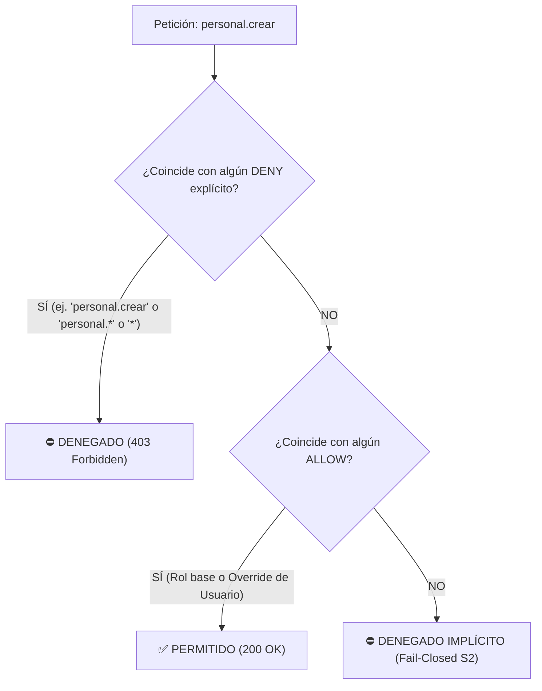

# MATRIZ OFICIAL DE PERMISOS — SISTEMA GATH (CONATEL)
## Módulo de Identidad y Control de Acceso (B3.3 / Contrato C-3)

> **Documento Rector de Autorización Granular**  
> **Fuente de Verdad Técnica:** `BACKEND/apps/identidad/management/commands/seed_permisos.py`  
> **Formato Canónico:** `[modulo].[accion]` (en minúsculas)  
> **Arquitectura:** Onion Architecture + SCREAM  
> **Reglas Rectoras:**  
> - **B2 / R16:** Cero comparaciones de nombres de roles (`ADMINISTRADOR`, `RECEPCIONISTA`, etc.) en la lógica de negocio; toda verificación se hace por código de permiso (`HasPermission` / `puede`).
> - **S1 / S2:** Control de acceso fail-closed (sin permiso explícito se deniega 403 y se audita).
> - **C-3:** Contrato unificado de permisos Backend (`HasPermission`) ↔ Frontend (`puede()`).

---

## 1. Catálogo Taxonómico de Permisos del Sistema GATH

Catálogo maestro de 91 permisos oficiales registrados en `PERMISOS_CATALOGO`.

### 1.1 Identidad y Seguridad (`identidad`)
| Código de Permiso | Descripción Oficial |
|---|---|
| `identidad.ver_usuarios` | Consultar listado y detalles de usuarios |
| `identidad.crear_usuarios` | Registrar nuevos usuarios en el sistema |
| `identidad.editar_usuarios` | Modificar datos de usuarios existentes |
| `identidad.desactivar_usuarios` | Activar o desactivar cuentas de usuario |
| `identidad.cambiar_password` | Forzar o gestionar cambio de contraseña |
| `identidad.ver_roles` | Consultar roles existentes |
| `identidad.crear_roles` | Crear nuevos roles institucionales |
| `identidad.editar_roles` | Modificar nombres o descripciones de roles |
| `identidad.eliminar_roles` | Eliminar roles no asignados |
| `identidad.asignar_permisos` | Modificar la matriz de permisos de roles |
| `identidad.desbloquear_cuentas` | Desbloquear cuentas tras incidentes de seguridad |

### 1.2 Organización (`organizacion`)
| Código de Permiso | Descripción Oficial |
|---|---|
| `organizacion.ver` | Consultar dependencias, direcciones y coordinaciones |
| `organizacion.crear` | Registrar nuevas unidades organizativas |
| `organizacion.editar` | Modificar unidades organizativas |
| `organizacion.eliminar` | Desactivar o eliminar unidades organizativas |
| `organizacion.ver_sedes` | Consultar sedes y ubicaciones físicas |
| `organizacion.gestionar_sedes` | Crear y modificar sedes físicas |

### 1.3 Catálogos (`catalogos`)
| Código de Permiso | Descripción Oficial |
|---|---|
| `catalogos.ver` | Consultar tablas maestras (profesiones, parentescos, etc.) |
| `catalogos.crear` | Registrar nuevos elementos en catálogos |
| `catalogos.editar` | Modificar elementos de catálogos |
| `catalogos.eliminar` | Desactivar elementos de catálogos |

### 1.4 Personal Activo (`personal`)
| Código de Permiso | Descripción Oficial |
|---|---|
| `personal.ver` | Consultar ficha básica y listado de trabajadores activos |
| `personal.ver_detalle` | Consultar expediente completo de trabajador activo |
| `personal.crear` | Registrar nuevo trabajador activo |
| `personal.editar_personales` | Actualizar datos personales y de contacto |
| `personal.editar_laborales` | Actualizar datos de contratación y nómina |
| `personal.editar_educacion` | Actualizar nivel de instrucción y títulos |
| `personal.editar_vivienda` | Actualizar información habitacional |
| `personal.ver_salud` | Consultar información médica y salud (PII protegido) |
| `personal.editar_salud` | Actualizar información médica y antecedentes de salud |
| `personal.egresar` | Procesar egreso de personal activo |
| `personal.reincorporar` | Reincorporar trabajador egresado |
| `personal.carga_masiva` | Ejecutar importación masiva de personal vía Excel |
| `personal.exportar_pdf` | Exportar el expediente de un trabajador activo en PDF |

### 1.5 Personal Pasivo (`pasivos`)
| Código de Permiso | Descripción Oficial |
|---|---|
| `pasivos.ver` | Consultar listado y ficha básica de personal pasivo |
| `pasivos.ver_detalle` | Consultar expediente completo de personal pasivo |
| `pasivos.crear` | Registrar nuevo personal jubilado/pensionado |
| `pasivos.editar` | Modificar datos de personal pasivo |
| `pasivos.exportar_pdf` | Exportar el expediente de un trabajador pasivo en PDF |
| `pasivos.cambiar_condicion` | Actualizar condición pasiva (jubilado, sobreviviente) |

### 1.6 Cargos y Ubicaciones (`cargos`)
| Código de Permiso | Descripción Oficial |
|---|---|
| `cargos.ver` | Consultar catálogo de cargos y vacantes |
| `cargos.crear` | Crear nuevas denominaciones de cargos |
| `cargos.editar` | Modificar denominaciones o requisitos de cargos |
| `cargos.asignar` | Asignar titular a un cargo |
| `cargos.prestar` | Registrar préstamo de cargo a otra dependencia |
| `cargos.revertir_prestamo` | Revertir préstamo de cargo |
| `cargos.desincorporar` | Desincorporar o eliminar cargo vacante |

### 1.7 Familiares y Cargas (`familiares`)
| Código de Permiso | Descripción Oficial |
|---|---|
| `familiares.ver` | Consultar familiares y cargas de trabajadores |
| `familiares.crear` | Registrar nuevo familiar o carga |
| `familiares.editar` | Modificar datos de familiar |
| `familiares.eliminar` | Desactivar o eliminar carga familiar |
| `familiares.adjuntar_documento` | Adjuntar partidas o constancias familiares |
| `familiares.descargar_documento` | Descargar documentos adjuntos de familiares |

### 1.8 Movimientos e Historial (`movimientos`)
| Código de Permiso | Descripción Oficial |
|---|---|
| `movimientos.ver` | Consultar historial de movimientos y transiciones |
| `movimientos.registrar_traslado` | Registrar cambio de dependencia o ubicación |
| `movimientos.registrar_ascenso` | Registrar ascenso de cargo o grado |
| `movimientos.registrar_aumento` | Registrar ajuste salarial |
| `movimientos.anular` | Anular movimiento laboral registrado |
| `movimientos.exportar_pdf` | Exportar el historial de movimientos en PDF |

### 1.9 Reportes y Constancias (`reportes`)
| Código de Permiso | Descripción Oficial |
|---|---|
| `reportes.ver` | Acceder al módulo de reportes |
| `reportes.generar_pdf` | Generar y descargar reportes en PDF |
| `reportes.generar_excel` | Generar y descargar reportes en Excel |
| `reportes.emitir_constancias` | Emitir constancias de trabajo y certificaciones |
| `reportes.estadisticas` | Consultar estadísticas consolidadas de RRHH |

### 1.10 Carnetización (`carnetizacion`)
| Código de Permiso | Descripción Oficial |
|---|---|
| `carnetizacion.ver` | Consultar estado de carnetización y carnets emitidos |
| `carnetizacion.disenar` | Gestionar plantillas de carnet |
| `carnetizacion.emitir` | Emitir y generar carnets con QR criptográfico |
| `carnetizacion.revocar` | Revocar o invalidar carnet emitido |
| `carnetizacion.reimprimir` | Solicitar reimpresión de carnet |

### 1.11 Autogestión (`autogestion`)
| Código de Permiso | Descripción Oficial |
|---|---|
| `autogestion.ver_propio` | Consultar expediente personal propio |
| `autogestion.actualizar_propio` | Actualizar datos personales propios |
| `autogestion.censo_ver_propio` | Consultar formulario de censo propio |
| `autogestion.censo_actualizar_propio` | Responder o modificar su censo socioeconómico |
| `autogestion.censo_ver_todos` | Consultar censos de todos los trabajadores (RRHH) |
| `autogestion.censo_exportar` | Exportar consolidado de censos |
| `autogestion.solicitar_actualizacion` | Solicitar la actualización de sus datos (flujo con revisión de Bienestar) |
| `autogestion.editar_borrador` | Editar su borrador de actualización mientras la ventana está habilitada |
| `autogestion.subir_soporte` | Subir soportes propios (títulos, actas) a una solicitud |

### 1.12 Auditoría (`auditoria`)
| Código de Permiso | Descripción Oficial |
|---|---|
| `auditoria.ver_logs` | Consultar bitácora de transacciones y auditoría |
| `auditoria.ver_seguridad` | Consultar incidentes y bloqueos de seguridad |
| `auditoria.exportar` | Exportar la bitácora de auditoría |

### 1.13 Configuración Visual (`configuracion`)
| Código de Permiso | Descripción Oficial |
|---|---|
| `configuracion.editar` | Editar la configuración visual del cintillo institucional (PDFs) |

### 1.14 Punto de Cuenta (`puntocuenta`)
| Código de Permiso | Descripción Oficial |
|---|---|
| `puntocuenta.ver` | Consultar los puntos de cuenta generados por cambios de dependencia |

### 1.15 Bienestar Social (`bienestar`)
| Código de Permiso | Descripción Oficial |
|---|---|
| `bienestar.ver_solicitudes` | Consultar las solicitudes de actualización de los trabajadores |
| `bienestar.habilitar_ventana` | Habilitar o cerrar la ventana de actualización de un trabajador |
| `bienestar.revisar_actualizacion` | Revisar, observar o rechazar una solicitud de actualización |
| `bienestar.aprobar` | Aprobar (total o parcialmente) o rechazar una actualización de datos: decide UNA sola persona |
| `bienestar.prorrogar_ventana` | Prorrogar el plazo de una ventana de actualización de datos |
| `bienestar.configurar_secciones` | Configurar las secciones autogestionables (soporte obligatorio, activas) |

> *Nota:* Los permisos obsoletos `bienestar.check_analista`, `bienestar.check_administradora` y `bienestar.aprobar_directo` fueron retirados del sistema de actualización de datos en favor del permiso unificado `bienestar.aprobar` (PLAN §2.4). El esquema de doble check y aprobación directa se mantiene exclusivamente en la fe de vida (`fe_de_vida.*`).

### 1.16 Fe de Vida de Pasivos (`fe_de_vida`)
| Código de Permiso | Descripción Oficial |
|---|---|
| `fe_de_vida.solicitar` | Enviar su solicitud de fe de vida (pasivo) |
| `fe_de_vida.ver_propia` | Consultar el estado y la constancia de su fe de vida |
| `fe_de_vida.revisar` | Revisar evidencia, rechazar o pedir repetición de una fe de vida |
| `fe_de_vida.check_analista` | Dar el check de la Analista en una fe de vida |
| `fe_de_vida.check_administradora` | Dar el check de la Administradora en una fe de vida |
| `fe_de_vida.aprobar_directo` | Validar una fe de vida por aprobación directa de la Administradora |
| `fe_de_vida.ver_evidencia` | Ver la foto de evidencia de una fe de vida (URL prefirmada corta) |
| `fe_de_vida.verificar_constancia` | Verificar internamente una constancia de fe de vida |
| `fe_de_vida.ver_panel` | Consultar el panel de fe de vida de Bienestar |
| `fe_de_vida.configurar_plantilla` | Editar la plantilla de la constancia de fe de vida |

### 1.17 Notificaciones (`notificaciones`)
| Código de Permiso | Descripción Oficial |
|---|---|
| `notificaciones.ver_propias` | Consultar y marcar como leídas sus notificaciones |
| `notificaciones.administrar` | Administrar el correo saliente (reintentos y fallidas) |

---

## 2. Matriz de Roles y Asignaciones

### 2.1 Resumen por Rol

| Rol | ID Legado | Total Permisos | Propósito y Alcance |
|---|:---:|:---:|---|
| **ADMINISTRADOR** | 1 | **91** (100%) | Superusuario institucional. Acceso a seguridad, auditoría, identidad, gestión de roles y configuración completa. |
| **ANALISTA** | 2 | **53** | Gestión operativa integral de RRHH: personal activo y pasivo, cargas, movimientos, cargos, reportes, carnetización y censos. Consulta de expediente propio y notificaciones. |
| **AUTOGESTION** | 3 | **10** | Portal del trabajador (activo o pasivo): expediente propio, solicitudes de actualización de datos con soportes, censo socioeconómico, fe de vida y notificaciones. |
| **PRESUPUESTO** | 4 | **12** | Planificación presupuestaria: consulta de personal (activos y pasivos), estructura organizativa, asignación de cargos, reportes y estadísticas. |
| **BIENESTAR SOCIAL** | 5 | **19** | Atención social: salud médica (PII protegido), familiares, censos y reportes. Verificación de constancias de fe de vida. |
| **RECEPCIONISTA** | 9 | **6** | Consulta básica en taquilla: visualización y ficha detallada de personal y familiares sin capacidad de exportación PDF ni edición. |
| **ANALISTA_BIENESTAR** | *(Dinámico)* | **28** | Analista operativa de Bienestar: rol BIENESTAR SOCIAL + revisión de actualizaciones (aprobar/observar), gestión de ventanas y fe de vida con `fe_de_vida.check_analista`. Nunca aprueba directo la fe de vida. |
| **ADMIN_BIENESTAR** | *(Dinámico)* | **31** | Administradora de Bienestar: rol BIENESTAR SOCIAL + aprobación de actualizaciones, parametrización de secciones, fe de vida con `fe_de_vida.check_administradora`, aprobación directa y plantilla de constancia. |

---

### 2.2 Notas Clave de Arquitectura y Roles

> [!IMPORTANT]
> **Ya NO existe el rol PASIVO.**  
> Tanto los trabajadores activos como los pasivos (jubilados, pensionados, sobrevivientes) utilizan el rol **`AUTOGESTION`**. La condición de trabajador (`ACTIVO`, `JUBILADO`, `PENSIONADO`, `SOBREVIVIENTE`, etc.) es un atributo propio del expediente del trabajador validado en el servidor, no un rol de usuario del sistema de identidad. Los permisos de fe de vida (`fe_de_vida.solicitar`, `fe_de_vida.ver_propia`) son concedidos al rol `AUTOGESTION`; el servidor valida si la condición del titular aplica para la solicitud.

> [!NOTE]
> **Roles confirmados pendientes de implementación:**  
> - **`AUDITOR`**: Perfil institucional de solo lectura transversal a los módulos y acceso completo a bitácoras de auditoría (`auditoria.*`), sin facultades de mutación ni emisión de documentos.
> - **`JEFE_RRHH`**: Jefa de la oficina de RRHH. Administra todo el módulo Gestión de Trabajadores (Bienestar Social, Captación y demás áreas). Confirmado por el usuario; pendiente de implementar (tarea D7).
> - **`ADMIN_CAPTACION` / `ANALISTA_CAPTACION`**: Administración y operación del área de Captación de personal. Se implementan junto con el módulo de Captación (tarea D7).

---

### 2.3 Matriz Detallada Rol × Permisos

Abreviaturas de columnas:
- **ADM**: ADMINISTRADOR (ID 1)
- **ANA**: ANALISTA (ID 2)
- **AUT**: AUTOGESTION (ID 3)
- **PRE**: PRESUPUESTO (ID 4)
- **BIE**: BIENESTAR SOCIAL (ID 5)
- **REC**: RECEPCIONISTA (ID 9)
- **A_B**: ANALISTA_BIENESTAR
- **M_B**: ADMIN_BIENESTAR

| Código de Permiso | ADM | ANA | AUT | PRE | BIE | REC | A_B | M_B |
|---|:---:|:---:|:---:|:---:|:---:|:---:|:---:|:---:|
| **`identidad.ver_usuarios`** | ✅ | ✅ | | | | | | |
| **`identidad.crear_usuarios`** | ✅ | | | | | | | |
| **`identidad.editar_usuarios`** | ✅ | | | | | | | |
| **`identidad.desactivar_usuarios`** | ✅ | | | | | | | |
| **`identidad.cambiar_password`** | ✅ | | | | | | | |
| **`identidad.ver_roles`** | ✅ | ✅ | | | | | | |
| **`identidad.crear_roles`** | ✅ | | | | | | | |
| **`identidad.editar_roles`** | ✅ | | | | | | | |
| **`identidad.eliminar_roles`** | ✅ | | | | | | | |
| **`identidad.asignar_permisos`** | ✅ | | | | | | | |
| **`identidad.desbloquear_cuentas`** | ✅ | | | | | | | |
| **`organizacion.ver`** | ✅ | ✅ | | ✅ | | | | |
| **`organizacion.crear`** | ✅ | ✅ | | | | | | |
| **`organizacion.editar`** | ✅ | ✅ | | | | | | |
| **`organizacion.eliminar`** | ✅ | | | | | | | |
| **`organizacion.ver_sedes`** | ✅ | ✅ | | ✅ | | | | |
| **`organizacion.gestionar_sedes`** | ✅ | | | | | | | |
| **`catalogos.ver`** | ✅ | ✅ | | | | | | |
| **`catalogos.crear`** | ✅ | ✅ | | | | | | |
| **`catalogos.editar`** | ✅ | ✅ | | | | | | |
| **`catalogos.eliminar`** | ✅ | | | | | | | |
| **`personal.ver`** | ✅ | ✅ | | ✅ | ✅ | ✅ | ✅ | ✅ |
| **`personal.ver_detalle`** | ✅ | ✅ | | | ✅ | ✅ | ✅ | ✅ |
| **`personal.crear`** | ✅ | ✅ | | | | | | |
| **`personal.editar_personales`** | ✅ | ✅ | | | | | | |
| **`personal.editar_laborales`** | ✅ | ✅ | | | | | | |
| **`personal.editar_educacion`** | ✅ | ✅ | | | | | | |
| **`personal.editar_vivienda`** | ✅ | ✅ | | | | | | |
| **`personal.ver_salud`** | ✅ | | | | ✅ | | ✅ | ✅ |
| **`personal.editar_salud`** | ✅ | | | | ✅ | | ✅ | ✅ |
| **`personal.egresar`** | ✅ | ✅ | | | | | | |
| **`personal.reincorporar`** | ✅ | ✅ | | | | | | |
| **`personal.carga_masiva`** | ✅ | ✅ | | | | | | |
| **`personal.exportar_pdf`** | ✅ | ✅ | | | ✅ | | ✅ | ✅ |
| **`pasivos.ver`** | ✅ | ✅ | | ✅ | ✅ | ✅ | ✅ | ✅ |
| **`pasivos.ver_detalle`** | ✅ | ✅ | | | ✅ | | ✅ | ✅ |
| **`pasivos.crear`** | ✅ | ✅ | | | | | | |
| **`pasivos.editar`** | ✅ | ✅ | | | | | | |
| **`pasivos.exportar_pdf`** | ✅ | ✅ | | | ✅ | | ✅ | ✅ |
| **`pasivos.cambiar_condicion`** | ✅ | ✅ | | | | | | |
| **`cargos.ver`** | ✅ | ✅ | | ✅ | | | | |
| **`cargos.crear`** | ✅ | ✅ | | | | | | |
| **`cargos.editar`** | ✅ | ✅ | | | | | | |
| **`cargos.asignar`** | ✅ | ✅ | | ✅ | | | | |
| **`cargos.prestar`** | ✅ | ✅ | | | | | | |
| **`cargos.revertir_prestamo`** | ✅ | ✅ | | | | | | |
| **`cargos.desincorporar`** | ✅ | | | | | | | |
| **`familiares.ver`** | ✅ | ✅ | | | ✅ | ✅ | ✅ | ✅ |
| **`familiares.crear`** | ✅ | ✅ | | | | | | |
| **`familiares.editar`** | ✅ | ✅ | | | | | | |
| **`familiares.eliminar`** | ✅ | ✅ | | | | | | |
| **`familiares.adjuntar_documento`** | ✅ | ✅ | | | ✅ | | ✅ | ✅ |
| **`familiares.descargar_documento`** | ✅ | ✅ | | | ✅ | | ✅ | ✅ |
| **`movimientos.ver`** | ✅ | ✅ | | | | | | |
| **`movimientos.registrar_traslado`** | ✅ | ✅ | | | | | | |
| **`movimientos.registrar_ascenso`** | ✅ | ✅ | | | | | | |
| **`movimientos.registrar_aumento`** | ✅ | ✅ | | | | | | |
| **`movimientos.anular`** | ✅ | | | | | | | |
| **`movimientos.exportar_pdf`** | ✅ | ✅ | | | | | | |
| **`reportes.ver`** | ✅ | ✅ | | ✅ | ✅ | | ✅ | ✅ |
| **`reportes.generar_pdf`** | ✅ | ✅ | | ✅ | ✅ | | ✅ | ✅ |
| **`reportes.generar_excel`** | ✅ | ✅ | | ✅ | ✅ | | ✅ | ✅ |
| **`reportes.emitir_constancias`** | ✅ | ✅ | | | | | | |
| **`reportes.estadisticas`** | ✅ | ✅ | | ✅ | | | | |
| **`carnetizacion.ver`** | ✅ | ✅ | | | | | | |
| **`carnetizacion.disenar`** | ✅ | | | | | | | |
| **`carnetizacion.emitir`** | ✅ | ✅ | | | | | | |
| **`carnetizacion.revocar`** | ✅ | | | | | | | |
| **`carnetizacion.reimprimir`** | ✅ | ✅ | | | | | | |
| **`autogestion.ver_propio`** | ✅ | ✅ | ✅ | ✅ | ✅ | ✅ | ✅ | ✅ |
| **`autogestion.actualizar_propio`** | ✅ | | ✅ | | | | | |
| **`autogestion.censo_ver_propio`** | ✅ | | ✅ | | | | | |
| **`autogestion.censo_actualizar_propio`** | ✅ | | ✅ | | | | | |
| **`autogestion.censo_ver_todos`** | ✅ | ✅ | | | ✅ | | ✅ | ✅ |
| **`autogestion.censo_exportar`** | ✅ | ✅ | | | ✅ | | ✅ | ✅ |
| **`autogestion.solicitar_actualizacion`** | ✅ | | ✅ | | | | | |
| **`autogestion.editar_borrador`** | ✅ | | ✅ | | | | | |
| **`autogestion.subir_soporte`** | ✅ | | ✅ | | | | | |
| **`auditoria.ver_logs`** | ✅ | | | | | | | |
| **`auditoria.ver_seguridad`** | ✅ | | | | | | | |
| **`auditoria.exportar`** | ✅ | | | | | | | |
| **`configuracion.editar`** | ✅ | | | | | | | |
| **`puntocuenta.ver`** | ✅ | | | | | | | |
| **`bienestar.ver_solicitudes`** | ✅ | | | | | | ✅ | ✅ |
| **`bienestar.habilitar_ventana`** | ✅ | | | | | | ✅ | ✅ |
| **`bienestar.revisar_actualizacion`** | ✅ | | | | | | ✅ | ✅ |
| **`bienestar.aprobar`** | ✅ | | | | | | ✅ | ✅ |
| **`bienestar.prorrogar_ventana`** | ✅ | | | | | | ✅ | ✅ |
| **`bienestar.configurar_secciones`** | ✅ | | | | | | | ✅ |
| **`fe_de_vida.solicitar`** | ✅ | | ✅ | | | | | |
| **`fe_de_vida.ver_propia`** | ✅ | | ✅ | | | | | |
| **`fe_de_vida.revisar`** | ✅ | | | | | | ✅ | ✅ |
| **`fe_de_vida.check_analista`** | ✅ | | | | | | ✅ | |
| **`fe_de_vida.check_administradora`** | ✅ | | | | | | | ✅ |
| **`fe_de_vida.aprobar_directo`** | ✅ | | | | | | | ✅ |
| **`fe_de_vida.ver_evidencia`** | ✅ | | | | | | ✅ | ✅ |
| **`fe_de_vida.verificar_constancia`** | ✅ | ✅ | | | ✅ | | ✅ | ✅ |
| **`fe_de_vida.ver_panel`** | ✅ | | | | | | ✅ | ✅ |
| **`fe_de_vida.configurar_plantilla`** | ✅ | | | | | | | ✅ |
| **`notificaciones.ver_propias`** | ✅ | ✅ | ✅ | ✅ | ✅ | ✅ | ✅ | ✅ |
| **`notificaciones.administrar`** | ✅ | | | | | | | |
| **TOTAL PERMISOS** | **91** | **53** | **10** | **12** | **19** | **6** | **28** | **31** |

---

## 3. Guía de Uso e Implementación

### 3.1 En el Backend (Django REST Framework)
En cualquier vista DRF (en `presentation/views/` o en vistas puente):

```python
from rest_framework.views import APIView
from rest_framework.permissions import IsAuthenticated
from core.presentation.permissions import HasPermission, IsOwnerOrHasPermission
from core.presentation.envelope import ok, fail

class ConsultarPersonalView(APIView):
    permission_classes = [IsAuthenticated, HasPermission('personal.ver')]

    def get(self, request):
        ...
```

Para endpoints de autogestión con verificación de propiedad:
```python
class CensoAutogestionView(APIView):
    permission_classes = [IsAuthenticated, IsOwnerOrHasPermission('autogestion.censo_ver_todos', owner_field='cedula')]

    def get(self, request, cedula):
        ...
```

### 3.2 En el Frontend (Next.js / React)
En componentes o Server Actions:

```tsx
import { puede } from "@/shared/lib/evaluador-iam";

// Evalúa si la política efectiva del usuario permite la acción
if (!puede(session.user.politica, "personal.editar_personales")) {
  return null; // Oculta elemento de UI si no tiene el código de permiso
}
```

---

## 4. Arquitectura Híbrida PBAC / AWS IAM (Roles + Excepciones de Usuario + Comodines)

El sistema soporta autorización declarativa inspirada en el motor **AWS IAM (Policy-Based Access Control)** con almacenamiento en base de datos (`identidad_usuario_permiso`) y compilación rápida $O(1)$:



### 4.1 Comodines (Wildcards)
* `*` $\rightarrow$ Concede acceso irrestricto a todo el sistema (Superadministrador).
* `personal.*` $\rightarrow$ Concede acceso a todas las acciones presentes y futuras del módulo de personal.
* `personal.ver` $\rightarrow$ Concede acceso puntual a una sola acción.

### 4.2 Excepciones Directas por Usuario (Overrides)
Un usuario hereda los permisos de su **Rol Institucional**, pero puede recibir políticas personalizadas sin necesidad de alterar el rol base:
* **Elevación por Solicitud (`allow`):** Un `ANALISTA` que requiere registrar usuarios puede recibir `allow: ["identidad.crear_usuarios"]`.
* **Segregación de Funciones (`deny`):** Un `ANALISTA` al que se le restringe información médica confidencial recibe `deny: ["personal.ver_salud"]`. **La regla `deny` siempre tiene prioridad sobre cualquier `allow`**.

### 4.3 Control de Versiones e Invalidación Instantánea
Cada modificación en la matriz de roles o en las excepciones de un usuario incrementa el campo `permisos_version` (en `cuenta` e `identidad_usuario_permiso`). El token JWT incluye este claim (`permisos_version`), permitiendo invalidar sesiones en tiempo real si los privilegios del usuario cambian.
