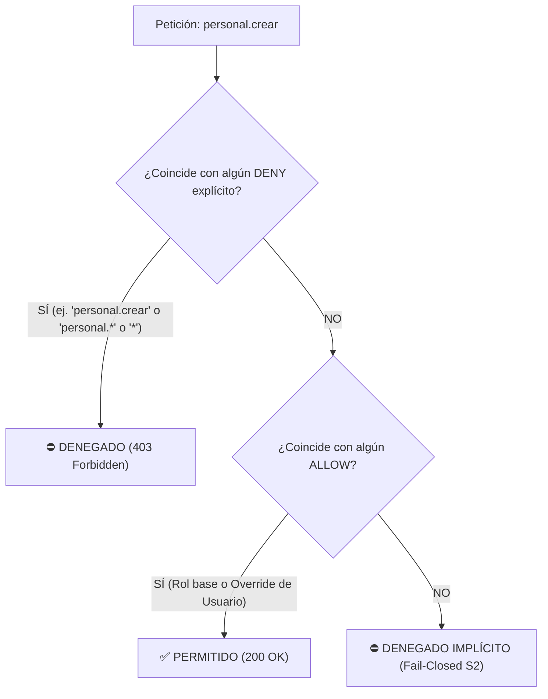

# MATRIZ OFICIAL DE PERMISOS — SISTEMA GATH (CONATEL)
## Módulo de Identidad y Control de Acceso (B3.3 / Contrato C-3)

> **Documento Rector de Autorización Granular**  
> **Formato Canónico:** `[modulo].[accion]` (todo en minúsculas)  
> **Arquitectura:** Onion Architecture + SCREAM  
> **Regla Rectoras:**  
> - **B2 / R16:** Cero comparaciones de nombres de roles (`ADMINISTRADOR`, `RECEPCIONISTA`) en lógica de negocio.
> - **S1 / S2:** Control de acceso fail-closed (sin permiso explícito se deniega 403 y se audita).
> - **C-3:** Contrato unificado de permisos Backend (`HasPermission`) ↔ Frontend (`puede()`).

---

## 1. Catálogo Taxonómico de Códigos de Permiso

| Módulo | Código de Permiso | Nombre / Descripción | Tipo Operación |
|---|---|---|---|
| **identidad** | `identidad.ver_usuarios` | Consultar listado y detalles de usuarios | Lectura |
| | `identidad.crear_usuarios` | Registrar nuevos usuarios en el sistema | Escritura (Admin) |
| | `identidad.editar_usuarios` | Modificar datos de usuarios existentes | Escritura (Admin) |
| | `identidad.desactivar_usuarios` | Activar o desactivar cuentas de usuario | Escritura (Admin) |
| | `identidad.cambiar_password` | Forzar o gestionar cambio de contraseña | Escritura (Admin) |
| | `identidad.ver_roles` | Consultar roles existentes | Lectura |
| | `identidad.crear_roles` | Crear nuevos roles institucionales | Escritura (Admin) |
| | `identidad.editar_roles` | Modificar nombres o descripciones de roles | Escritura (Admin) |
| | `identidad.eliminar_roles` | Eliminar roles no asignados | Escritura (Admin) |
| | `identidad.asignar_permisos` | Modificar la matriz de permisos de roles | Escritura (Admin) |
| | `identidad.desbloquear_cuentas` | Desbloquear cuentas tras incidentes de seguridad | Escritura (Admin) |
| **organizacion** | `organizacion.ver` | Consultar dependencias, direcciones y coordinaciones | Lectura |
| | `organizacion.crear` | Registrar nuevas unidades organizativas | Escritura |
| | `organizacion.editar` | Modificar unidades organizativas | Escritura |
| | `organizacion.eliminar` | Desactivar o eliminar unidades organizativas | Escritura |
| | `organizacion.ver_sedes` | Consultar sedes y ubicaciones físicas | Lectura |
| | `organizacion.gestionar_sedes` | Crear y modificar sedes físicas | Escritura |
| **catalogos** | `catalogos.ver` | Consultar tablas maestras (profesiones, parentescos, etc.) | Lectura |
| | `catalogos.crear` | Registrar nuevos elementos en catálogos | Escritura |
| | `catalogos.editar` | Modificar elementos de catálogos | Escritura |
| | `catalogos.eliminar` | Desactivar elementos de catálogos | Escritura |
| **personal** | `personal.ver` | Consultar ficha básica y listado de trabajadores activos | Lectura |
| | `personal.ver_detalle` | Consultar expediente completo de trabajador activo | Lectura |
| | `personal.crear` | Registrar nuevo trabajador activo | Escritura |
| | `personal.editar_personales` | Actualizar datos personales y de contacto | Escritura |
| | `personal.editar_laborales` | Actualizar datos de contratación y nómina | Escritura |
| | `personal.editar_educacion` | Actualizar nivel de instrucción y títulos | Escritura |
| | `personal.editar_vivienda` | Actualizar información habitacional | Escritura |
| | `personal.ver_salud` | Consultar información médica y salud (PII protegido) | Lectura Sensible |
| | `personal.editar_salud` | Actualizar información médica y antecedentes de salud | Escritura Sensible |
| | `personal.egresar` | Procesar egreso de personal activo | Escritura Crítica |
| | `personal.reincorporar` | Reincorporar trabajador egresado | Escritura Crítica |
| | `personal.carga_masiva` | Ejecutar importación masiva de personal vía Excel | Escritura Masiva |
| **pasivos** | `pasivos.ver` | Consultar listado y ficha básica de personal pasivo | Lectura |
| | `pasivos.ver_detalle` | Consultar expediente completo de personal pasivo | Lectura |
| | `pasivos.crear` | Registrar nuevo personal jubilado/pensionado | Escritura |
| | `pasivos.editar` | Modificar datos de personal pasivo | Escritura |
| | `pasivos.cambiar_condicion` | Actualizar condición pasiva (jubilado, sobreviviente) | Escritura |
| **cargos** | `cargos.ver` | Consultar catálogo de cargos y vacantes | Lectura |
| | `cargos.crear` | Crear nuevas denominaciones de cargos | Escritura |
| | `cargos.editar` | Modificar denominaciones o requisitos de cargos | Escritura |
| | `cargos.asignar` | Asignar titular a un cargo | Escritura |
| | `cargos.prestar` | Registrar préstamo de cargo a otra dependencia | Escritura |
| | `cargos.revertir_prestamo` | Revertir préstamo de cargo | Escritura |
| | `cargos.desincorporar` | Desincorporar o eliminar cargo vacante | Escritura |
| **familiares** | `familiares.ver` | Consultar familiares y cargas de trabajadores | Lectura |
| | `familiares.crear` | Registrar nuevo familiar o carga | Escritura |
| | `familiares.editar` | Modificar datos de familiar | Escritura |
| | `familiares.eliminar` | Desactivar o eliminar carga familiar | Escritura |
| | `familiares.adjuntar_documento` | Adjuntar partidas o constancias familiares | Escritura |
| | `familiares.descargar_documento` | Descargar documentos adjuntos de familiares | Lectura |
| **movimientos** | `movimientos.ver` | Consultar historial de movimientos y transiciones | Lectura |
| | `movimientos.registrar_traslado` | Registrar cambio de dependencia o ubicación | Escritura |
| | `movimientos.registrar_ascenso` | Registrar ascenso de cargo o grado | Escritura |
| | `movimientos.registrar_aumento` | Registrar ajuste salarial | Escritura |
| | `movimientos.anular` | Anular movimiento laboral registrado | Escritura Crítica |
| **reportes** | `reportes.ver` | Acceder al módulo de reportes | Lectura |
| | `reportes.generar_pdf` | Generar y descargar reportes en PDF | Lectura / Export |
| | `reportes.generar_excel` | Generar y descargar reportes en Excel | Lectura / Export |
| | `reportes.emitir_constancias` | Emitir constancias de trabajo y certificaciones | Lectura / Export |
| | `reportes.estadisticas` | Consultar estadísticas consolidadas de RRHH | Lectura |
| **carnetizacion** | `carnetizacion.ver` | Consultar estado de carnetización y carnets emitidos | Lectura |
| | `carnetizacion.disenar` | Gestionar plantillas de carnet | Escritura |
| | `carnetizacion.emitir` | Emitir y generar carnets con QR criptográfico | Escritura |
| | `carnetizacion.revocar` | Revocar o invalidar carnet emitido | Escritura |
| | `carnetizacion.reimprimir` | Solicitar reimpresión de carnet | Escritura |
| **autogestion** | `autogestion.ver_propio` | Consultar expediente personal propio | Lectura (Owner) |
| | `autogestion.actualizar_propio` | Actualizar datos personales propios | Escritura (Owner) |
| | `autogestion.censo_ver_propio` | Consultar formulario de censo propio | Lectura (Owner) |
| | `autogestion.censo_actualizar_propio` | Responder o modificar su censo socioeconómico | Escritura (Owner) |
| | `autogestion.censo_ver_todos` | Consultar censos de todos los trabajadores (RRHH) | Lectura Masiva |
| | `autogestion.censo_exportar` | Exportar consolidado de censos | Exportación |
| **auditoria** | `auditoria.ver_logs` | Consultar bitácora de transacciones y auditoría | Lectura (Admin) |
| | `auditoria.ver_seguridad` | Consultar incidentes y bloqueos de seguridad | Lectura (Admin) |

---

## 2. Matriz de Roles Iniciales del Sistema GATH

| Rol (ID Legado) | Total Permisos | Dominios Cubiertos | Restricciones / Reglas Especiales |
|---|:---:|---|---|
| **ADMINISTRADOR** (ID 1) | **74 (100%)** | Todos los módulos | Superusuario institucional. Acceso a seguridad, auditoría, gestión de roles y configuración. |
| **ANALISTA** (ID 2) | **50** | Gestión de Personal, Familiares, Cargos, Movimientos, Organización, Catálogos, Reportes, Carnets | Operación general de RRHH. Sin acceso a administración de usuarios ni logs de seguridad. |
| **AUTOGESTION** (ID 3) | **4** | Autogestión y Censo socioeconómico | Estricto acceso a recursos propios mediante `IsOwnerOrHasPermission` (ALTA-07). |
| **PRESUPUESTO** (ID 4) | **10** | Cargos, Ubicación, Reportes y Estadísticas | Consulta de nómina y cargos con facultades de asignación presupuestaria. |
| **BIENESTAR SOCIAL** (ID 5) | **14** | Personal, Salud, Familiares, Censos y Reportes | Acceso a expediente médico y salud de trabajadores (`personal.ver_salud`, `personal.editar_salud`). |
| **RECEPCIONISTA** (ID 9) | **3** | Personal, Pasivos, Familiares | **Estricto perfil de sólo consulta** (`personal.ver`, `pasivos.ver`, `familiares.ver`). Cero facultades de escritura o reportes. |

---

## 3. Guía de Uso e Implementación

### 3.1 En el Backend (Django REST Framework)
En cualquier vista DRF (en `presentation/views/` o en vistas puente):

```python
from rest_framework.views import APIView
from rest_framework.permissions import IsAuthenticated
from core.presentation.permissions import HasPermission, IsOwnerOrHasPermission
from core.presentation.envelope import ok, fail

class ConsultarPersonalView(APIView):
    permission_classes = [IsAuthenticated, HasPermission('personal.ver')]

    def get(self, request):
        ...
```

Para endpoints de autogestión con verificación de propiedad:
```python
class CensoAutogestionView(APIView):
    permission_classes = [IsAuthenticated, IsOwnerOrHasPermission('autogestion.censo_ver_todos', owner_field='cedula')]

    def get(self, request, cedula):
        ...
```

### 3.2 En el Frontend (Next.js / React)
En componentes o Server Actions:

```tsx
import { puede } from "@/shared/lib/evaluador-iam";

// Evalúa si la política efectiva del usuario permite la acción
if (!puede(session.user.politica, "personal.editar_personales")) {
  return null; // Oculta elemento de UI si no tiene el código de permiso
}
```

---

## 4. Arquitectura Híbrida PBAC / AWS IAM (Roles + Excepciones de Usuario + Comodines)

El sistema soporta autorización declarativa inspirada en el motor **AWS IAM (Policy-Based Access Control)** con almacenamiento en base de datos (`identidad_usuario_permiso`) y compilación rápida $O(1)$:



### 4.1 Comodines (Wildcards)
* `*` $\rightarrow$ Concede acceso irrestricto a todo el sistema (Superadministrador).
* `personal.*` $\rightarrow$ Concede acceso a todas las acciones presentes y futuras del módulo de personal.
* `personal.ver` $\rightarrow$ Concede acceso puntual a una sola acción.

### 4.2 Excepciones Directas por Usuario (Overrides)
Un usuario hereda los permisos de su **Rol Institucional**, pero puede recibir políticas personalizadas sin necesidad de alterar el rol base:
* **Elevación por Solicitud (`allow`):** Un `ANALISTA` que requiere registrar usuarios puede recibir `allow: ["identidad.crear_usuarios"]`.
* **Segregación de Funciones (`deny`):** Un `ANALISTA` al que se le restringe información médica confidencial recibe `deny: ["personal.ver_salud"]`. **La regla `deny` siempre tiene prioridad sobre cualquier `allow`**.

### 4.3 Control de Versiones e Invalidación Instantánea
Cada modificación en los permisos de un usuario incrementa su campo `version` en `identidad_usuario_permiso`. Esto permite invalidar sesiones o claims en tokens JWT en tiempo real sin requerir recreación manual de cuentas.

