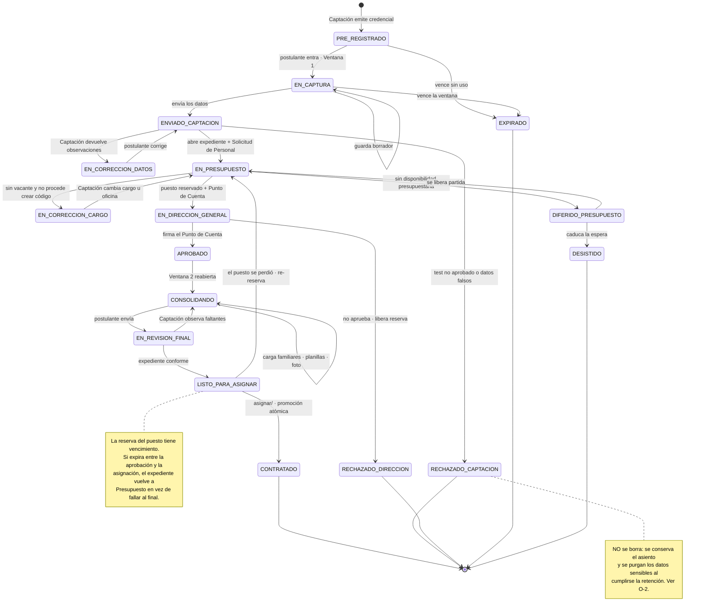
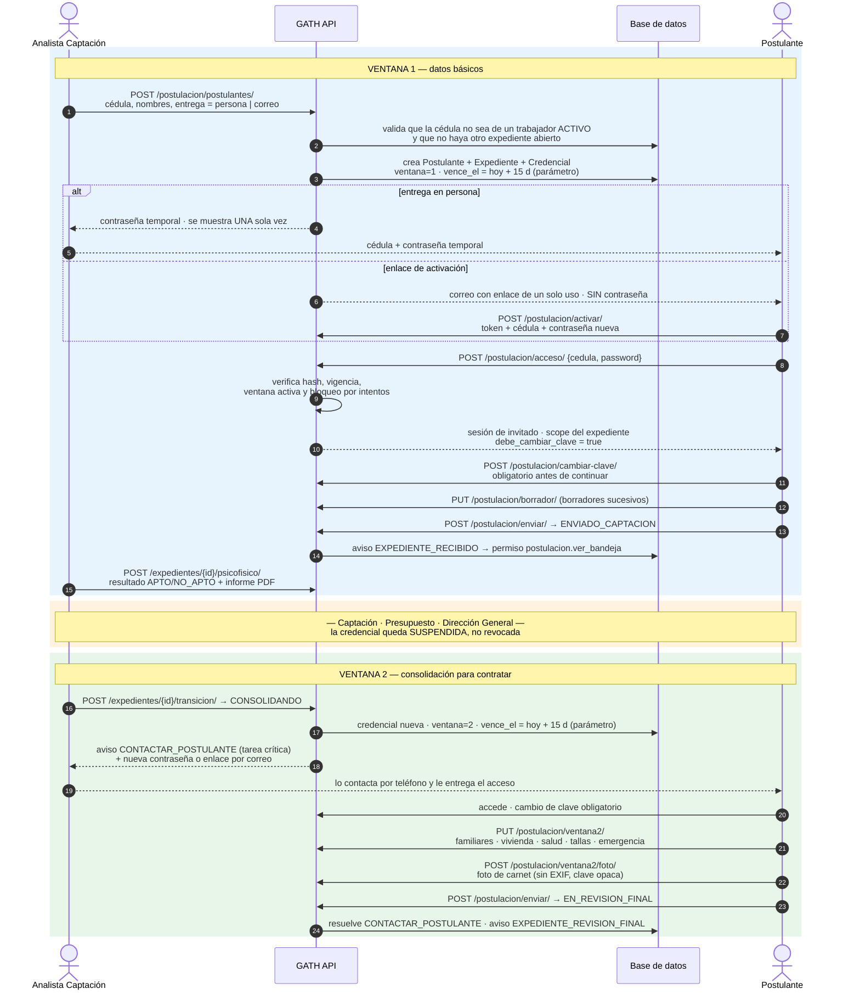
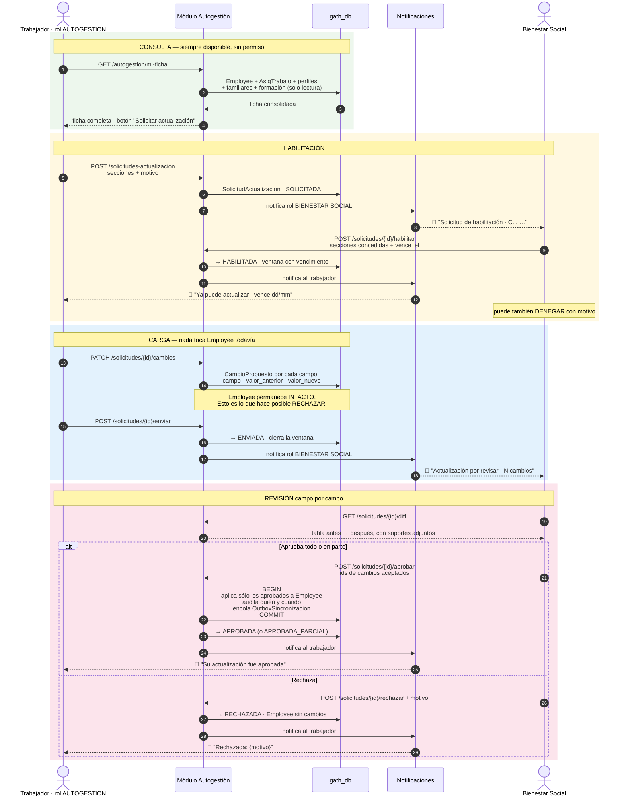
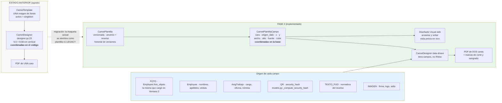
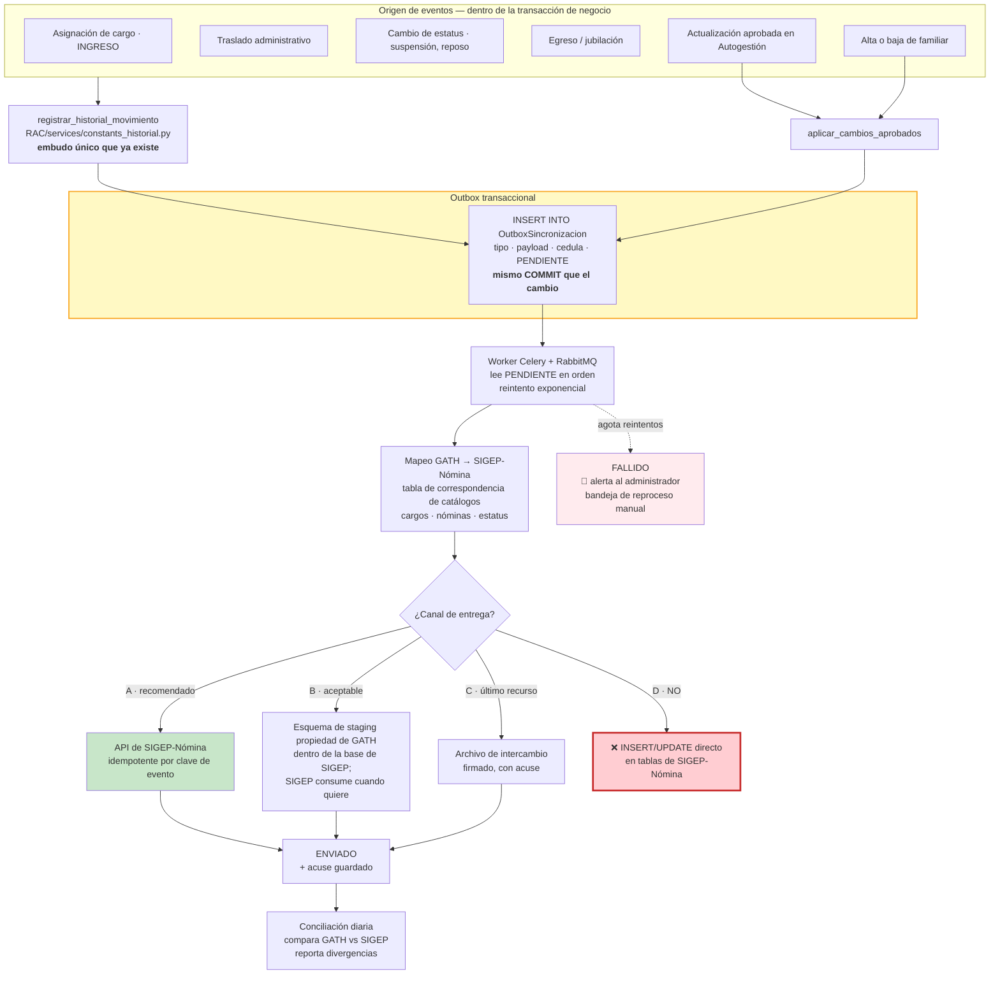
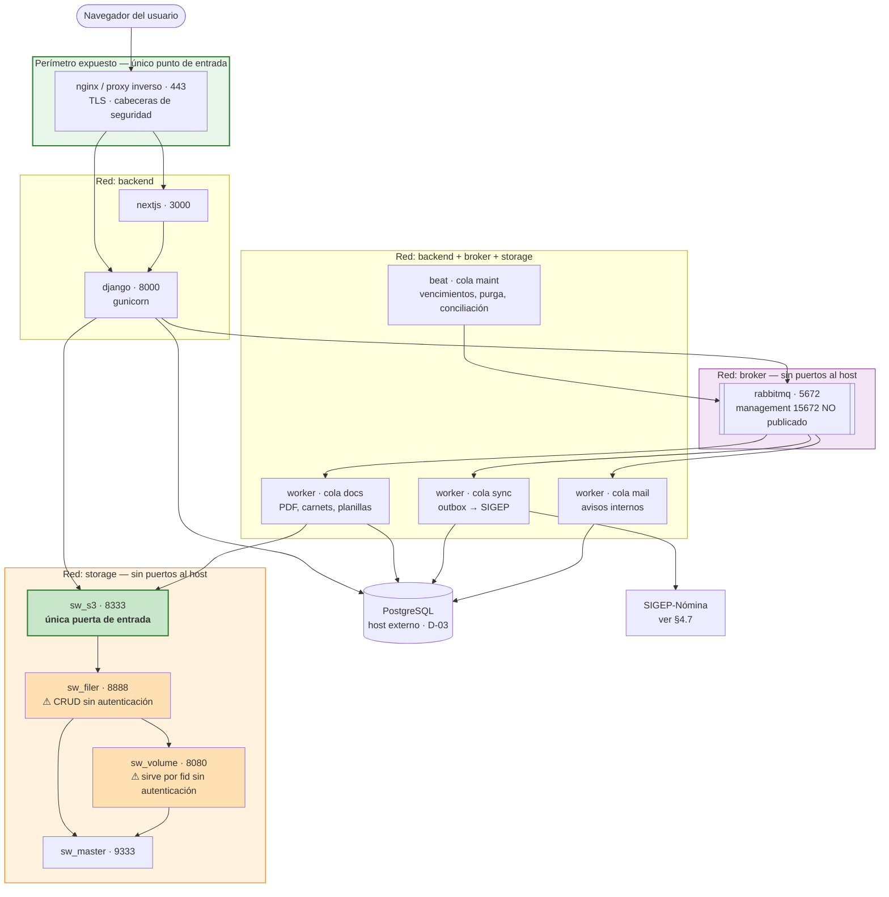
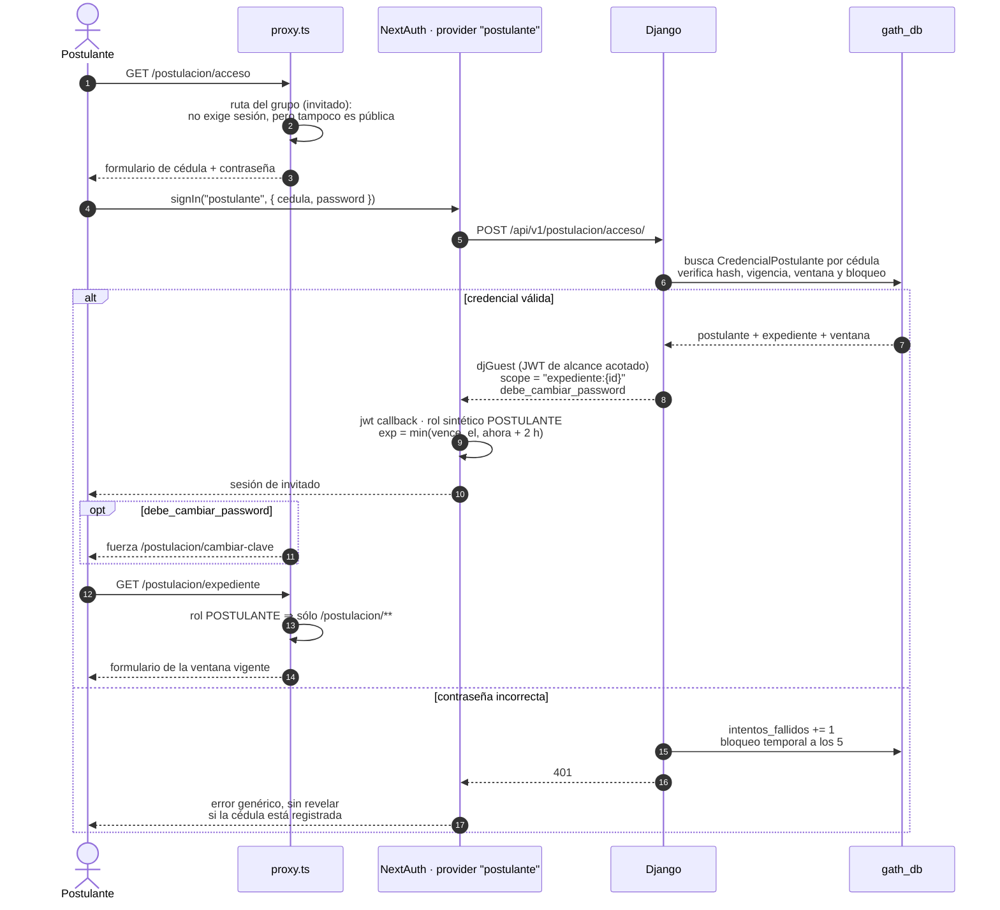

# GATH — Fase 2

## Onboarding digital, Autogestión, Carnetización de dos caras y (por definir) Sincronización con nómina

**Documento técnico** · CONATEL · rama `feature/fase2-captacion-carnet` · diseño verificado sobre código el 21-08-2026 · **estado de implementación actualizado el 24-11-2026**
Referencia base: `propuesta-gath.jpg` y `PLAN_RECONSTRUCCION_ONION.md` · Seguimiento detallado: `FASE2_SEGUIMIENTO.md`

---

## Estado de implementación (24-11-2026)

Este documento nació como propuesta (21-08-2026). Hoy el circuito de ingreso **funciona de punta a punta**, del alta del
postulante hasta la ficha del trabajador contratado, y el carnet de dos caras está en operación. Donde lo construido
difiere del diseño original, la sección correspondiente lo indica como **Implementado**; ante cualquier duda manda el
código y, después, `FASE2_SEGUIMIENTO.md`.

| Bloque (seguimiento) | Alcance | Estado |
|---|---|---|
| **A** · Carnet: lo diseñado = lo impreso | un solo dibujador de cara, biblioteca, rotación y opacidad, plantilla según la condición real, solicitudes de carnet | ✅ 9/9 |
| **B** · Carnet: funciones faltantes | vista previa PDF, fondo por cara, formato imprenta (sangrado y marcas), PDF guardado, ciclo físico, lote de trabajadores, plantilla `LEGACY` | ✅ 11/11 |
| **K** · Hallazgos de auditoría del carnet | orden dúplex del lote, color por nómina real, reglas de uso de plantilla, EXIF, límites de píxeles, etc. | ✅ 16/16 |
| **C** · Decisiones de Captación | C-1…C-10 (ver §9) | ✅ 9/10 · C-9 por aclarar |
| **D** · Captación, Ventana 1 | app `postulacion`, máquina de 17 estados, credencial, sesión de invitado, bandeja, psicofísico, enlace de activación | ✅ 10/10 |
| **E** · Presupuesto y Dirección General | vacantes, reserva, constancia, Punto de Cuenta de ingreso, bandeja de Dirección General, vencimientos | ✅ 7/7 |
| **G** · Ventana 2 y contratación | familiares, vivienda, salud, tallas, foto, revisión final, promoción atómica del cargo | ✅ 6/6 |
| **H** · Transversales | SeaweedFS con identidades, claves opacas, bitácora de descargas, bandeja compartida, sondeo de avisos, colas de Celery, verificación de migraciones | ✅ 13/13 |
| **F** · Documentos digitales | planillas prellenadas, contrato, firma por clic | ⬜ 5 tareas pendientes · ⏸ F-3 espera los PDF oficiales · ✅ F-7 (descarga con bitácora) |
| **I** · Sincronización con nómina (E-9) | outbox, mapeo, despacho, conciliación | ⏸ **fuera de alcance**: el sistema de nómina destino está por definir |
| **J** · Documentación del plan | este documento y `Propuesta_Fase2_GATH.html` | ✅ 2/2 |

**Qué queda por hacer**

- **Bloque F** (documentos digitales). Espera los PDF oficiales vigentes de HCM, Caja de Ahorro y Oferta de Servicios
  (F-3, lo entrega el área usuaria). Mientras tanto la Ventana 2 *captura* los datos (familiares, vivienda, salud,
  tallas, contacto de emergencia, foto) pero **no emite planillas, contrato ni firma**. El Punto de Cuenta de ingreso
  sí existe: lo emite Presupuesto desde `apps/puntocuenta`.
- **C-9** (¿un jubilado o pensionado puede volver a postularse?). Provisionalmente **sí**: solo se rechaza a quien está
  ACTIVO. Falta confirmarlo con el área usuaria.
- **Bloque I**. El sistema de nómina destino no está definido (no es SIGESP). §4.7, `OutboxSincronizacion` y
  `MapeoCatalogo` quedan como **diseño sin implementar**; los nombres «SIGEP-Nómina» o «SIGESP» que aparecen en este
  documento son provisionales.
- **Purga de expedientes rechazados** (O-2). Existe el parámetro `captacion.retencion_rechazados_meses` (24 por
  defecto) pero **no hay todavía la tarea programada que purga**: el expediente rechazado se conserva.

**Pendiente de despliegue**

1. **Migraciones** de esta rama: `postulacion` 0001–0007, `personal` 0004 (por SQL), `configuracion` 0013–0017,
   `identidad` 0016, `notificaciones` 0003 y `carnetizacion` 0013–0022. Se aplican con `python manage.py migrate`;
   `BACKEND/scripts/verificar_migraciones.sh` comprueba que todas se aplican desde cero y se revierten (H-7).
2. **`python manage.py migrar_claves_soportes`** en producción: primero en seco y luego `--aplicar` (copia los soportes
   de autogestión a claves opacas, actualiza el soporte y `Employee.profile/foto_objeto`, y solo después borra) (H-2).
3. **`python manage.py verificar_plantilla_legacy`** en producción antes de desplegar el carnet (K-10), y cargar los
   tres medios institucionales sin archivo desde la Biblioteca de Medios (B-9).
4. **SeaweedFS con identidades** (H-1): `docker compose up -d` basta; `sw_s3` genera `identities.json` al arrancar desde
   las claves de `BACKEND/.env` y no arranca sin ellas. Falta una prueba con S3 autenticado en el servidor real.
5. **Código**: la rama está en GitHub; el push a GitLab (`origin`) sigue pendiente (el DNS de `gitlab.conatel.int` no
   resolvía). **Integración en QA pendiente**: el ambiente actual se construye desde otra rama, de modo que los cambios
   de la Fase 2 solo se ven en el entorno propio de la rama. Nunca se hace push directo a `dev` ni a `qa`.
6. **Colas de Celery separadas** (H-6), opcional: `CELERY_COLAS_SEPARADAS=1` en el worker, el beat y Django (los tres
   deben coincidir) y un worker por cola (§12.6).
7. **Primera corrida de `cargos.procesar_vencimientos_prestamos`**: esta tarea nunca se registraba en el worker (faltaba
   un import); al desplegar procesará de una vez los préstamos de cargo atrasados.
8. **Datos de negocio**: asignar los roles `CAPTACION`, `PRESUPUESTO` y `DIRECCION_GENERAL` a las personas (C-8) y fijar
   con Consultoría Jurídica el valor de `captacion.retencion_rechazados_meses`.

Verificación al 24-11-2026: 3477 pruebas de backend, 109 contratos de `import-linter`, 1606 pruebas de frontend y los
recorridos E2E de Playwright (escritorio y teléfono 390×844) de postulante, Captación y carnet.

---

## 0. Resumen ejecutivo

La Fase 2 convierte un sistema que hoy **registra personal ya contratado** en un sistema que
**conduce el proceso de contratación de punta a punta** y luego **mantiene el expediente vivo** con
participación del propio trabajador.

Son cinco capacidades nuevas, en orden de dependencia:

| # | Capacidad | Depende de |
|---|---|---|
| 1 | **Notificaciones + Autorización real en backend** | — (habilitador transversal) |
| 2 | **Expediente de Postulación** (postulante → captación → presupuesto → dirección general → contratación) | 1 |
| 3 | **Documentos digitales** (Punto de Cuenta, Oferta de Servicios, HCM, Caja de Ahorro…) | 2 |
| 4 | **Autogestión con ciclo de aprobación** | 1 |
| 5 | **Carnet de dos caras con diseñador** (✅) y **ETL a nómina** (⏸ fuera de alcance, destino por definir) | 2, 4 |

**El documento del diagrama que no recordabas es el «Punto de Cuenta»** — aparece literalmente en
`propuesta-gath.jpg`, en el nodo *«Abrir Expediente y Generar Punto de Cuenta»*. Es el instrumento
correcto: es el documento que sube a la Dirección General para firma y aprobación.

### Convenciones de identificadores

Este documento usa cuatro series de referencias cruzadas, más las del plan de reconstrucción:

| Serie | Significado | Dónde se define |
|---|---|---|
| `H-1`…`H-3` | **Hallazgos** que condicionan el diseño entero | §0 |
| `O-1`…`O-9` | **Observaciones** al diagrama `propuesta-gath.jpg` | §2 |
| `DEC-1`…`DEC-12`, `C-1`…`C-10` | **Decisiones**: las `DEC` del diseño y las `C` del seguimiento (casi todas tomadas) | §9 |
| `E-0`…`E-10` | **Etapas** de entrega | §10 |
| `CRIT-nn` `ALTA-nn` `MED-nn` `D-0n` `B0.n` | hallazgos y decisiones **del `PLAN_RECONSTRUCCION_ONION.md`**, no de este documento | ese plan |

### Los tres hallazgos que condicionan todo el diseño

**H-1 · Un postulante no puede tener cuenta en el sistema actual.**
`cuenta.cedula` es un `OneToOneField` a `RAC.Employee` con `to_field='cedulaidentidad'`
(`BACKEND/USER/models/user_models.py:52`). No existe cuenta sin empleado. Crear el `Employee` por
adelantado para darle acceso al candidato contamina la tabla maestra de personal con gente que quizá
nunca sea contratada, y el nodo *«Eliminar Datos y Cierre de Proceso»* del diagrama sería
**imposible de ejecutar**: media docena de FKs apuntan a `Employee` con `on_delete=PROTECT`.
→ El postulante debe vivir en su propio agregado (`Postulante`) con credencial firmada y expirable,
y **promoverse** a `Employee` sólo cuando la Dirección General aprueba. §5.1

**H-2 · La autogestión no puede escribir directamente sobre `Employee`.**
El flujo que describes exige que Bienestar Social *evalúe lo cargado y decida si aprueba o rechaza*.
Si el usuario escribe directo en `Employee`, «rechazar» no tiene semántica: el dato original ya se
perdió. → Toda actualización se materializa como **cambios propuestos** (`campo`,
`valor_anterior`, `valor_nuevo`) y sólo se aplica al aprobarse. §5.3

**H-3 · La autorización hoy vive en el frontend.**
Son 35 referencias a `nombre_rol` en 24 archivos del frontend, contra prácticamente ninguna
verificación en backend (MED-18 y CRIT-08 del plan de reconstrucción). Los `roleAccept` de
`app-sidebar.tsx:79` esconden el menú, no protegen el endpoint. Una aprobación de **Presupuesto** o
una firma de **Dirección General** con consecuencia presupuestaria y legal no puede depender de que
un botón esté oculto. → La autorización en backend es **prerrequisito bloqueante** de la Fase 2, no
una mejora paralela. §7

---

## 1. Estado actual verificado

> **Fotografía del 21-08-2026, previa a la implementación.** Describe de dónde se partió. Lo construido desde entonces
> está en «Estado de implementación» y marcado como **Implementado** en cada sección.
### 1.1 Módulos existentes

| App | Líneas | Qué hace hoy | Rol en Fase 2 |
|---|---|---|---|
| `RAC` | 12.225 | Todo el dominio: personal activo/pasivo, cargos, familiares, ubicaciones, movimientos, PDFs | Se le **quita** el onboarding; recibe al empleado ya promovido |
| `USER` | 1.423 | `cuenta` (JWT), `Rol`, `departaments` | Debe soportar credenciales de invitado y permisos reales |
| `AUTOGESTION` | 1.220 | **Sólo una encuesta** (censo de vivienda) | Se **reescribe** como portal del trabajador |
| `CARNETIZACION` | 1.009 | Carnet de **una cara**, plantilla = una imagen de fondo | Se **extiende** a dos caras + diseñador |
| `SIGEP` (config) | 277 | Settings/urls | Aloja el router del alias externo |
| — | — | *No existe* módulo de notificaciones | **Nuevo** |
| — | — | *No existe* módulo de postulación | **Nuevo** |
| — | — | *No existe* ETL | **Nuevo** |

### 1.2 Modelo de datos que la Fase 2 va a tocar

```
Employee                        RAC/models/personal_models.py:476
├─ cedulaidentidad  TEXT UNIQUE   ← clave natural de todo el sistema
├─ nombres, apellidos, fecha_nacimiento
├─ profile          TEXT          ← hoy sin uso claro; candidato a ruta de foto
├─ correo           EMAIL UNIQUE NULL  ← ¡único! colisiona si un ex-empleado repostula
├─ sexoid           FK PROTECT NOT NULL
└─ total_anos_apn   editable=False

AsigTrabajo                     RAC/models/personal_models.py:499
├─ employee         FK NULL      ← puesto sin titular
├─ codigo           CHAR(20)     unique_together con tiponominaid
├─ denominacioncargoid / …especificoid
├─ Dependencia / DireccionGeneral / DireccionLinea / Coordinacion  ← la «oficina»
└─ estatusid        FK           ← 'VACANTE' marca el puesto disponible

cuenta                          USER/models/user_models.py:45
├─ cedula      O2O → Employee.cedulaidentidad   ← ver H-1
├─ rol         FK Rol NULL
└─ departamento FK departaments NULL

EmployeeMovementHistory         RAC/models/historial_personal_models.py:20
└─ escrito SIEMPRE por registrar_historial_movimiento()
                                RAC/services/constants_historial.py:2
```

### 1.3 Lo que **ya existe** y hay que reutilizar, no reinventar

Esto es lo que abarata la Fase 2:

1. **La vacante ya es un dato consultable.** Un puesto disponible es una fila de `AsigTrabajo` con
   `estatusid.estatus == 'VACANTE'` (`RAC/utils/constants.py:2`), y ya hay endpoint:
   `GET /api/cargos/vacantes/` (`RAC/urls.py:117`). La decisión *«¿hay vacante para ese cargo en esa
   oficina?»* del diagrama es **una consulta, no un desarrollo**. §4.4
2. **Presupuesto ya puede crear cargos.** El menú «Gestión De Códigos → Crear Nuevo Código» está
   restringido a `roleAccept: ["PRESUPUESTO"]` (`app-sidebar.tsx`), y
   `RAC/services/generacion_codigo.py` genera el código de 8 dígitos. Coincide exactamente con lo
   que describes: *presupuesto tiene el poder de crear nuevos cargos*.
3. **El circuito de la foto ya existe, pero su esquema de claves no sirve.**
   `CARNETIZACION/views.py:29-41` lee y escribe en NestJS bajo `profile/{cedula}`. El mecanismo
   —captación guarda, carnetización lee— es el correcto y se conserva. Lo que **no** se conserva es
   la ruta: `profile/{cedula}` es una clave **adivinable**, y es precisamente la forma de CRIT-06 y
   CRIT-07. En Fase 2 la clave pasa a ser un UUID opaco y la correspondencia cédula → objeto vive en
   la base (`Employee.foto_objeto`); carnetización resuelve por consulta, no construyendo la ruta.
   El almacenamiento pasa a **SeaweedFS por su puerta S3** detrás del puerto `AlmacenDeArchivos`
   (§12.2, §12.4).

   ✅ **Resuelto.** El problema de Docker (`NESTJS_URL` apuntando a `localhost:5000`, servicio fuera de la red
   `file_manager`) desapareció con el retiro de NestJS: el almacenamiento es SeaweedFS por su puerta S3 y no queda
   rastro de `NESTJS_URL`. La clave opaca y `Employee.foto_objeto` se implementaron tal como se propuso (§5.5, §12.2).
4. **Existe un único punto de escritura del historial de movimientos.**
   `registrar_historial_movimiento()` es el embudo por el que pasan ingresos, traslados, egresos y
   cambios de estatus. Es **el gancho natural del ETL**: un solo lugar donde emitir el evento. §4.7
5. **Los roles del flujo ya están creados**: `ADMINISTRADOR`, `ANALISTA`, `PRESUPUESTO`,
5. **Los roles del flujo ya están creados**: `ADMINISTRADOR`, `ANALISTA`, `PRESUPUESTO`,
   `BIENSTAR SOCIAL`, `RECEPCIONISTA`, `AUTOGESTION`.
   ✅ **Implementado:** se crearon además `CAPTACION` y `DIRECCION_GENERAL` (migración `identidad.0016` y
   `seed_permisos`), y `PRESUPUESTO` recibió sus permisos `postulacion.*`. La errata `BIENSTAR SOCIAL` ya está
   corregida en producción; no hay que tratarla como pendiente.
6. **Generadores de PDF con estilos institucionales** en `RAC/services/pdf/` (`base_generator.py`,
   `templates/styles.py`, `components.py`). El Punto de Cuenta y las planillas se construyen sobre
   esa base.

### 1.4 Lo que **no existe** y hay que construir

Estado al 24-11-2026 de cada carencia de agosto:

| Falta (agosto) | Impacto en Fase 2 | Estado hoy |
|---|---|---|
| **Notificaciones** — cero referencias en todo el backend | Bloquea los avisos del flujo | ✅ `apps/notificaciones` con bandeja por permiso, correo por outbox y sondeo de 15 s (§5.6) |
| **Máquina de estados / workflow** | No había «expediente en trámite» | ✅ `apps/postulacion`: 17 estados, 24 transiciones (§4.2) |
| **Permisos por rol en backend** | Bloqueante (H-3) | ✅ Autorización por **permiso** (`HasPermission`, catálogo `modulo.accion`, fail-closed); ver `BACKEND/PERMISOS.md` (§7) |
| **Cola de tareas** — `celery` sin broker ni app | Bloquea el ETL y los vencimientos | ✅ Celery 5.6.3 + RabbitMQ; resultados en Redis; beat estático (§12.6). El ETL sigue sin existir (bloque I) |
| **Almacenamiento de objetos** | Dos sistemas de ficheros sueltos | ✅ SeaweedFS por gateway S3, con identidades (§12) |
| **`boto3`** ausente | Sin cliente S3 no hay acceso | ✅ `boto3==1.35.36` |
| **Migraciones versionadas** — 0 archivos | Bloqueante absoluto | ✅ Migraciones versionadas en cada app; el script `verificar_migraciones.sh` las prueba desde cero y en reversa |
| **Campo de foto en `Employee`** | La foto vivía fuera de la base | ✅ `Employee.foto_objeto` y `foto_actualizada` (§5.5) |
| **Tests** — 4 funciones en todo el backend | Una máquina de estados sin tests es una fuente de expedientes trabados | ✅ 3477 pruebas de backend, 1606 de frontend, E2E con Playwright |

---

## 2. Análisis del diagrama propuesto — 9 observaciones

El diagrama de `propuesta-gath.jpg` es correcto en su secuencia macro. Estas son las brechas entre
lo dibujado, lo que describes en el enunciado, y lo que el sistema puede sostener.

> **Estado:** todas las observaciones quedaron resueltas en el diseño implementado, salvo O-8 (la sincronización con
> nómina está fuera de alcance hasta definir el sistema destino) y la parte de planillas de O-1 (bloque F, pendiente).

### O-1 · Falta la segunda ventana de acceso del postulante
El diagrama pone *«Generar Documentación Adicional: HCM, Oferta, Notif. Itenera, Caja de Ahorro»*
como una tarea del **analista**. Pero tu enunciado dice otra cosa: *«el entrevistado cargaría su carga
familiar y demás datos requeridos, al igual que el llenado de ciertos documentos»*.

Son dos cosas distintas y la diferencia es de diseño, no de matiz: significa que **la credencial
temporal del postulante tiene dos ventanas de vigencia**, no una:

- **Ventana 1** (antes de Captación): datos básicos + test psicofísico.
- **Ventana 2** (después de que aprueba Dirección General): carga familiar, documentos, foto.

Entre ambas la credencial está **suspendida**, no revocada. El diagrama debe reflejarlo, porque de
otro modo el postulante no tiene por dónde entrar la segunda vez. → Recogido en §4.1 y §4.3.

### O-2 · «Eliminar Datos y Cierre de Proceso» no es ejecutable ni deseable
Dos razones:
- **Técnica**: si el postulante se creó como `Employee`, el borrado falla por `PROTECT`.
- **Institucional**: en un organismo público, borrar el rastro de un candidato rechazado elimina la
  evidencia de que el proceso fue conducido correctamente. Si mañana alguien impugna la no
  contratación, no hay nada que mostrar.

→ Sustituir por **`RECHAZADO_CAPTACION` + política de retención**: el expediente se conserva con su
motivo y su auditoría, la credencial se revoca, y un trabajo programado **purga los datos sensibles**
(resultados del test, documentos cargados) al cumplirse el plazo de retención que defina Consultoría
Jurídica, conservando el asiento mínimo (cédula, fecha, motivo, quién decidió).

> **Implementado en parte:** `RECHAZADO_CAPTACION` conserva el expediente con motivo y auditoría y revoca la credencial;
> el plazo de retención es el parámetro `captacion.retencion_rechazados_meses` (C-7). **La tarea programada de purga
> todavía no existe.**

### O-3 · Los dos rechazos vuelven al mismo nodo, sin distinguir corrección de desistimiento
Ambas flechas *«Regresa a RRHH con Motivo de Rechazo»* apuntan a *«Abrir Expediente y Generar Punto
de Cuenta»*. Eso produce un ciclo sin límite ni salida: un expediente puede rebotar indefinidamente
entre Captación y Presupuesto sin que nadie lo cierre.

→ El rechazo de Presupuesto y el de Dirección General **no son el mismo evento** y no deben
devolver al mismo estado:

| Rechazo | Causa típica | Estado destino | Qué corrige Captación |
|---|---|---|---|
| Presupuesto — sin vacante | no hay `AsigTrabajo` VACANTE en esa oficina | `EN_CORRECCION_CARGO` | cambia cargo/oficina, o pide a Presupuesto crear el código |
| Presupuesto — sin disponibilidad presupuestaria | gestión externa | `DIFERIDO_PRESUPUESTO` | **nada que corregir**: queda en espera, no en corrección |
| Dirección General — no aprueba | criterio de la máxima autoridad | `RECHAZADO_DIRECCION` | normalmente **terminal** |

La distinción importa: `DIFERIDO_PRESUPUESTO` es una cola de espera, no un error de Captación.
Mandarlo a «corregir» hace que Captación toque un expediente que está correcto.

### O-4 · El «Punto de Cuenta» se genera demasiado pronto
El diagrama lo genera al abrir el expediente, **antes** de que Presupuesto valide. Un Punto de Cuenta
es el documento que sube a firma de la máxima autoridad; emitirlo antes de saber si hay vacante y
disponibilidad presupuestaria produce documentos numerados que nacen inválidos.

→ Separar en dos artefactos:
- **`SolicitudDePersonal`** (interna, Captación → Presupuesto): datos del postulante + cargo + oficina.
- **`PuntoDeCuenta`** (formal, → Dirección General): se genera **después** del visto bueno de
  Presupuesto, ya con el código de cargo asignado y la constancia de disponibilidad. Lleva número
  correlativo y es el que se firma.

### O-5 · La disponibilidad presupuestaria es un dato de entrada, no una decisión del sistema
Lo dices explícitamente: *«la disponibilidad presupuestaria ya es una gestión aparte que evalúan
ellos»*. Correcto — y el sistema **no debe pretender calcularla**. Lo que sí debe hacer es
**registrar el resultado**: quién lo declaró, cuándo, con qué referencia (número de oficio o
constancia) y opcionalmente el adjunto. Esa es la evidencia que respalda el Punto de Cuenta.

La **vacante**, en cambio, sí la resuelve el sistema (§4.4). Son dos verificaciones independientes en
un mismo paso, y el expediente sólo avanza si ambas dan verde.

### O-6 · Falta el nodo de asignación de cargo
Tu enunciado menciona *«posterior sería la asignación del cargo»*, pero el diagrama salta de
*«Generar Documentación Adicional»* a *«Inicio de Actividades y Registro definitivo en Nómina»*.

La asignación es el momento **más delicado de todo el flujo**: es donde el `Employee` se crea de
verdad y donde el `AsigTrabajo` VACANTE pasa a tener titular. Debe ser una transacción atómica única,
con bloqueo del puesto, porque dos expedientes aprobados para el mismo código son una condición de
carrera perfectamente posible. §4.4 y §5.5.

### O-7 · El test psicofísico no tiene estructura en el diagrama
*«¿Aprueba Test y Corrobora Datos?»* es un solo rombo con dos responsabilidades distintas: el
resultado del test (que puede ser un instrumento con preguntas, puntaje y baremo) y la verificación
documental de los datos. Conviene separarlos, porque los aprueba gente distinta y en momentos
distintos.

La infraestructura de instrumentos **ya existe** y es reutilizable: `TipoPregunta`,
`PreguntasEncuestas`, `OpcionesPregunta` en `AUTOGESTION/models/models_encuestas.py` son un motor de
cuestionarios genérico. Lo que falta es el puntaje y el baremo. Nota: `RespuestasEncuesta.empleado`
es FK a `Employee` — para el postulante hace falta un modelo paralelo o generalizar el sujeto.

> **Resuelto de otra forma (C-6):** el test **no se responde en el sistema**. Se aplica fuera y Captación registra el
> **resultado (APTO / NO_APTO) y el informe PDF** (`ResultadoPsicofisicoModel`, permiso `postulacion.registrar_psicofisico`).
> La verificación de datos y el resultado del test son dos pasos distintos, como proponía esta observación. No se
> reutilizó el motor de cuestionarios de Autogestión.

### O-8 · No aparece la sincronización con SIGEP
Es un requisito central de tu enunciado — *«cada registro y actualización y movimiento de cargo,
suspensión y etc debe de hacerse un ETL»* — y no está en el diagrama. Se incorpora como §4.7.

⚠️ **Sincronización con nómina: fuera de alcance por ahora.** El sistema de nómina destino **está por definir** (se
descartó que sea SIGESP) y mientras no se conozca su canal no se diseña el mapeo ni el despacho. En este documento
«SIGEP-Nómina» o «SIGESP» son nombres provisionales de ese sistema. La colisión de nombres que se detectó entonces
(la base local se llamaba `SIGEP`) ya se resolvió: la base local de ejemplo se llama `gath` (`DJANGO_DB_NAME=gath`
en `.env.example` y `compose.example.yml`, H-9) y el paquete de configuración de Django es `GATH`.

### O-9 · Colisión de cédula al registrarse
`Employee.cedulaidentidad` es `unique=True`, y `correo` también. La cédula es la que importa: un
ex-empleado que repostula rompe el alta en el último paso, después de que la persona llenó todo.
→ Validar **al generar la credencial**, no al promover. El correo deja de ser un problema en el alta
porque el postulante ya no se identifica con él (§4.3): es un dato de contacto opcional, y sólo hay
que resolver la colisión si trae uno y coincide con el de otro empleado.

✅ **Decidido (C-1):** el reingreso de un egresado es la **misma persona (`Employee` existente) con un expediente
nuevo**: conserva su historial y no duplica la cédula. Solo se rechaza el alta si la cédula pertenece a un trabajador
**ACTIVO** (`EMPLEADO_ACTIVO`). Lo que decide la regla es la condición real del trabajador, no su sola existencia.

---

## 3. Arquitectura de la Fase 2

Apps de la Fase 2 y su estado, siguiendo la nomenclatura SCREAM del `PLAN_RECONSTRUCCION_ONION.md` (§0.3): la carpeta
nombra el dominio, no la tecnología.

```
BACKEND/
├─ apps/
│  ├─ postulacion/      ← ✅ IMPLEMENTADO · postulante, expediente, credencial, reserva, constancia, psicofísico
│  ├─ notificaciones/   ← ✅ IMPLEMENTADO · bandeja por permiso, outbox de correo, estado con ETag
│  ├─ autogestion/      ← ✅ REESCRITA · solicitudes de actualización, cambios propuestos, aprobación parcial
│  ├─ carnetizacion/    ← ✅ EXTENDIDA · dos caras, diseñador, ciclo físico, solicitudes, lote
│  ├─ puntocuenta/      ← ✅ EXTENDIDA · proceso `ingreso_postulacion` (Punto de Cuenta de ingreso)
│  ├─ personal/         ← ✅ recibe al trabajador promovido (`origen_expediente`, `foto_objeto`)
│  ├─ identidad/        ← ✅ roles y permisos `postulacion.*`; cuentas de trabajadores
│  ├─ configuracion/    ← ✅ parámetros del grupo «captacion»
│  ├─ documentos/       ← ⬜ NO EXISTE todavía (bloque F: planillas, contrato, firma)
│  └─ sincronizacion/   ← ⏸ NO EXISTE (bloque I: nómina por definir)
└─ core/                ← permisos, envelope, auditoría, puertos (`Notificador`, almacén de archivos)
```

Regla de dependencia (Onion, §0.3 del plan): `postulacion` puede depender de `personal` para **promover**, pero
`personal` **no conoce** `postulacion`. ✅ **Implementado así:** la promoción es el caso de uso
`postulacion.application.use_cases.promocion.promover_postulante`, que invoca el puerto `PromotorEmpleado`; el
adaptador (`infrastructure/promotor_empleado_orm.py`) orquesta `personal`, `familiares`, `cargos` e `identidad` sin
duplicar su lógica. A `Employee` solo le llega un identificador opaco (`origen_expediente`, UUID sin clave foránea).
Los modelos de `postulacion` referencian datos de otras apps **por identificador, sin FK dura** (cargo, oficina, puesto,
cédulas): así el día que se retire el módulo, el resto no se entera.

---

## 4. Diagramas de flujo

### 4.1 Flujo macro del onboarding, por carril

```mermaid
flowchart TD
    START([Inicio: Captación pre-registra al postulante]) --> INV

    subgraph CAP1["🟦 CAPTACIÓN · emisión de credencial"]
        INV["Valida que la cédula no sea de un trabajador ACTIVO<br/>Genera la credencial · Ventana 1<br/>vence en 15 días (parámetro)"]
    end

    INV -->|"entrega en persona<br/>o enlace de activación por correo"| P1

    subgraph POST1["🟩 POSTULANTE · Ventana 1"]
        P1["Accede con cédula + contraseña<br/>cambio de clave obligatorio"]
        P2["Registra datos básicos<br/>identidad · contacto · académico"]
        P4["Envía expediente<br/>estado: ENVIADO_CAPTACION"]
        P1 --> P2 --> P4
    end

    P4 --> VPSI

    subgraph CAP2["🟦 CAPTACIÓN · verificación"]
        VPSI["Registra el resultado del test psicofísico<br/>APTO / NO_APTO + informe PDF<br/>el test se aplica fuera del sistema"]
        V1{"¿Datos corroborados<br/>y test aprobado?"}
        VC["EN_CORRECCION_DATOS<br/>devuelve con observaciones<br/>el postulante corrige y reenvía"]
        VR["RECHAZADO_CAPTACION<br/>revoca credencial<br/>conserva auditoría"]
        VOK["Abre Expediente<br/>propone CARGO + OFICINA<br/>solicitud de personal"]
        VPSI --> V1
        V1 -->|"Faltan datos"| VC
        V1 -->|No| VR
        V1 -->|Sí| VOK
    end

    VC -.->|"corrige y reenvía"| V1
    VR --> FINR([Fin: no contratado])
    VOK --> PR1

    subgraph PRE["🟨 PRESUPUESTO"]
        PR1{"¿Existe puesto VACANTE<br/>para ese cargo en esa oficina?<br/>— lo resuelve el sistema —"}
        PR2{"¿Hay disponibilidad<br/>presupuestaria?<br/>— gestión externa, se registra —"}
        PRDIF["DIFERIDO_PRESUPUESTO<br/>cola de espera · 90 días (parámetro)"]
        PRERR["EN_CORRECCION_CARGO<br/>Captación revisa cargo/oficina"]
        PROK["Reserva el puesto<br/>registra constancia<br/>emite PUNTO DE CUENTA"]
        PR1 -->|No hay| PRERR
        PR1 -->|Sí| PR2
        PR2 -->|No| PRDIF
        PR2 -->|Sí| PROK
    end

    PRERR --> VOK
    PRDIF -->|se libera partida| PR1
    PROK --> DG1

    subgraph DIR["🟥 DIRECCIÓN GENERAL"]
        DG1{"¿Firma y aprueba<br/>el Punto de Cuenta?"}
        DGNO["RECHAZADO_DIRECCION<br/>libera la reserva del puesto<br/>terminal"]
        DGOK["APROBADO<br/>Punto de Cuenta firmado"]
        DG1 -->|No| DGNO
        DG1 -->|Sí| DGOK
    end

    DGNO --> FINR
    DGOK --> RE

    subgraph CAP3["🟦 CAPTACIÓN · reapertura"]
        RE["Reabre la Ventana 2<br/>nueva credencial (en persona o enlace)<br/>aviso CONTACTAR_POSTULANTE"]
    end

    RE --> P5

    subgraph POST2["🟩 POSTULANTE · Ventana 2"]
        P5["Carga grupo familiar"]
        P6["Completa vivienda · salud<br/>tallas · contacto de emergencia"]
        P8["Sube FOTO de carnet"]
        P9["Envía · EN_REVISION_FINAL"]
        P5 --> P6 --> P8 --> P9
    end

    P7["Planillas prellenadas y firma por clic<br/>⬜ pendiente: bloque F"]
    P6 -.-> P7 -.-> P8

    P9 --> C1

    subgraph CAP4["🟦 CAPTACIÓN · revisión final y asignación"]
        C1{"¿Expediente conforme?"}
        C1b["Observa faltantes<br/>vuelve a CONSOLIDANDO"]
        C1c["LISTO_PARA_ASIGNAR"]
        C3["<b>ASIGNACIÓN DE CARGO</b> · POST asignar/<br/>transacción atómica:<br/>1 revalida reserva y puesto<br/>2 Employee (o el existente · reingreso)<br/>3 familiares · vivienda · salud · tallas<br/>4 asigna el puesto · movimiento INGRESO<br/>5 cuenta del sistema si el correo es institucional<br/>6 reserva CONSUMIDA · expediente CONTRATADO"]
        C1 -->|No| C1b
        C1 -->|Sí| C1c --> C3
    end

    C1b -.-> P5

    C3 --> CARN["🟪 CARNETIZACIÓN<br/>la foto ya está en Employee.foto_objeto<br/>aviso CARNET_PENDIENTE"]
    C3 --> AG["🟫 AUTOGESTIÓN<br/>ficha disponible para el trabajador"]
    C3 -.-> ETL["⚙️ SINCRONIZACIÓN CON NÓMINA<br/>⏸ fuera de alcance: sistema destino por definir"]

    CARN --> FIN([Fin: personal activo])
    AG --> FIN

    style START fill:#e8f5e9,stroke:#2e7d32
    style FIN fill:#e8f5e9,stroke:#2e7d32
    style FINR fill:#ffebee,stroke:#c62828
    style C3 fill:#fff9c4,stroke:#f9a825,stroke-width:3px
    style VR fill:#ffebee
    style DGNO fill:#ffebee
    style PRDIF fill:#fff3e0
    style PRERR fill:#fff3e0
    style P7 fill:#f5f5f5,stroke:#9e9e9e,stroke-dasharray: 5 5
    style ETL fill:#f5f5f5,stroke:#9e9e9e,stroke-dasharray: 5 5
```



**Lo que este diagrama corrige respecto de `propuesta-gath.jpg`:** las dos ventanas del postulante
(O-1), el cierre con retención en vez de borrado (O-2), rechazos diferenciados con destinos distintos
(O-3), el Punto de Cuenta emitido después de Presupuesto (O-4), la vacante como consulta automática
frente a la disponibilidad como dato registrado (O-5), y la asignación de cargo como transacción
explícita (O-6).

**Cambios respecto del diseño de agosto, ya construidos:**

- El **test psicofísico no lo responde el postulante en el sistema** (C-6): se aplica fuera y Captación **registra el
  resultado (APTO / NO_APTO) y el informe PDF**. Que el resultado sea obligatorio para pasar a Presupuesto lo decide el
  parámetro `captacion.psicofisico_obligatorio`.
- La entrega del acceso es **en persona o por enlace de activación enviado al correo** (§4.3).
- Un diferido que se libera **vuelve a EN_PRESUPUESTO** (la máquina no admite DIFERIDO → EN_CORRECCION_CARGO).
- La **contratación** no es una transición más: se ejecuta por el endpoint `asignar/` (§4.4) y la cuenta del sistema solo
  se crea si el correo del trabajador es institucional.
- Planillas, contrato y firma (bloque F) y la sincronización con nómina (bloque I) **no están construidos**.

### 4.2 Máquina de estados del Expediente de Postulación

Es el corazón de la Fase 2. Cada transición es un caso de uso, con un rol autorizado y un asiento de
auditoría. Nada cambia de estado sin las tres cosas.



**Estados terminales**: `CONTRATADO`, `RECHAZADO_CAPTACION`, `RECHAZADO_DIRECCION`, `EXPIRADO`,
`DESISTIDO`. Un expediente terminal es inmutable; corregir exige uno nuevo con referencia al anterior.

**Implementado.** Son **17 estados** (el diagrama de agosto decía 16: se contaban mal) y **24 transiciones**, definidas
en `apps/postulacion/domain/services/maquina_estados.py`, que es la fuente de verdad. Cada una declara quién la ejecuta
(un permiso `postulacion.*`, el propio postulante o el sistema) y sus guardas; todo cambio de estado deja un asiento
inmutable en el historial (salvo los guardados de borrador, que no generan ruido).

| # | Transición | Quién | Guardas |
|---|---|---|---|
| 1 | `PRE_REGISTRADO → EN_CAPTURA` | postulante | ventana vigente |
| 2 | `PRE_REGISTRADO → EXPIRADO` | sistema | ventana vencida |
| 3 | `EN_CAPTURA → EN_CAPTURA` (borrador) | postulante | ventana vigente · sin asiento |
| 4 | `EN_CAPTURA → ENVIADO_CAPTACION` | postulante | ventana vigente |
| 5 | `EN_CAPTURA → EXPIRADO` | sistema | ventana vencida |
| 6 | `ENVIADO_CAPTACION → EN_CORRECCION_DATOS` | `postulacion.verificar` | motivo obligatorio (reabre la ventana) |
| 7 | `EN_CORRECCION_DATOS → ENVIADO_CAPTACION` | postulante | ventana vigente |
| 8 | `ENVIADO_CAPTACION → RECHAZADO_CAPTACION` | `postulacion.rechazar` | motivo obligatorio |
| 9 | `ENVIADO_CAPTACION → EN_PRESUPUESTO` | `postulacion.abrir_expediente` | cargo y oficina definidos · psicofísico registrado si es obligatorio |
| 10 | `EN_PRESUPUESTO → EN_CORRECCION_CARGO` | `postulacion.devolver_solicitud` | motivo obligatorio |
| 11 | `EN_CORRECCION_CARGO → EN_PRESUPUESTO` | `postulacion.abrir_expediente` | cargo y oficina definidos |
| 12 | `EN_PRESUPUESTO → DIFERIDO_PRESUPUESTO` | `postulacion.devolver_solicitud` | motivo obligatorio (fija el vencimiento de la espera) |
| 13 | `DIFERIDO_PRESUPUESTO → EN_PRESUPUESTO` | `postulacion.declarar_disponibilidad` | — |
| 14 | `DIFERIDO_PRESUPUESTO → DESISTIDO` | sistema | espera vencida (`captacion.espera_diferido_dias`, 90) |
| 15 | `EN_PRESUPUESTO → EN_DIRECCION_GENERAL` | `postulacion.emitir_punto_cuenta` | puesto reservado y vigente + disponibilidad declarada |
| 16 | `EN_DIRECCION_GENERAL → RECHAZADO_DIRECCION` | `postulacion.aprobar_ingreso` | motivo obligatorio (libera la reserva) |
| 17 | `EN_DIRECCION_GENERAL → APROBADO` | `postulacion.aprobar_ingreso` | — |
| 18 | `APROBADO → CONSOLIDANDO` | `postulacion.revision_final` | — (reabre la Ventana 2) |
| 19 | `CONSOLIDANDO → CONSOLIDANDO` (borrador) | postulante | ventana vigente · sin asiento |
| 20 | `CONSOLIDANDO → EN_REVISION_FINAL` | postulante | ventana vigente |
| 21 | `EN_REVISION_FINAL → CONSOLIDANDO` | `postulacion.revision_final` | motivo obligatorio (observa faltantes; reabre la ventana) |
| 22 | `EN_REVISION_FINAL → LISTO_PARA_ASIGNAR` | `postulacion.revision_final` | — |
| 23 | `LISTO_PARA_ASIGNAR → CONTRATADO` | `postulacion.revision_final` | reserva vigente y puesto revalidado · **solo por `asignar/`** |
| 24 | `LISTO_PARA_ASIGNAR → EN_PRESUPUESTO` | sistema o `postulacion.revision_final` | el puesto se perdió (reserva vencida o puesto ocupado) |

Dos matices que el diagrama no dibuja: «evaluar el test» y «reservar el puesto / registrar la constancia» **no son
transiciones**, son hechos que la máquina exige como guardas (`registrar_psicofisico`, `reservar_puesto`,
`declarar_disponibilidad`); y los vencimientos (filas 2, 5, 14 y 24) los ejecuta únicamente el sistema, nunca el
postulante.

### 4.3 Secuencia: la credencial del postulante y sus dos ventanas

**El postulante entra con cédula y contraseña.** No con correo: todavía no tiene correo institucional, y no se puede
hacer depender el acceso de una dirección personal que puede no existir, estar mal transcrita o no ser consultada.

✅ **Implementado: dos formas de entregar el acceso (D-10).**

1. **En persona.** El sistema genera la contraseña temporal y **Captación la entrega en el mismo acto** en que recibe
   al postulante. Se muestra una sola vez.
2. **Enlace de activación por correo** (a distancia, aprobado por el usuario). El postulante recibe un correo con un
   enlace de **un solo uso**; el enlace **nunca lleva contraseña**. Para usarlo debe escribir **su cédula (segundo
   factor)** y crear su propia contraseña. El token es aleatorio de 32 bytes y **en la base solo se guarda su hash
   (sha256)**; vence a las **48 horas** (`captacion.horas_vigencia_enlace_activacion`, entre 1 y 168) y nunca más allá
   de la ventana del expediente; **5 cédulas equivocadas bloquean el enlace**; reenviarlo invalida el anterior; el
   token en claro se retira del outbox apenas se envía o falla. Captación recibe el recordatorio de confirmar el
   correo por teléfono.

Esto resuelve H-1 sin tocar `Employee` ni `cuenta`.



> Las planillas prellenadas y su firma por clic (`GET /documentos/{plantilla}/prellenado`, `POST planilla firmada`) del
> diseño de agosto **no están construidas** (bloque F). La credencial de la Ventana 2 se revoca definitivamente al
> contratar, no al enviar: así Captación puede devolver faltantes y reabrirla.

**Consecuencia operativa de no tener correo institucional.** El postulante **no tiene cuenta ni campana**. Por eso los
avisos internos se convierten en **tareas para Captación** (§5.6): «contactar al postulante para la segunda etapa»,
«faltan datos». Su **correo personal es solo de cortesía** —nunca el canal único—: si lo dejó, el sistema le envía
correos por el outbox (después del commit, deduplicados y con reintentos) en estos casos:

| Correo | Cuándo | Contenido |
|---|---|---|
| `POSTULACION_CORRECCION` | Captación devuelve el expediente con observaciones | qué corregir y hasta cuándo |
| `POSTULACION_VENTANA2` | se reabre la Ventana 2 tras la aprobación | «¡Tu ingreso fue aprobado!», plazo y remite al portal |
| `POSTULACION_FALTANTES` | Captación observa faltantes de la Ventana 2 | qué falta y cómo recibe el nuevo acceso |
| `POSTULACION_ACTIVACION` | Captación envía el enlace de activación | botón «Crear mi contraseña» (enlace de un solo uso) |
| `POSTULACION_RECHAZO` | Captación rechaza | aviso cordial, **sin el motivo interno** |

**Ningún correo lleva jamás una contraseña ni la cédula.** Remiten al portal y recuerdan que se entra con la propia.
La reapertura de la Ventana 2 sigue siendo el punto crítico: si nadie contacta al postulante el expediente se queda
quieto, por eso `CONTACTAR_POSTULANTE` se destaca en la bandeja con su antigüedad y **escala** (§5.6).

**Decisiones de seguridad de este mecanismo:**
- La credencial **no es una fila en `cuenta`**: es un registro propio (`postulacion_credencial`) con su hash, su
  ventana, su vencimiento y su alcance. No hereda ningún permiso del sistema. La sesión de invitado es un token propio
  (`TIPO_TOKEN = 'postulante'`) aislado del resto.
- **La cédula es un dato público, así que la contraseña es el único secreto.** Eso obliga a lo demás: cambio forzoso en
  el primer ingreso, **mínimo de 10 caracteres que combinen letras y números, sin contener la cédula ni repetir la actual**, **bloqueo de 15 minutos tras 5 intentos fallidos** y
  vencimiento corto de la ventana. La contraseña temporal es aleatoria de 12 caracteres.
- **Cambio de contraseña obligatorio** al primer ingreso de cada ventana.
- **Un solo expediente por credencial.** El postulante no puede enumerar ni leer otros expedientes.
- **No hay recuperación automática.** Sin cuenta no hay «olvidé mi contraseña»: la reposición la hace Captación
  (`reponer-credencial/`), solo mientras haya una ventana abierta (si no, responde 409 `SIN_VENTANA_ABIERTA`), y queda
  asentada con responsable y fecha.
- **La sesión de invitado dura como máximo 2 horas** y el backend revalida el alcance en cada llamada.
- Un error de acceso es siempre genérico: nunca revela si una cédula está registrada.

### 4.4 Decisión de vacante y asignación atómica del cargo

Lo que el sistema resuelve solo, y lo que registra de la gestión externa.

```mermaid
flowchart TD
    A["Expediente en EN_PRESUPUESTO<br/>cargo propuesto + oficina propuesta"] --> B

    subgraph SIS["Lo resuelve el sistema — consulta, no desarrollo"]
        B["GET solicitudes/{id}/vacantes/<br/>puestos VACANTES compatibles con el cargo<br/>y la oficina · excluye los ya reservados"]
        C{"¿hay puestos?"}
        B --> C
    end

    C -->|Sí| D["POST solicitudes/{id}/reserva/<br/>ReservaPuesto ACTIVA · vence en 30 días (parámetro)<br/>una sola reserva activa por puesto y por expediente"]
    C -->|No| E{"¿Presupuesto crea un código nuevo?<br/>(Gestión de códigos)"}

    E -->|Sí| F["genera el código de 8 dígitos<br/>y el puesto queda VACANTE"]
    E -->|No| G["EN_CORRECCION_CARGO<br/>vuelve a Captación con motivo"]
    F --> D

    D --> H

    subgraph EXT["Gestión externa — el sistema sólo registra el resultado"]
        H{"¿Disponibilidad<br/>presupuestaria?"}
        I["ConstanciaPresupuestaria:<br/>declarado por (nombre) · fecha · referencia<br/>adjunto PDF opcional"]
        J["DIFERIDO_PRESUPUESTO<br/>libera la reserva<br/>espera 90 días"]
        H -->|Sí| I
        H -->|No| J
    end

    I --> K["Emite PUNTO DE CUENTA<br/>proceso ingreso_postulacion · correlativo + PDF<br/>→ EN_DIRECCION_GENERAL"]

    K --> L["… aprueba Dirección General …"] --> M

    subgraph ASIG["ASIGNACIÓN — POST asignar/ · una sola transacción"]
        M["BEGIN"]
        M1["1 · bloquea expediente, puesto y reserva<br/>y REVALIDA: reserva de ESTE expediente,<br/>ACTIVA y vigente · puesto aún vacante"]
        M2["2 · Employee nuevo (o el existente en un reingreso)<br/>con datos de Ventana 1 y 2 · foto · origen_expediente"]
        M3["3 · familiares · vivienda · salud · tallas"]
        M4["4 · asigna el puesto al Employee<br/>movimiento INGRESO"]
        M5["5 · cuenta del sistema<br/>solo si el correo es institucional"]
        M6["6 · reserva CONSUMIDA · postulante enlazado<br/>credencial revocada · expediente CONTRATADO"]
        M7["COMMIT · después: avisos"]
        M --> M1 --> M2 --> M3 --> M4 --> M5 --> M6 --> M7
    end

    M7 --> N([Personal activo])
    M1 -.->|"ya no está vacante o la reserva venció<br/>409 PUESTO_NO_DISPONIBLE · no se toca nada"| O["EN_PRESUPUESTO<br/>re-reservar puesto"]

    style ASIG fill:#fff9c4,stroke:#f9a825,stroke-width:3px
    style SIS fill:#e3f2fd
    style EXT fill:#fce4ec
    style O fill:#ffebee
```



**Por qué bloquear y revalidar en el paso 1:** entre la reserva y la asignación pasan días. Dos expedientes
aprobados para el mismo código, o un traslado interno que ocupó el puesto mientras tanto, son escenarios reales. El
caso de uso toma los bloqueos siempre **en el mismo orden** (expediente, puesto, reserva) y revalida con datos reales;
una prueba de concurrencia (G-6) simula dos expedientes sobre el mismo puesto. Si algo falla, **no queda nada a
medias**: ni Employee, ni familiares, ni puesto ocupado, ni movimiento, ni cuenta, ni cambio de estado.

**Pasos reales de la contratación** (puerto `PromotorEmpleado`, implementado en `promotor_empleado_orm.py`):

- **Reingreso (C-1):** si la cédula ya tiene `Employee` (egresado), se reutiliza y se reactiva; si está ACTIVO, 409
  `EMPLEADO_ACTIVO`. La respuesta indica `es_reingreso`.
- **El correo del `Employee` es el institucional.** El del postulante casi siempre es personal: queda como correo
  *alternativo*. La **cuenta del sistema solo se crea si el correo es institucional** (del dominio de la casa,
  `DOMINIO_CORREO_INSTITUCIONAL`). Si no lo es, la contratación igual se completa y se emite el aviso
  **`CORREO_INSTITUCIONAL_PENDIENTE`** a quien tenga `personal.editar_personales` (RRHH), con enlace a la ficha: pide
  gestionar el correo con Tecnología y cargarlo. **El aviso se resuelve solo** cuando se carga el correo y se crea la
  cuenta.
- Tras el commit salen `CONTRATACION_COMPLETADA` (a Captación) y, si hay foto, `CARNET_PENDIENTE` (a quien emite
  carnets); se cierran todos los avisos pendientes del expediente.
- La respuesta nunca incluye contraseñas.

**Lo que ya no está en el diseño:** la asignación **no encola eventos de sincronización** (el outbox hacia nómina es el
bloque I, fuera de alcance), y el bloqueo de la vacante usa `SELECT … FOR UPDATE` del puesto, no `SKIP LOCKED`.

### 4.5 Autogestión: ficha, solicitud, cambios propuestos y aprobación

> **Nota de alcance.** `apps/autogestion` está construida en esta rama con sus propios estados y permisos
> (`bienestar.habilitar_ventana`, `bienestar.aprobar`, …); esta revisión **no la re-audita**. Lo que sigue es el diseño
> original; donde difiere (estados, prórrogas, devolución para corregir) manda el código.

Implementa H-2: el trabajador **propone**, Bienestar Social **aplica**.



**Estados de la solicitud (implementados)**: `SOLICITADA → HABILITADA → ENVIADA → APROBADA | APROBADA_PARCIAL |
RECHAZADA`, más `DEVUELTA` (Bienestar Social la devuelve al trabajador con motivo para que corrija y reenvíe) y
`EXPIRADA` (la ventana venció sin envío; hay **prórrogas** de la ventana). El diseño de agosto hablaba de `EN_CARGA` y
`DENEGADA`, que no existen en el código.

**Aprobación parcial:** es la razón práctica de guardar cambio por cambio en lugar de un JSON
completo. Si el trabajador actualiza teléfono, dirección y nivel académico, y sólo el nivel académico
carece de soporte documental, Bienestar Social aprueba dos y rechaza uno. Con un blob no se puede.

**Qué es autogestionable y qué no** — esto define el alcance real del módulo:

| Sección | ¿Puede solicitarlo? | Nota |
|---|---|---|
| Contacto: teléfonos, correo | Sí | `correo` es `unique`: validar colisión al proponer |
| Estado civil | Sí | con soporte |
| Vivienda y dirección | Sí | |
| Perfil de salud, tallas | Sí | tallas sin soporte; salud con constancia |
| Formación académica | Sí | **exige soporte obligatorio** |
| Grupo familiar | Sí | alta/baja con acta o partida |
| Contacto de emergencia | Sí | |
| Foto de carnet | Sí | dispara reemisión de carnet |
| **Cédula, nombres, fecha de nacimiento** | **No** | sólo Captación con soporte legal |
| **Cargo, oficina, nómina, estatus** | **No** | es un movimiento, no una actualización |

### 4.6 Carnetización de dos caras con formato editable



**Modo dual, tal como lo pides** — *«que permita crear o editar su formato desde el mismo sistema y
diseñarlo o cargarlo ya listo»*:

- **Modo diseño**: fondo + campos posicionados en el diseñador web. Editable, versionable.
- **Modo carga directa**: fondo por cara tomado de una imagen o de la página elegida de un PDF de la Biblioteca (el PDF
  se rasteriza a PNG con límites de páginas, tamaño y tiempo), con los campos variables encima.

✅ **Implementado (bloques A, B y K).** Lo que quedó construido sobre el diseño anterior:

- **Una sola función dibuja cada cara** (`dibujar_cara`): el PDF individual, el de lote y la vista previa salen idénticos
  a lo diseñado. Se aplican imágenes de la biblioteca, **rotación y opacidad**, formas libres y esquinas redondeadas.
- **Formato imprenta**: sangrado configurable (`carnetizacion.sangrado_mm`, 2 mm) y marcas de corte, con `TrimBox` y
  `BleedBox`; **dúplex** configurable (ninguno, borde largo o corto) y lote de trabajadores con las páginas
  intercaladas A1, R1, A2, R2…
- **El PDF emitido se guarda** (`CarnetEmitidoArchivo`, clave opaca y sha256) y la reimpresión sale idéntica.
- **Ciclo físico**: `EMITIDO → IMPRESO → ENTREGADO`, y `ANULADO` con motivo obligatorio; avisos «listo para retirar».
- **Solicitudes de carnet reales**: el trabajador solicita desde Autogestión y RRHH emite o rechaza desde la bandeja.
- **La plantilla se elige por la condición real del titular** (activo, pasivo o sin asignación) con el resolutor
  central, y por la **regla de uso** de cada plantilla (p. ej. nómina = CONTRATADO).
- **La credencial toma el diseño de la nómina del titular.** El color y el nivel salen de la asignación vigente
  (Funcionario, Obrero, Contratado…). **Alto Nivel es la nómina FUNCIONARIO** (azul marino). **Contratados y pasantes
  *no* son tipos de credencial**: usan el diseño de su nómina. Los tipos de credencial que quedan son trabajador,
  pasivo y los externos (visitante, contratista, trabajador temporal). Las migraciones 0021 y 0022 retiraron
  «autoridad», «contratado» y «pasante».
- **Migración de la maqueta heredada**: la maqueta de `designer.py` se sembró como **plantilla v1 `LEGACY`** (migración
  `0017`) con una prueba de comparación de imagen con tolerancia documentada; `CarnetTemplate` se retiró del código
  (la tabla física queda intacta). El comando `verificar_plantilla_legacy` comprueba, antes de desplegar, qué carnets
  antiguos dependen de ella.
- **Biblioteca de medios segura**: solo PNG, JPEG y WebP en subidas nuevas (tipo real por *magic bytes*), tope de 40
  megapíxeles, SVG históricos saneados y servidos como adjunto; el borrado de un medio en uso pide confirmación.
- **Diseñador**: carnet siempre visible en escritorio y teléfono, aviso de cambios sin guardar y sin pérdida de trabajo
  al volver a la ventana.

El diseño de agosto proponía además «activo por tipo de carnet» en lugar de un singleton global: quedó resuelto por
la **regla de uso de cada plantilla** y por el tipo de credencial.

### 4.7 Sincronización con el sistema de nómina (por definir) — patrón outbox

> ⏸ **Fuera de alcance — sin implementar.** El sistema de nómina destino **está por definir** (no es SIGESP), por lo
> que no existen `OutboxSincronizacion`, `MapeoCatalogo`, el worker de despacho ni la conciliación (bloque I, E-9).
> Lo que sigue es **el patrón de diseño** que se aplicaría cuando se conozca el canal; los nombres «SIGEP-Nómina» y
> «SIGESP» son provisionales y no hay ninguna escritura hacia ninguna base de nóminas.

*«Cada registro y actualización y movimiento de cargo, suspensión y etc.»*



**Por qué outbox y no una llamada directa:** si el despacho a SIGEP-Nómina ocurre dentro del ciclo de
la petición, una contratación falla porque el sistema de nóminas está caído. Con outbox, el cambio se
confirma en GATH y la entrega se reintenta. El evento **nunca se pierde** porque se inserta en el
mismo `COMMIT` que el dato que lo originó — que es precisamente la garantía que un `POST` posterior no
da.

**Por qué el escritor directo (D) está tachado.** Escribir con `INSERT`/`UPDATE` en las tablas de un
sistema de nóminas ajeno significa: asumir su esquema sin contrato, saltarse sus validaciones,
duplicar sus reglas de negocio, y quedar sin auditoría de quién produjo cada fila. Cuando SIGEP
cambie una columna, la nómina se rompe y nadie sabrá por qué. Si el organismo **exige** esa vía, hay
que aislarla como en §I.4.6 del plan de reconstrucción: alias propio, `CONN_MAX_AGE = 0`,
`connect_timeout = 5`, espejos `managed = False` con **sólo** las columnas usadas, router por módulo,
y usuario SQL con permisos acotados a esas tablas. Y dejar por escrito quién asume el riesgo.

**Prerrequisito de infraestructura — ya resuelto:** el broker es **RabbitMQ** y existe la app de Celery (`GATH/celery.py`)
con `acks_late`, reintentos y colas configurables (§12.6). Lo que falta para la sincronización no es infraestructura
sino **definir el sistema destino y su canal** (DEC-1 y DEC-2, ver §9).

---

## 5. Modelo de datos propuesto

Sólo lo esencial de cada tabla. Convención del proyecto: `db_table` explícito, `managed = True`,
`db_column` en las FKs.

### 5.1 `apps/postulacion`

✅ **Implementado.** El código real difiere del boceto de agosto en tres decisiones de arquitectura:

- **Sin claves foráneas entre módulos (regla Onion).** Cargo, oficina, puesto y trabajador se guardan como
  **identificadores** (`cargo_propuesto_id`, `puesto_id`, `employee_cedula`…); las personas que actúan se guardan por
  **cédula** (texto). Así `postulacion` no depende de los modelos de `personal` ni de `cargos`.
- **Clave primaria UUID** (`BaseModel`, UUID v7) en todas las tablas.
- **Una credencial por expediente**, y un postulante puede tener **varios expedientes** a lo largo del tiempo (un
  reingreso o un nuevo intento), pero **solo uno abierto** (restricción única parcial).

Modelos (tablas `postulacion_*`), solo lo esencial:

```python
class PostulanteModel(BaseModel):          # NO es Employee (H-1)
    cedula = CharField(max_length=15, unique=True)
    nombres, apellidos = CharField(150), CharField(150)
    correo = EmailField(blank=True)         # personal y de cortesía: NO es el acceso
    telefono_movil = CharField(20, blank=True)
    employee_cedula = CharField(15, blank=True, db_index=True)   # se llena al contratar (sin FK)
    creado_por = CharField(15)              # cédula del analista de Captación


class ExpedientePostulacionModel(BaseModel):
    numero = CharField(20, unique=True)     # EXP-2026-00001
    postulante = ForeignKey(PostulanteModel, PROTECT, related_name='expedientes')
    estado = CharField(30, db_index=True)   # los 17 estados de §4.2
    # propuesta de Captación — identificadores, sin FK
    cargo_propuesto_id, cargo_especifico_propuesto_id, tipo_nomina_propuesto_id = PositiveIntegerField(null=True) …
    direccion_general_id, direccion_linea_id, coordinacion_id, dependencia_id = PositiveIntegerField(null=True) …
    cargo_propuesto_texto, oficina_propuesta_texto = CharField(200)   # nombres al abrir hacia Presupuesto
    ventana = PositiveSmallIntegerField(null=True)                  # 1 o 2
    ventana_vence_el, reserva_vence_el, diferido_vence_el = DateTimeField(null=True)
    datos_ventana1 = JSONField()            # formulario de la Ventana 1 (esquema en el dominio)
    datos_ventana2 = JSONField()            # familiares, vivienda, salud, tallas, emergencia (Ventana 2)
    foto_clave, foto_sha256, foto_tamano, foto_subida_el        # foto de carnet: clave opaca
    contacto_pendiente_desde = DateTimeField(null=True)         # para el escalamiento de CONTACTAR_POSTULANTE
    fecha_apertura, fecha_cierre
    # constraint: postul_un_expediente_abierto_por_postulante (un expediente no terminal por postulante)


class TransicionExpedienteModel(BaseModel):    # historial inmutable
    expediente = ForeignKey(ExpedientePostulacionModel, PROTECT, related_name='transiciones')
    estado_origen, estado_destino, actor_cedula, actor_tipo   # USUARIO | POSTULANTE | SISTEMA
    fecha, motivo, datos_extra = …


class CredencialPostulanteModel(BaseModel):
    expediente = OneToOneField(ExpedientePostulacionModel, PROTECT, related_name='credencial')
    usuario = CharField(15)                 # la cédula
    clave_hash = CharField(255)             # hasher de Django, nunca en claro
    ventana, vence_el, debe_cambiar_clave
    intentos_fallidos, bloqueada_hasta      # bloqueo de 15 min a los 5 fallos
    ultimo_acceso, emitida_por, emitida_el, version_sesion, revocada


class EnlaceActivacionModel(BaseModel):        # D-10
    expediente = ForeignKey(ExpedientePostulacionModel, PROTECT, related_name='enlaces_activacion')
    token_hash = CharField(64, unique=True)  # sha256 del token; el token en claro NO se guarda
    correo_destino, creado_por, creado_el, vence_el
    usado_el, ip_uso, intentos, revocado


class ReservaPuestoModel(BaseModel):
    expediente = ForeignKey(ExpedientePostulacionModel, PROTECT, related_name='reservas')
    puesto_id = PositiveIntegerField(db_index=True)    # AsigTrabajo, SIN FK dura
    reservado_por, reservado_el, vence_el
    estado = CharField(10)                  # ACTIVA | LIBERADA | CONSUMIDA | VENCIDA
    motivo_liberacion, cerrada_el
    # constraints: una reserva ACTIVA por puesto y una por expediente


class ConstanciaPresupuestariaModel(BaseModel):   # el sistema NO calcula la disponibilidad (O-5)
    expediente = OneToOneField(ExpedientePostulacionModel, PROTECT, related_name='constancia_presupuestaria')
    declarado_por_cedula, declarado_por_nombre, referencia, fecha, observaciones
    adjunto_clave, adjunto_sha256, adjunto_tamano         # PDF opcional, clave opaca


class PuntoCuentaIngresoModel(BaseModel):     # enlace con apps.puntocuenta, por id y número
    expediente = OneToOneField(ExpedientePostulacionModel, PROTECT, related_name='punto_cuenta_ingreso')
    punto_cuenta_id = UUIDField(); numero; pdf_clave
    estado = CharField(10)                  # EMITIDO | FIRMADO | RECHAZADO
    puesto_id, referencia_constancia, emitido_por, emitido_el, decidido_por, decidido_el


class ResultadoPsicofisicoModel(BaseModel):   # C-6: solo resultado e informe
    expediente = OneToOneField(ExpedientePostulacionModel, PROTECT, related_name='psicofisico')
    resultado = CharField(10)               # APTO | NO_APTO
    fecha_aplicacion, observaciones
    informe_clave, informe_sha256, informe_tamano         # PDF opcional, clave opaca
    registrado_por, registrado_el
```

Lo que el boceto de agosto tenía y **no existe**: `InstrumentoEvaluacion` y `ResultadoEvaluacion` (el test no se
modela en el sistema, solo su resultado: C-6); el motor de cuestionarios de Autogestión no se reutilizó para el test.
El `Punto de Cuenta` no es una tabla de `postulacion` sino un proceso de `apps/puntocuenta` (`ingreso_postulacion`).

### 5.2 `apps/documentos`

> ⬜ **No implementado (bloque F).** Espera los PDF oficiales vigentes (F-3). Se conserva como diseño. Hoy los únicos
> documentos del flujo son el **Punto de Cuenta de ingreso** (en `apps/puntocuenta`) y los PDF que se **adjuntan**
> (informe psicofísico, constancia presupuestaria), guardados con clave opaca y sha256.
```python
class PlantillaDocumento(models.Model):
    """Los formatos que hoy se llenan en físico. Ver §8."""
    codigo      = models.CharField(max_length=30, unique=True)   # OFERTA_SERVICIOS, HCM_MIRANDA…
    nombre      = models.CharField(max_length=200)
    version     = models.PositiveSmallIntegerField(default=1)
    motor       = models.CharField(max_length=20)   # 'reportlab' | 'html' | 'pdf_overlay'
    definicion  = models.JSONField()                # campos, orígenes de datos, posiciones
    requiere_firma_postulante = models.BooleanField(default=True)
    activo      = models.BooleanField(default=True)

    class Meta:
        unique_together = ('codigo', 'version')


class DocumentoGenerado(models.Model):
    plantilla    = models.ForeignKey(PlantillaDocumento, models.PROTECT)
    expediente   = models.ForeignKey('postulacion.ExpedientePostulacion', models.CASCADE, null=True)
    employee     = models.ForeignKey('RAC.Employee', models.CASCADE, null=True)
    correlativo  = models.CharField(max_length=30, unique=True, null=True)  # Punto de Cuenta
    datos        = models.JSONField()          # snapshot: lo que se imprimió, para siempre
    bucket       = models.CharField(max_length=40)    # gath-documentos
    objeto_clave = models.CharField(max_length=120)   # UUID opaco, NO derivado de la cédula (§12.2)
    hash_sha256  = models.CharField(max_length=64)    # integridad
    generado_por = models.ForeignKey('USER.cuenta', models.PROTECT, null=True)
    fecha        = models.DateTimeField(auto_now_add=True)


class FirmaDocumento(models.Model):
    documento   = models.ForeignKey(DocumentoGenerado, models.CASCADE, related_name='firmas')
    firmante    = models.ForeignKey('USER.cuenta', models.PROTECT, null=True)
    rol_firmante = models.CharField(max_length=50)   # POSTULANTE, ANALISTA, DIRECTOR_GENERAL
    tipo        = models.CharField(max_length=20)    # 'clic_conforme' | 'imagen' | 'certificado'
    evidencia   = models.JSONField(default=dict)     # IP, user-agent, sello de tiempo
    fecha       = models.DateTimeField(auto_now_add=True)
```

**El `snapshot` de `datos` no es opcional.** Un documento firmado tiene que poder reimprimirse
idéntico dentro de cinco años, aunque el trabajador haya cambiado de dirección, de apellido o de
cargo. Si el PDF se regenera leyendo `Employee` en vivo, el reimpreso no coincide con el firmado.

### 5.3 `apps/autogestion` (reescritura)

> ✅ **Implementada** con variantes (estados `DEVUELTA` y `EXPIRADA`, prórrogas, secciones configurables y soportes por
> tipo); el código es la referencia. El boceto siguiente es el diseño original.
```python
class SolicitudActualizacion(models.Model):
    ESTADOS = ['SOLICITADA','HABILITADA','EN_CARGA','ENVIADA',
               'APROBADA','APROBADA_PARCIAL','RECHAZADA','DENEGADA','EXPIRADA']
    employee          = models.ForeignKey('RAC.Employee', models.CASCADE,
                                          to_field='cedulaidentidad',
                                          db_column='employeeCedula')
    estado            = models.CharField(max_length=20, choices=..., db_index=True)
    secciones_pedidas   = models.JSONField(default=list)   # ['contacto','vivienda']
    secciones_concedidas= models.JSONField(default=list)   # puede ser un subconjunto
    motivo_solicitud  = models.TextField(blank=True)
    habilitado_por    = models.ForeignKey('USER.cuenta', models.PROTECT, null=True,
                                          related_name='habilitaciones')
    ventana_vence_el  = models.DateTimeField(null=True, db_index=True)
    revisado_por      = models.ForeignKey('USER.cuenta', models.PROTECT, null=True,
                                          related_name='revisiones')
    motivo_decision   = models.TextField(blank=True)
    fecha_solicitud   = models.DateTimeField(auto_now_add=True)
    fecha_decision    = models.DateTimeField(null=True)

    class Meta:
        constraints = [
            # un empleado no puede tener dos solicitudes abiertas a la vez
            models.UniqueConstraint(
                fields=['employee'],
                condition=Q(estado__in=['SOLICITADA','HABILITADA','EN_CARGA','ENVIADA']),
                name='una_solicitud_abierta_por_empleado'),
        ]


class CambioPropuesto(models.Model):
    """El núcleo de H-2: el cambio vive AQUÍ hasta que se aprueba."""
    solicitud       = models.ForeignKey(SolicitudActualizacion, models.CASCADE,
                                       related_name='cambios')
    seccion         = models.CharField(max_length=40)     # 'contacto', 'familiar', 'formacion'
    modelo_destino  = models.CharField(max_length=60)     # 'RAC.Employee', 'RAC.Employeefamily'
    objeto_id       = models.CharField(max_length=40, blank=True)  # vacío = alta nueva
    campo           = models.CharField(max_length=60)
    valor_anterior  = models.TextField(blank=True, null=True)
    valor_nuevo     = models.TextField(blank=True, null=True)
    operacion       = models.CharField(max_length=10)     # 'UPDATE' | 'CREATE' | 'DELETE'
    soporte_clave   = models.CharField(max_length=120, blank=True)   # objeto en gath-soportes
    aprobado        = models.BooleanField(null=True)      # null = sin decidir
    motivo_rechazo  = models.TextField(blank=True)
    aplicado_el     = models.DateTimeField(null=True, blank=True)
```

### 5.4 `apps/notificaciones` y `apps/sincronizacion`

✅ **Implementado (notificaciones).** El destinatario no es un rol: el aviso se **dirige a un permiso** (p. ej.
`postulacion.ver_bandeja`) o a una cédula concreta, y al emitirse se crea **una copia por cada cuenta** que tiene ese
permiso. Todas las copias de un mismo caso comparten `ref_tipo`/`ref_id`, y cuando alguien lo atiende las demás pasan
a «atendida» (H-4, §5.6). Se evita el duplicado con `clave_unica`.

```python
class NotificacionModel(BaseModel):              # notificaciones_notificacion
    destinatario_cedula = CharField(20)
    tipo = CharField(60); titulo = CharField(200); mensaje = TextField()
    enlace = CharField(300)                      # ruta interna relativa
    ref_tipo, ref_id = CharField(40), CharField(64)   # referencia genérica, sin acoplar apps
    modulo = CharField(30)                       # etiqueta del módulo en la campana
    leida, fecha_lectura
    clave_unica = CharField(160, null=True)      # deduplicación
    grupo = CharField(32)                        # copias del mismo caso
    atendida, atendida_por_cedula, atendida_por_nombre, fecha_atendida   # «el primero que actúa»


class EventoOutboxModel(BaseModel):              # notificaciones_evento_outbox · correo asíncrono
    tipo, canal ('EMAIL'), destinatario (correo), destinatario_cedula, payload
    idempotency_key = CharField(250, unique=True)
    estado (PENDIENTE|…), intentos, proximo_intento, ultimo_error, enviado_en
```

El correo a una persona sin cuenta (el postulante) **no usa campana**: pasa por el puerto `Notificador.enviar_correo_directo`,
que escribe en `EventoOutboxModel`; Celery lo envía y una tarea cada 5 minutos reprograma los pendientes que nadie
envió (broker o worker caídos).

⏸ **Sin implementar (bloque I).** El outbox de sincronización con nómina sigue siendo solo diseño:

```python
class OutboxSincronizacion(models.Model):
    """Se inserta en el MISMO COMMIT que el cambio de negocio. Ver §4.7."""
    ESTADOS = ['PENDIENTE','ENVIANDO','ENVIADO','FALLIDO','DESCARTADO']
    clave_evento  = models.CharField(max_length=100, unique=True)   # idempotencia
    tipo          = models.CharField(max_length=40)   # INGRESO, TRASLADO, SUSPENSION, EGRESO, ACTUALIZACION
    cedula        = models.CharField(max_length=15, db_index=True)
    payload       = models.JSONField()
    estado        = models.CharField(max_length=12, default='PENDIENTE', db_index=True)
    intentos      = models.PositiveSmallIntegerField(default=0)
    ultimo_error  = models.TextField(blank=True)
    acuse         = models.JSONField(default=dict)     # respuesta de SIGEP-Nómina
    fecha_creacion= models.DateTimeField(auto_now_add=True)
    fecha_envio   = models.DateTimeField(null=True, blank=True)

    class Meta:
        indexes = [models.Index(fields=['estado', 'fecha_creacion'])]


class MapeoCatalogo(models.Model):
    """Correspondencia GATH ↔ SIGEP-Nómina de cargos, nóminas y estatus."""
    catalogo    = models.CharField(max_length=40)   # 'cargo', 'nomina', 'estatus'
    valor_gath  = models.CharField(max_length=100)
    valor_sigep = models.CharField(max_length=100)

    class Meta:
        unique_together = ('catalogo', 'valor_gath')
```

### 5.5 Cambios en modelos existentes

| Modelo | Cambio | Estado |
|---|---|---|
| `Employee` (`apps/personal`) | `foto_objeto` (CharField 120, null) y `foto_actualizada` (DateTime, null): clave opaca de la foto de carnet y fecha | ✅ migración `personal.0004` (por SQL). `profile` conserva su uso y se alinea con `foto_objeto` cuando la foto llega por la promoción |
| `Employee` (`apps/personal`) | `origen_expediente`: **`UUIDField` nullable, SIN clave foránea** | ✅ trazabilidad de cómo entró cada trabajador; es un id opaco porque `personal` **no puede conocer** `postulacion` (regla Onion). La propuesta de agosto decía «FK nullable»: se descartó |
| `CarnetTemplate` | se retiró del código; la tabla física queda intacta | ✅ nace `PlantillaCarnetModel` versionada y la plantilla `LEGACY` (migraciones 0017 y 0018) |
| `CarnetEmitido` | el PDF emitido se guarda aparte | ✅ `CarnetEmitidoArchivo` (clave opaca, sha256, formato) y `CarnetCiclo` (ciclo físico); la versión de plantilla viaja en el *snapshot* |
| `Rol` | `codigo` estable | ⬜ no se implementó: la autorización es por **permiso** (`modulo.accion`), no por nombre de rol |
| `RespuestasEncuesta` generalizable al postulante | — | ❌ no hizo falta: el test psicofísico no se responde en el sistema (C-6) |

### 5.6 Catálogo de notificaciones

✅ **Implementado.** Estos son los avisos que el flujo de Captación emite **hoy** (fuente: `apps/postulacion/application/use_cases/avisos.py`
y `vencimientos.py`). El destino es un **permiso**: le llega a todas las cuentas que lo tengan (bandeja compartida) y
**el primero que actúa lo resuelve para todos** (H-4): las demás copias pasan a «atendidas» («Atendido por …») y salen
del contador de la campana, y el aviso personal del mismo caso no se toca. La emisión ocurre **después del commit**; un
fallo al avisar nunca deshace la transición.

| `tipo` | Se emite cuando | Destino (permiso) | Se resuelve cuando |
|---|---|---|---|
| `EXPEDIENTE_RECIBIDO` | el postulante envía la Ventana 1 (o su corrección) | `postulacion.ver_bandeja` (Captación) | Captación actúa sobre el expediente enviado |
| `EXPEDIENTE_REVISION_FINAL` | el postulante envía la Ventana 2 | `postulacion.ver_bandeja` | Captación observa faltantes, da conforme o contrata |
| `EXPEDIENTE_EN_PRESUPUESTO` | Captación abre (o reabre) hacia Presupuesto, o el puesto reservado se perdió | `postulacion.ver_solicitudes` (Presupuesto) | Presupuesto actúa (devuelve, difiere o emite el Punto de Cuenta) |
| `EXPEDIENTE_CORRECCION_CARGO` | Presupuesto devuelve por cargo u oficina (con el motivo) | `postulacion.ver_bandeja` | Captación reabre hacia Presupuesto |
| `EXPEDIENTE_EN_DIRECCION` | Presupuesto emite el Punto de Cuenta | `postulacion.ver_ingresos` (Dirección General) | Dirección General aprueba o rechaza |
| `INGRESO_APROBADO` | Dirección General aprueba | `postulacion.ver_bandeja` | Captación reabre la Ventana 2 |
| `CONTACTAR_POSTULANTE` | se reabre la Ventana 2 o se observan faltantes | `postulacion.ver_bandeja` (**tarea crítica**) | Captación lo marca «ya lo contacté» (`contactado/`), el postulante envía, o se contrata |
| `CONTACTO_ATRASADO` | el contacto lleva más de `captacion.horas_escalamiento_contacto` horas sin atender (48 por defecto); una sola vez por reapertura | `postulacion.ver_bandeja` | igual que `CONTACTAR_POSTULANTE` |
| `CONTRATACION_COMPLETADA` | asignación de cargo exitosa | `postulacion.ver_bandeja` | informativo |
| `CARNET_PENDIENTE` | contratado con foto cargada y sin carnet | `carnetizacion.emitir` | informativo |
| `CORREO_INSTITUCIONAL_PENDIENTE` | contratado cuyo correo **no** es institucional | `personal.editar_personales` (RRHH) · enlace a la ficha | **se resuelve solo** al cargarse el correo institucional y crearse la cuenta |

Otros módulos emiten además sus propios avisos: Carnetización (`CARNET_SOLICITUD_RECIBIDA` a quien tiene el permiso de la
bandeja de solicitudes, `CARNET_SOLICITUD_APROBADA` / `CARNET_SOLICITUD_RECHAZADA` y `CARNET_LISTO_PARA_RETIRAR` al
trabajador) y Autogestión (`autogestion.solicitud_creada`, `ventana_habilitada`, `ventana_prorrogada`,
`solicitud_enviada`, `solicitud_devuelta`, `correccion_reenviada`, `solicitud_rechazada`, `actualizacion_aprobada`,
`foto_aprobada`, `ventana_expirada` y `ventana_por_expirar`, dirigidos a Bienestar Social, al trabajador o a quien reemite
carnets).

**Avisos del diseño de agosto que NO existen**, y por qué: `CREDENCIAL_GENERADA` (la contraseña se muestra en la propia
respuesta del alta, una sola vez), `EXPEDIENTE_OBSERVADO`, `EXPEDIENTE_DIFERIDO` y `EXPEDIENTE_RECHAZADO_DG` (quien
ejecuta la acción ya la conoce; el postulante, si tiene correo, recibe el suyo), `VENTANA_POR_VENCER` (la ventana vencida
la maneja el vencimiento automático, no un aviso previo) y `SINCRONIZACION_FALLIDA` / `CONCILIACION_CON_DIVERGENCIAS`
(bloque I).

**Ninguno se dirige al postulante por campana**: no tiene cuenta (§4.3). Si dejó correo personal recibe los correos de
§4.3, que nunca llevan contraseña.

**`CONTACTAR_POSTULANTE` es el más importante del catálogo:** si nadie actúa sobre él, el expediente se detiene y la
persona nunca sabe que fue aprobada. Se destaca en la bandeja («Por contactar») con su antigüedad visible, y una tarea
programada **escala** el aviso (`CONTACTO_ATRASADO`) cuando supera `captacion.horas_escalamiento_contacto`.

**Notificaciones casi en tiempo real: sondeo de 15 s con ETag, no SSE.**
`GET /api/v1/notificaciones/estado/` devuelve `{no_leidas, ultima_actualizacion}` con una sola consulta agregada y un
`ETag`; con `If-None-Match` responde `304` sin cuerpo. El frontend hace **un único sondeo cada 15 segundos solo con la
pestaña visible**, revalida al volver a la ventana o reconectar, recarga la lista y muestra el *toast* únicamente si el
estado cambió. Se descartó el SSE del diseño original (`GET /notificaciones/stream/`) **porque el backend corre sobre
WSGI**: una conexión SSE mantiene ocupado un worker por usuario conectado y agotaría el servidor con pocos cientos de
sesiones. **Para tener SSE real haría falta**: servir Django bajo ASGI (existe `GATH/asgi.py`) con vistas asíncronas o
un servicio de *streaming* aparte, un canal de eventos entre procesos (Redis ya está disponible), un proxy que no
almacene en búfer (`proxy_buffering off`) y reconexión con `Last-Event-ID`. Pendiente opcional del sondeo: una pestaña
«líder» (BroadcastChannel) para que varias pestañas no sondeen a la vez.

Dos reglas que evitan el ruido: **una copia por cuenta resuelta por permiso, agrupada por caso**, y **deduplicación por
`clave_unica`** (un reenvío tras corregir genera un aviso nuevo porque su clave es el asiento del historial).

---

## 6. Contratos de API

Bajo `/api/v1/`. Todo endpoint con permiso declarado **en backend**. La referencia viva es el esquema OpenAPI
(`/api/schema/`, Swagger); lo que sigue es el mapa de lo **implementado**.

### Postulación (`/api/v1/postulacion/`)
```
# Postulante (sesión de invitado, token propio)
POST   acceso/                                  invitado    cédula + contraseña → sesión de invitado
POST   activar/                                 público     enlace de activación + cédula + contraseña nueva (D-10)
POST   cambiar-clave/                           invitado    obligatorio en el primer ingreso
GET    mi-expediente/                           invitado    estado y campos pendientes
PUT    borrador/                                invitado    guardado de borrador de la Ventana 1
POST   enviar/                                  invitado    Ventana 1 → ENVIADO_CAPTACION · Ventana 2 → EN_REVISION_FINAL
GET/PUT ventana2/                               invitado    familiares, vivienda, salud, tallas, emergencia
GET    ventana2/catalogos/                      invitado    catálogos del formulario
GET/POST ventana2/foto/                         invitado    foto de carnet (sin EXIF, clave opaca)

# Captación
POST   postulantes/                             crear_postulante      alta + credencial (entrega = persona | correo)
POST   expedientes/{id}/reponer-credencial/     crear_postulante      regenera la contraseña (solo con ventana abierta)
POST   expedientes/{id}/enviar-enlace/          crear_postulante      envía el enlace de activación por correo
GET    expedientes/                             ver_bandeja           bandeja con filtros y «Por contactar»
GET    expedientes/{id}/                        ver_bandeja           detalle con historial y acciones[] permitidas
POST   expedientes/{id}/transicion/             según el par          devolver · rechazar · abrir · reabrir V2 · observar · conforme
POST   expedientes/{id}/contactado/             revision_final        «ya lo contacté»
POST   expedientes/{id}/asignar/                revision_final        promoción atómica (§4.4)
GET/POST expedientes/{id}/psicofisico/          registrar_psicofisico resultado APTO / NO_APTO
GET    expedientes/{id}/psicofisico/informe/    ver_bandeja           descarga del informe PDF (con bitácora)
GET    expedientes/{id}/foto/                   ver_bandeja           foto del postulante (con bitácora)

# Presupuesto
GET    solicitudes/  ·  solicitudes/{id}/       ver_solicitudes       bandeja y detalle
GET    solicitudes/{id}/vacantes/               ver_solicitudes       consulta de §4.4
POST   solicitudes/{id}/reserva/                reservar_puesto       reserva del puesto
POST   solicitudes/{id}/constancia/             declarar_disponibilidad  constancia (+ constancia/adjunto/)
POST   solicitudes/{id}/transicion/             devolver_solicitud | emitir_punto_cuenta | declarar_disponibilidad
GET    solicitudes/{id}/punto-cuenta/           ver_solicitudes|ver_ingresos  PDF del Punto de Cuenta

# Dirección General
GET    ingresos/  ·  ingresos/{id}/             ver_ingresos          bandeja y detalle
POST   ingresos/{id}/transicion/                aprobar_ingreso       aprobar | rechazar (motivo)
GET    ingresos/{id}/punto-cuenta/              ver_ingresos          PDF del Punto de Cuenta
```

### Documentos
```
⬜ NO IMPLEMENTADO (bloque F). Diseño original:
GET    /documentos/plantillas/                      CAPTACION|ADMIN
GET    /documentos/plantillas/{codigo}/prellenado/  invitado|CAPTACION  campos ya resueltos
POST   /documentos/generar/                         CAPTACION|invitado
POST   /documentos/{id}/firmar/                     según rol_firmante
GET    /documentos/{id}/descargar/                  autenticado + dueño o rol   ← CRIT-06/07
```

### Autogestión
Implementada (`/api/v1/autogestion/`); ver Swagger. Su detalle no se re-auditó en esta revisión (§4.5).

### Notificaciones · Carnet · Sincronización
```
GET    /notificaciones/                          autenticado   propias, con filtros
GET    /notificaciones/conteo/                   autenticado   para el badge
GET    /notificaciones/estado/                   autenticado   sondeo con ETag / 304 (cada 15 s)
POST   /notificaciones/{id}/leer/                autenticado
POST   /notificaciones/leer-todas/               autenticado
(no existe /notificaciones/stream/: el backend es WSGI, §5.6)

GET    /carnetizacion/plantillas-motor/          plantillas versionadas (+ /activa/, /{id}/publicar/, /activar/, /versiones/)
POST   /carnetizacion/generar/{cedula}/          emitir el carnet de 2 caras (PDF guardado)
GET    /carnetizacion/{id}/pdf/                  reimprimir idéntico (?formato=imprenta)
GET    /carnetizacion/cola-impresion/            cola de trabajadores; POST lote-trabajadores/pdf/
POST   /carnetizacion/{id}/impreso/ · entregado/ · revocar/   ciclo físico
GET    /carnetizacion/solicitudes/               bandeja de solicitudes de carnet (el trabajador solicita desde Autogestión)
GET/POST /carnetizacion/biblioteca/              medios (PNG/JPEG/WebP y fondos PDF)

⏸ /sincronizacion/*   NO IMPLEMENTADO (bloque I)
```

---

## 7. Roles y permisos

> ✅ **Implementado.** La autorización vive en el backend y es **por permiso** (`modulo.accion`), nunca por nombre de
> rol (regla B2/R16): cada vista declara `HasPermission(...)`, sin permiso se deniega (403) y se audita (*fail-closed*).
> El catálogo y la matriz se siembran con `apps/identidad/management/commands/seed_permisos.py`; `BACKEND/PERMISOS.md`
> es el documento rector. El frontend aplica la misma regla con `puede()` (§13.4).

### 7.1 Roles

| Rol | Estado | Qué hace en la Fase 2 |
|---|---|---|
| `ADMINISTRADOR` | ✅ | todo el catálogo de permisos (salvo `personal.recibir_avisos_movimientos`): plantillas, parámetros, roles |
| `ANALISTA` | ✅ | operación de personal y emisión de carnets |
| `CAPTACION` | ✅ **creado** (migración `identidad.0016`) | conduce el expediente: 8 permisos `postulacion.*` + `notificaciones.ver_propias`, `autogestion.ver_propio`, `cargos.ver`, `organizacion.ver`, `catalogos.ver` |
| `PRESUPUESTO` | ✅ **ampliado** | 5 permisos `postulacion.*`: solicitudes, reserva, constancia, devolución, Punto de Cuenta |
| `DIRECCION_GENERAL` | ✅ **creado** | `postulacion.ver_ingresos` y `postulacion.aprobar_ingreso` + permisos base |
| `BIENESTAR SOCIAL` | ✅ (la errata `BIENSTAR` ya está corregida en producción) | habilita y aprueba actualizaciones; existen además `ANALISTA_BIENESTAR` y `ADMIN_BIENESTAR` |
| `RECEPCIONISTA`, `AUTOGESTION` | ✅ | consulta de familiares; el trabajador sobre su propia ficha |
| `AUDITOR`, `JEFE_RRHH` | ✅ (no son de esta fase) | consulta de bitácora; consulta de gestión de personal |
| *(invitado)* | **no es un `Rol`** | el postulante: sesión propia con alcance de su expediente (§4.3, §13.3) |

**Decisión C-8:** los roles `CAPTACION`, `PRESUPUESTO` y `DIRECCION_GENERAL` quedan **creados con sus permisos**; **el
usuario (RRHH) los asigna a las personas**. La sembradora no asigna ninguno. El `Rol.codigo` propuesto en agosto no se
implementó: al comparar por permiso ya no hace falta.

### 7.2 Matriz de autorización: permisos `postulacion.*`

Cada fila es una comprobación **en backend**. Los quince permisos están sembrados en `seed_permisos`:

| Permiso | Rol que lo trae | Qué autoriza | Condición adicional (guarda) |
|---|---|---|---|
| `postulacion.ver_bandeja` | `CAPTACION` | ver la bandeja, el detalle, la foto y el informe | — |
| `postulacion.crear_postulante` | `CAPTACION` | alta del postulante, reponer credencial, enviar enlace de activación | cédula que no sea de un trabajador ACTIVO; sin otro expediente abierto |
| `postulacion.verificar` | `CAPTACION` | devolver con observaciones (`ENVIADO_CAPTACION → EN_CORRECCION_DATOS`) | motivo obligatorio |
| `postulacion.rechazar` | `CAPTACION` | `→ RECHAZADO_CAPTACION` | motivo obligatorio |
| `postulacion.registrar_psicofisico` | `CAPTACION` | registrar el resultado y el informe | — |
| `postulacion.abrir_expediente` | `CAPTACION` | abrir o reabrir hacia Presupuesto | cargo y oficina definidos; psicofísico si es obligatorio |
| `postulacion.revision_final` | `CAPTACION` | reabrir la Ventana 2, observar faltantes, dar conforme, marcar contactado y **asignar el cargo** | asignar: `LISTO_PARA_ASIGNAR` + reserva vigente + puesto revalidado |
| `postulacion.ver_auditoria` | `CAPTACION` | consultar el historial de transiciones | — |
| `postulacion.ver_solicitudes` | `PRESUPUESTO` | bandeja de solicitudes y consulta de vacantes | estado `EN_PRESUPUESTO` |
| `postulacion.reservar_puesto` | `PRESUPUESTO` | reservar el puesto | puesto `VACANTE`, sin reserva activa |
| `postulacion.declarar_disponibilidad` | `PRESUPUESTO` | registrar la constancia (queda con el nombre de quien la declara) y retomar un diferido | reserva vigente |
| `postulacion.devolver_solicitud` | `PRESUPUESTO` | devolver por cargo u oficina, o diferir | motivo obligatorio |
| `postulacion.emitir_punto_cuenta` | `PRESUPUESTO` | emitir el Punto de Cuenta y enviar a Dirección General | puesto reservado y disponibilidad declarada |
| `postulacion.ver_ingresos` | `DIRECCION_GENERAL` | ver los ingresos pendientes | — |
| `postulacion.aprobar_ingreso` | `DIRECCION_GENERAL` | aprobar o rechazar el ingreso (firma del Punto de Cuenta) | estado `EN_DIRECCION_GENERAL`; rechazar pide motivo |

Los avisos se dirigen a estos mismos permisos (§5.6). La **crítica de seguridad** de la matriz de agosto («hoy ninguna
existe») **ya no aplica**: cada vista exige su permiso y las pruebas de integración verifican el 403.

### 7.3 Hallazgos previos que bloqueaban la Fase 2

Del `PLAN_RECONSTRUCCION_ONION.md`. Verificados contra el código el 24-11-2026:

| Hallazgo | Estado |
|---|---|
| **B0.0** — 0 migraciones versionadas | ✅ migraciones versionadas en todas las apps; `verificar_migraciones.sh` las prueba desde cero |
| **CRIT-08** — la API no impone restricciones | ✅ `HasPermission` / `HasAnyPermission` en las vistas, fail-closed |
| **CRIT-06 / 07** — documentos sin autenticar | ✅ no hay `/media/` público: todo archivo se sirve por una vista que autentica y autoriza, y **cada descarga queda en bitácora** (§12.5) |
| **D-02** — Celery sin broker | ✅ Celery 5.6.3 + RabbitMQ (§12.6) |
| **ALTA-17** — sin backend de caché | ✅ Redis cuando hay `REDIS_URL`; si no, la tabla de PostgreSQL (§12.9) |
| **CRIT-04 / CRIT-05 / CRIT-12** — contraseña sin la actual, `register_view`, roles sin permiso | no se re-verificaron en esta revisión; existen los permisos `identidad.*` que los gobiernan |

---

## 8. Documentos a digitalizar

Los que nombras, más los que el flujo implica:

| # | Documento | Genera | Cuándo | Datos que ya no se transcriben | Estado |
|---|---|---|---|---|---|
| 1 | **Punto de Cuenta** de ingreso | Presupuesto → DG | tras la constancia (O-4) | nombres, cédula, cargo, oficina, código del puesto | ✅ proceso `ingreso_postulacion` en `apps/puntocuenta`, correlativo y PDF; estados EMITIDO / FIRMADO / RECHAZADO |
| 2 | **Oferta de Servicios** *(«1-»)* | postulante | Ventana 2 | identidad, contacto, dirección, académico | ⬜ bloque F, espera F-3 |
| 3 | **Afiliación Caja de Ahorro** *(«3-»)* | postulante | Ventana 2 | identidad, cargo, nómina, % de aporte | ⬜ bloque F, espera F-3 |
| 4 | **Planilla HCM Seguros Miranda** *(«7-»)* | postulante | Ventana 2 | identidad + **grupo familiar completo** | ⬜ bloque F, espera F-3 |
| 5 | **Notificación Itinerante** | Captación | tras asignar | identidad, cargo, oficina, fecha de inicio | ⬜ F-5 |
| 6 | **Contrato** determinado / indeterminado | Captación | tras revisión final | identidad, cargo, código, vigencia | ⬜ F-5 |
| 7 | Declaración jurada de no incompatibilidad | postulante | Ventana 2 | identidad | ⬜ F-5 |
| 8 | Autorización de tratamiento de datos | postulante | Ventana 1, antes de cargar nada | identidad | ⬜ F-5 |
| 9 | Constancia de recepción de expediente | Captación | al verificar | — | ⬜ sin tarea asignada |

**El ahorro real está en el punto 4.** La planilla HCM repite el grupo familiar entero. Hoy la **Ventana 2 ya captura
el grupo familiar** (y vivienda, salud y tallas) y la promoción lo copia a `Employeefamily`; lo que falta es **estampar**
esos datos en la planilla oficial (F-4).

**Motores de plantilla** (diseño, bloque F):
- `reportlab` — formatos propios, sobre los generadores de PDF institucionales. Punto de Cuenta, contrato, constancias.
- `pdf_overlay` — cuando el formato lo dicta un tercero y **no se puede alterar** (HCM, Caja de Ahorro). Se toma el PDF
  oficial como fondo y se estampan los valores en coordenadas. **El carnet ya lo hace** (fondo desde PDF rasterizado,
  campos encima): F-2 propone compartir ese código.
- `html` — documentos de texto largo donde el diseño importa poco.

⚠️ Antes de programar los puntos 2, 3 y 4 hace falta **el PDF oficial vigente de cada planilla (F-3)**: lo entrega el
área usuaria. Las coordenadas del `pdf_overlay` dependen del archivo exacto; hay que versionar el PDF fuente con la
plantilla.

**Firma (C-5):** decidida como **clic de «acepto y declaro»** con fecha, hora, IP y huella (sha256) del documento, sin
firma electrónica certificada por ahora. Su implementación (F-6) depende de que existan los documentos.

---

## 9. Decisiones

**Resueltas.** Las de infraestructura del 21-08-2026 y todas las de negocio que tomó el área usuaria el 20-11-2026
(bloque C del seguimiento). Los parámetros se editan en *Gestión del sistema → grupo «Captación»*.

| Tema | Decisión | Dónde queda |
|---|---|---|
| Almacenamiento de archivos | **SeaweedFS** por gateway S3 | §12 |
| Broker de tareas | **RabbitMQ** + Celery | §12.6 |
| Resultados y caché | **Redis** (resultados db 1 y caché) cuando hay `REDIS_URL`; sin él, tabla de PostgreSQL. *Cambio respecto de agosto, cuando se decidió no agregar Redis* | §12.6, §12.9 |
| **C-1 · Reingreso** (DEC-4) | **Misma persona (`Employee` existente) con un expediente nuevo**: conserva el historial y no duplica la cédula | `PromotorEmpleado`, `es_reingreso` |
| **C-2 · Quién declara la disponibilidad** (DEC-5) | **Quien tenga el permiso** `postulacion.declarar_disponibilidad` (p. ej. administrador de Presupuesto o quien designe el usuario); **queda registrado con su nombre** | `ConstanciaPresupuestaria.declarado_por_*` |
| **C-3 · Vigencia de las ventanas** (DEC-6) | **Parámetros configurables** por ventana | `captacion.vigencia_ventana1_dias` (15 por defecto) y `captacion.vigencia_ventana2_dias` (15) |
| **C-4 · Vigencia de la reserva** (DEC-7) | **Parámetro configurable**; al vencer se libera sola | `captacion.vigencia_reserva_puesto_dias` (30) |
| **C-5 · Firma del postulante** (DEC-9) | **Clic de «acepto y declaro»** con fecha, hora, **IP y sha256** del documento; sin firma electrónica certificada | decidido; se implementa con el bloque F (F-6) |
| **C-6 · Test psicofísico** (DEC-11) | **Solo resultado e informe** (no se aplica en el sistema); obligatorio o no, parametrizable | `captacion.psicofisico_obligatorio` (sí) |
| **C-7 · Retención de rechazados** (DEC-3) | **Plazo parametrizable**; el valor definitivo lo fija Consultoría Jurídica | `captacion.retencion_rechazados_meses` (24 por defecto). *La tarea de purga aún no existe* |
| **C-8 · Roles** | Crear `CAPTACION`, `PRESUPUESTO` (ampliado) y `DIRECCION_GENERAL` con sus permisos; **el usuario los asigna a las personas** | §7.1 |
| **C-10 · Espera de un diferido** | Parámetro; pasado el plazo el expediente pasa a `DESISTIDO` | `captacion.espera_diferido_dias` (**90** por defecto) |
| **C-9 · ¿Un jubilado puede volver a postularse?** | **Provisional: SÍ.** Solo se rechaza a quien está ACTIVO | por confirmar con el área usuaria |
| DEC-8 · `BIENSTAR SOCIAL` | corregido en producción; se compara por permiso, no por nombre | §7.1 |
| DEC-10 · Formato del carnet | el formato ya existía (plantilla con colores por nómina); se sembró como `LEGACY` y se extendió | §4.6 |
| DEC-12 · Renombrar la base local | la base de ejemplo se llama `gath` | §2, O-8 |

Parámetros adicionales que se crearon durante la construcción: `captacion.horas_escalamiento_contacto` (**48** h: tras
ellas el contacto pendiente escala) y `captacion.horas_vigencia_enlace_activacion` (**48** h, de 1 a 168: vigencia del
enlace de activación, D-10).

**Siguen abiertas**

| # | Decisión | Estado |
|---|---|---|
| **C-9** | ¿Un jubilado o pensionado puede volver a postularse? | ⏸ por aclarar con el área usuaria |
| **DEC-1 / DEC-2** | Canal de entrega y documentación del **sistema de nómina destino** | ⏸ el sistema destino **está por definir** (no es SIGESP); el bloque I está fuera de alcance hasta saberlo |
| **F-3** | Los PDF oficiales vigentes de HCM, Caja de Ahorro y Oferta de Servicios | ⏸ los entrega el área usuaria |

---

## 10. Plan de entrega

Cada etapa es desplegable y deja valor por sí solo. La columna **Estado** es al 24-11-2026.

| Etapa | Contenido | Semanas (est. de agosto) | Estado |
|---|---|---|---|
| **E-0** | Reconstrucción base + migraciones + **SeaweedFS y RabbitMQ endurecidos (§12)** + caché | 2,5 | ✅ |
| **E-1** | Permisos en backend y en el frontend (§7, §13.4) | 2,5 | ✅ por permiso, no por tabla de capacidades |
| **E-2** | `notificaciones`: modelo, bandeja, badge | 1,5 | ✅ con **sondeo de 15 s** en lugar de SSE |
| **E-3** | `postulacion` — Ventana 1: postulante, credencial, datos básicos, bandeja de Captación, verificación | 3 | ✅ (D) · incluye enlace de activación |
| **E-4** | `postulacion` — Presupuesto y DG: vacantes, reserva, constancia, Punto de Cuenta, aprobación | 3 | ✅ (E) · «firma» = aprobación con acta; sin firma digital |
| **E-5** | `documentos`: plantillas, prellenado, `pdf_overlay`, firma, descarga | 3 | ⬜ **pendiente** (F); la descarga autenticada con bitácora ya está (F-7, H-3) |
| **E-6** | `postulacion` — Ventana 2 y **asignación atómica** | 3 | ✅ familiares, vivienda, salud, tallas, foto y asignación (G) · ⬜ planillas y contrato, que dependen de F |
| **E-7** | `autogestion` reescrita | 3 | ✅ (fuera del seguimiento de esta revisión) |
| **E-8** | `carnetizacion`: plantilla versionada, diseñador, PDF de 2 caras, `LEGACY` | 3 | ✅ (A, B, K) |
| **E-9** | `sincronizacion`: outbox, worker, mapeo, despacho, conciliación | 3 | ⏸ fuera de alcance: sistema destino por definir |
| **E-10** | Endurecimiento: pruebas, carga, documentación, capacitación | 2,5 | 🟦 las pruebas del mínimo de §14 están; carga, documentación de usuario y capacitación no se registran |

**Estimación original: ≈ 30 semanas secuenciales (≈ 21 con dos frentes).** Lo que falta para cerrar la Fase 2 es el
**bloque F** (E-5 y la parte documental de E-6), que espera los PDF oficiales; y el **bloque I** (E-9), que espera la
definición del sistema de nómina.

Las estimaciones incluyen el frontend de cada etapa (§13). **No incluyen** migrar las pantallas antiguas a
`src/modules/`: eso es trabajo del plan de reconstrucción, no de esta fase (§13.6).

---

## 11. Riesgos

| Riesgo | Impacto | Mitigación |
|---|---|---|
| Expedientes trabados en un estado sin salida | Alto — bloquea contrataciones reales | Tests exhaustivos de la máquina de estados + rol `ADMINISTRADOR` con transición forzada **auditada** |
| Dos expedientes al mismo puesto | Alto — `unique_together` estalla al final | `ReservaPuesto` + `FOR UPDATE` + revalidación en la asignación (§4.4) |
| Escritura en SIGEP-Nómina rompe la nómina | **Crítico** — afecta pagos | DEC-1: no escribir directo. Conciliación diaria. Ambiente de pruebas antes de producción |
| El postulante abandona a medio proceso | Medio — expedientes zombis | Vencimiento de ventanas + `EXPIRADO` automático + aviso a Captación antes de vencer |
| Coordenadas de `pdf_overlay` desfasadas | Medio — planillas ilegibles | Versionar el PDF fuente con la plantilla + prueba de impresión por versión |
| Cambio de formato del carnet ya emitido | Bajo | `plantilla_version` en `CarnetEmitido`: cada carnet sabe con qué formato salió |
| Datos personales de candidatos no contratados | **Alto — legal** | DEC-3: retención definida y purga programada, no discrecional |
| Frontend sin tests (0 hoy) sobre flujos de aprobación | Medio | El mínimo de §14: `playwright` sobre los recorridos de aprobación |
| Menú y middleware que discrepan | Medio — pantallas visibles que no abren | ✅ Un solo permiso alimenta el menú y el `proxy.ts` (`REGLAS_RUTA` + `puede()`, §13.4) |
| Proveedor de invitado sobre `next-auth` en beta | Medio | Pruebas de extremo a extremo del acceso por cédula y del vencimiento de sesión (§13.3) |
| **Nadie contacta al postulante tras la aprobación** | **Alto** — el expediente se detiene y la persona nunca se entera | `CONTACTAR_POSTULANTE` destacado en la bandeja con antigüedad y escalamiento a las 48 h (§5.6) |
| Contraseña temporal débil o reutilizada | Alto — la cédula es pública, la clave es el único secreto | Generación aleatoria, cambio forzoso al primer ingreso, bloqueo por intentos, ventana corta (§4.3) |
| Sesión de invitado más larga que su ventana | Alto — acceso después de vencida la credencial | `exp` acotado a 2 h en el `jwt` callback; el backend revalida el `scope` en cada llamada (§13.3) |
| Las cinco áreas nuevas construidas por copia | Medio — duplica el problema de §II.1.4 del plan | `src/modules/` + frontera de importación en `eslint` desde el primer día (§13.1) |
| Migración del layout del carnet | Medio | Siembra `LEGACY` + comparación píxel a píxel antes de activar (§4.6) |
| **Puertos 8080/8888 de SeaweedFS publicados al host** | **Crítico** — lectura de cualquier documento de personal sin autenticarse, saltándose Django | No publicarlos; sólo red interna. Hallazgo 1 de §12.3 |
| Pérdida de `seaweed_metadata` o de PostgreSQL | **Crítico** — con claves UUID, el almacén es ilegible sin el índice | Respaldo de las **tres** piezas y prueba de restauración mensual (§12.10) |
| Un solo volume server sin replicación | Alto — fallo de disco = pérdida de expedientes firmados | Explicitar `000` y asumirlo con respaldo verificado, o segundo volume server (§12.3, hallazgo 8) |
| Migración de `profile/{cedula}` conservando la ruta | Medio — el esquema adivinable se muda al almacén nuevo | Reasignar claves UUID en el paso 3 de §12.8; no habrá segunda ocasión barata |
| RabbitMQ caído durante una contratación | Bajo — el outbox absorbe la caída | Eventos quedan en `PENDIENTE`; `reencolar_outbox_pendiente` los despacha al volver (§12.6) |
| Subida de archivo malicioso por un postulante | Medio | MIME real, tope de tamaño, reencodificado de imágenes con EXIF eliminado (§12.2) |

**Estado de los riesgos al 24-11-2026.**

- **Mitigados y verificados:** expedientes trabados (las 24 transiciones están cubiertas por pruebas y los vencimientos
  los ejecuta el sistema); dos expedientes al mismo puesto (reserva + bloqueo + revalidación + prueba de concurrencia);
  expedientes zombis (vencimiento automático de ventanas y de la espera del diferido); contraseña débil (aleatoria,
  cambio forzoso, bloqueo, enlace de un solo uso con hash); sesión de invitado (máximo 2 h, alcance revalidado);
  puertos de SeaweedFS (no se publican; `sw_s3` exige identidad y no arranca sin claves); claves adivinables (opacas,
  H-2); **nadie contacta al postulante** (`CONTACTAR_POSTULANTE` con antigüedad y escalamiento a las 48 h); migración del
  layout del carnet (plantilla `LEGACY` con comparación de imagen).
- **Abiertos:** escritura hacia nómina (**no se escribe nada**; el bloque I está fuera de alcance); coordenadas de
  `pdf_overlay` (bloque F, depende de F-3); datos personales de no contratados (hay plazo configurable, **falta la tarea
  de purga**); respaldo y restauración de las tres piezas del almacén (§12.10, no verificado en esta revisión);
  frontend sin pruebas de extremo a extremo de la sesión de invitado en producción (hay E2E en desarrollo).
- **Nuevos:** la base de desarrollo **envía correos reales** por el outbox (en pruebas usar direcciones `@ejemplo.invalid`
  y limpiar); cada contratación de prueba crea un `Employee` real y ocupa un puesto (hay que limpiarlo); una tarea
  programada de préstamos de cargo nunca corría y al desplegar procesará lo atrasado.

---

## 12. Infraestructura: SeaweedFS y RabbitMQ

Decidido: **SeaweedFS** por su gateway S3 para archivos, **RabbitMQ** como broker de Celery. Esta
sección especifica cómo se integran y qué hay que corregir del `compose` propuesto antes de
levantarlo.

> ✅ **Estado al 24-11-2026.** Ambos servicios están integrados y en el `compose.yml` real. Lo construido difiere del
> diseño de agosto en varios puntos que cada subsección indica como **Implementado**: un solo bucket con prefijos por
> módulo, una identidad S3 de aplicación generada al arrancar (H-1), claves opacas en todo el código (H-2), bitácora de
> descargas (H-3), colas de Celery `mail`/`docs`/`maint`/`gath` (H-6), resultados y caché en Redis, calendario de tareas
> estático en código y verificación de migraciones desde cero (H-7). La cola `sync` y el servicio de nómina del
> diagrama siguiente **no existen** (bloque I).

### 12.1 Topología de servicios



La regla que ordena todo el dibujo: **nada del almacenamiento ni del broker se publica al host.**
Sólo nginx queda expuesto. Django alcanza SeaweedFS por la red interna, y el navegador **nunca**
habla con SeaweedFS.

✅ **Implementado así en `compose.yml`:** `sw_master`, `sw_volume`, `sw_filer` y `sw_s3` no publican puertos (solo
la red interna `storage`); `rabbitmq` y `redis` tampoco (redes `broker` y `cache`); los únicos puertos publicados son
los de Django, Next.js y la consola de administración de contenedores. Además de RabbitMQ hay un **Redis** (resultados
de Celery y caché) que el diagrama de agosto no dibujaba.

### 12.2 Claves y organización del almacén

✅ **Implementado (H-2).** Se usa **un solo bucket** (`gath-storage`, variable `SEAWEEDFS_S3_BUCKET`) con **prefijos por
módulo**, en lugar de los cuatro buckets del diseño de agosto. Todas las claves nuevas las genera
`clave_segura(prefijo, extension)` = `{prefijo}/{uuid4}{ext}`: **opacas, nunca derivadas de la cédula**.

| Prefijo | Contenido |
|---|---|
| `postulacion/foto/` | foto de carnet del postulante (Ventana 2) |
| `postulacion/constancia/` | adjunto de la constancia presupuestaria |
| `postulacion/psicofisico/` | informe del test psicofísico |
| `autogestion/soportes/` | soportes de las solicitudes de actualización (antes `…/soportes/{cedula}/…`) |
| `perfiles/`, `carnets/`, `familiares/{id}/`, `configuracion/{campo}/`, `fe_de_vida/constancias/` | fotos de perfil, PDF de carnets emitidos, familiares, medios de configuración y constancias de fe de vida |

**Corrección de fondo a `profile/{cedula}` (§1.3).** Una clave adivinable convierte cualquier fuga de red en una fuga
masiva. Con UUID, la correspondencia vive en PostgreSQL (`Employee.foto_objeto`, `adjunto_clave`, `informe_clave`…) y
**está sujeta al mismo control de acceso que el resto del expediente**. Los soportes de autogestión anteriores seguían
bajo una clave con la cédula: los soportes **nuevos** ya usan clave opaca y los **viejos siguen descargándose**; el
comando `migrar_claves_soportes` los pasa a claves opacas (primero en seco; con `--aplicar` copia, actualiza el soporte
y `Employee.profile/foto_objeto`, y solo después borra). **Falta correrlo en producción.**

Corolario operativo: la base de datos deja de ser opcional para interpretar el almacén. Un respaldo de los datos de
SeaweedFS sin el respaldo de PostgreSQL es un montón de objetos sin nombre (§12.10).

**Al subir, siempre:** validar el tipo real por *magic bytes* (no la extensión), imponer tamaño máximo, tope de
megapíxeles (`IMAGEN_MAX_PIXELES`, 40 millones), **reencodificar las imágenes con Pillow** (orientación EXIF aplicada y
metadatos descartados; las fotos de celular traen GPS y modelo de cámara) y guardar el `sha256` junto al registro.

### 12.3 Endurecimiento del `compose` propuesto

Tu configuración funciona y **no choca con los puertos actuales** —`compose.yml` sólo publica 3000,
5000, 8000 y 9443, así que 9333, 8080, 8888 y 8333 están libres—. Estos son los diez cambios que
recomiendo antes de llevarla a producción, ordenados por gravedad:

| # | Hallazgo | Por qué importa | Corrección |
|---|---|---|---|
| **1** | `volume` publica `8080:8080` y `filer` publica `8888:8888` | 🔴 **El más grave.** El volume server entrega contenido por `fid` **sin autenticación** y el filer expone CRUD completo **sin autenticación**. Publicarlos al host reproduce CRIT-06/CRIT-07 en la capa de infraestructura, y peor: **saltándose Django por completo**. Cualquiera que alcance el host lee todo documento de personal | **No publicar** 8080, 8888 ni 9333. Sólo red interna |
| **2** | `AWS_SECRET_ACCESS_KEY=conatel_secret_2026` en el compose | 🔴 Secreto en control de versiones — CRIT-03/CRIT-10. Y es adivinable: nombre de organismo + año | A `.env` no versionado, con valor generado aleatoriamente |
| **3** | Una sola identidad S3, con permisos totales | Django, los workers y cualquier script comparten la llave del administrador. Sin separación de lectura/escritura ni por bucket | `-config=/etc/s3/identities.json` con identidades acotadas (§12.4) |
| **4** | `depends_on` sin `condition` | Django y los workers arrancan antes de que el gateway S3 responda; las primeras subidas fallan | `healthcheck` en cada servicio + `condition: service_healthy` |
| **5** | Sin `networks` declaradas | Caerían en `portainer_network`, donde **Django no está**. No se alcanzarían | Red `storage` dedicada; agregar `django` y los workers a ella |
| **6** | Bind mounts relativos `./seaweed_data` | Dependen del directorio de invocación; en el despliegue actual el resto usa rutas absolutas o volúmenes con nombre | Volúmenes con nombre, o rutas absolutas bajo `/opt/gath/` |
| **7** | Metadatos del filer en leveldb de un solo nodo | Es el índice del namespace. Si se pierde `seaweed_metadata`, los objetos quedan sin nombre aunque `seaweed_data` esté intacto | Respaldar **ambos** volúmenes; evaluar `filer.store` en PostgreSQL |
| **8** | Sin replicación (`000` implícito) y un solo volume server | Un fallo de disco es pérdida definitiva de expedientes firmados | Explicitar `-defaultReplication=000` y asumirlo **con respaldo diario verificado**, o un segundo volume server con `001` |
| **9** | Mezcla `master`/`sw_filer` como destinos | `-mserver=master` usa el nombre de servicio; `-filer=sw_filer` el del contenedor. Ambos resuelven, pero mantener las dos convenciones invita a errores | Un solo criterio: nombres de servicio |
| **10** | Sin límites de recursos ni `logging` | Un volume server sin tope compite con PostgreSQL y Django por memoria | `deploy.resources.limits` y rotación de logs |

El archivo endurecido, listo para revisar, quedó en **`infra-fase2/compose.fase2.yml`**.

✅ **Estado de estos hallazgos en el `compose.yml` real:** el **1** (puertos de SeaweedFS) está resuelto: no se publica
ninguno. Los **2 y 3** (secreto en el repositorio e identidad única con permisos totales) se resolvieron con H-1: las
claves viven en `BACKEND/.env` (no versionado) y `sw_s3` **genera `identities.json` al arrancar** y **no arranca sin
claves** (§12.4). El **5** (redes) está resuelto: `backend`, `storage`, `broker` y `cache`. Los demás (**7** y **8**,
respaldo y replicación; **10**, límites de recursos) no se verificaron en esta revisión.

### 12.4 El puerto de almacenamiento y SeaweedFS

✅ **Implementado.** Onion manda: el dominio no conoce S3. El puerto es **`FileStorage`** (`core/domain/ports.py`) y su
implementación es `SeaweedFSStorage` (`core/infrastructure/storage/seaweedfs_storage.py`), **la única clase que conoce
`boto3`**, con `subir`, `descargar`, `existe`, `eliminar` y `descargar_flujo` (*streaming*). Un almacén que no responde
no debe volver las peticiones colgadas: **`connect_timeout` de 3 s, lectura de 15 s y reintentos acotados**; guardar el
PDF de un carnet emitido falla en menos de 6 s sin bloquear la emisión (H-12). No se implementó `url_temporal()` ni el
puerto `NestJSLegacy`: NestJS ya se retiró.

**Identidad S3 (H-1).** En lugar de las tres identidades del diseño de agosto (`gath-app`, `gath-lector`,
`gath-respaldo`) hay **una sola identidad de aplicación, `gath-app`, sin `Admin`**, con `Read`, `Write`, `List` y
`Tagging` **acotadas al bucket**. `sw_s3` la construye en cada arranque (`infra-fase2/seaweedfs/s3-entrypoint.sh`) a
partir de `SEAWEEDFS_S3_ACCESS_KEY`, `SEAWEEDFS_S3_SECRET_KEY` y `SEAWEEDFS_S3_BUCKET` de `BACKEND/.env`: **las claves
del gateway y las de la aplicación no pueden desalinearse**, el archivo queda dentro del contenedor (ni en el host ni en
git) y, si faltan las claves, el servicio **no arranca** (falla cerrado: nunca S3 anónimo). Para desplegar basta
`docker compose up -d`. Las identidades de solo lectura y de respaldo quedan como mejora futura.

### 12.5 Servido seguro: cómo se cierra CRIT-06 y CRIT-07

✅ **Implementado.** El navegador nunca recibe una URL de SeaweedFS. Todo archivo protegido se pide a una vista de
Django que **primero autentica y autoriza y después entrega** con `respuesta_archivo(...)`
(`core/presentation/archivos.py`), en *streaming* y con la URL interna jamás expuesta. Las vistas autorizan por permiso
(p. ej. `postulacion.ver_bandeja` para el informe o la foto de un postulante) y, en el caso del postulante, por el
alcance de su expediente. No hay ruta pública `/media/`: los medios pasan por una vista que autentica
(`servir_archivo_media`).

**Bitácora de descargas (H-3, F-7).** Cada descarga de un archivo protegido deja un asiento en `AuditoriaLog` con la
acción **`DESCARGA_ARCHIVO`**: **quién** (cédula y rol; el postulante figura como `POSTULANTE`), **qué** (tipo y id del
recurso, nunca la clave del almacén ni el contenido), **cuándo**, **desde dónde** (IP y agente) y **con qué resultado**
(éxito o no encontrado). Registrar nunca impide la descarga. Se consulta en `/auditoria` filtrando por la acción y exige
`auditoria.ver_logs`. Los documentos del bloque F deberán servirse con el mismo mecanismo al crearse.

*Optimización posterior, no para la primera entrega:* una URL prefirmada de 60 segundos exigiría publicar el gateway S3
detrás de nginx; solo vale la pena si el volumen de descargas lo justifica.

### 12.6 RabbitMQ y Celery: colas y garantías

✅ **Implementado (H-6).** Celery 5.6.3 con **RabbitMQ** como broker (vhost `gath`) y **Redis** (db 1) como almacén de
resultados, con expiración de una hora. Garantías activas: `acks_late`, `reject_on_worker_lost`, `prefetch = 1`,
confirmación de publicación (`confirm_publish`), serialización JSON, límite de tarea de 300 s y publicación que falla
rápido: sin broker el encolado responde 503 en lugar de colgarse. Sin `CELERY_BROKER_URL` el encolado **falla cerrado**
(nunca simula una tarea).

**Colas.** Por defecto todo corre en la cola `gath`, como en un despliegue con un solo worker. Con
**`CELERY_COLAS_SEPARADAS=1`** (en el worker, el beat y Django: los tres deben coincidir porque enrutan al publicar)
`settings.CELERY_RUTAS_POR_COLA` envía cada tarea a su cola y hay que levantar **un worker por cola**:

| Cola | Tareas | Worker (en `compose.example.yml`) |
|---|---|---|
| `mail` | `notificaciones.enviar_correo_outbox`, `notificaciones.reprocesar_outbox`, `identidad.solicitar_recuperacion_password` | `-Q mail` |
| `docs` | `exportaciones.generar` (PDF, Excel, carnets) | `-Q docs` |
| `maint` | vencimientos, purgas y barridos: `postulacion.liberar_reservas_vencidas`, `autogestion.expirar_ventanas`, `autogestion.avisar_ventanas_por_expirar`, `cargos.procesar_vencimientos_prestamos`, `configuracion.purgar_retencion`, `exportaciones.purgar`, `fe_de_vida.*`, `identidad.*`, `core.metricas_cola` | `-Q maint,gath` |
| `gath` | el resto y la cola por defecto | `-Q maint,gath` |

Una prueba (`tests/unit/core/test_colas_celery.py`) verifica que **toda tarea registrada tiene ruta** y que sin el flag no
hay rutas; toda tarea nueva debe añadirse a `CELERY_RUTAS_POR_COLA`. **No existe la cola `sync`**: no hay sincronización
con nómina.

**Hallazgo corregido durante H-6:** `cargos.procesar_vencimientos_prestamos` (programada en el beat) **nunca se
registraba en el worker**, porque `apps/cargos/infrastructure/tasks/__init__.py` no importaba `prestamos_tasks`: el beat
la enviaba y no corría. Ya se corrigió; **al desplegar, la primera corrida procesará de una vez los préstamos de cargo
atrasados.**

El modelo de resultados y de caché cambió respecto de agosto: no se usó `django-db` ni `django-celery-beat`. Los
resultados van a Redis (con expiración, sin tablas ni migraciones) y el calendario del beat es una **lista estática en
`CELERY_BEAT_SCHEDULE`** (`GATH/settings.py`); un calendario editable desde la interfaz se evaluará si hace falta. Hay una
tarea periódica `core.metricas_cola` que registra la profundidad de la cola.

**El outbox no depende del broker para no perder eventos.** Hoy ese patrón sostiene el **correo**: el aviso se inserta
como evento del outbox de notificaciones y Celery lo *despacha*; si RabbitMQ está caído, el evento queda pendiente y
`notificaciones.reprocesar_outbox` (cada 5 min) lo reprograma. El mismo patrón aplicará a la sincronización con nómina
cuando se defina (bloque I).

RabbitMQ usa un vhost propio (`gath`) y no publica puertos al host (ni el de mensajería ni el de administración).

### 12.7 Tareas programadas

✅ **Implementado** como lista estática (`CELERY_BEAT_SCHEDULE`). Las relacionadas con la Fase 2:

| Tarea | Cadencia | Qué hace |
|---|---|---|
| **`postulacion.liberar_reservas_vencidas`** | **cada 15 min** | reserva ACTIVA vencida → VENCIDA (y si el expediente estaba en `LISTO_PARA_ASIGNAR` vuelve a `EN_PRESUPUESTO`); `DIFERIDO_PRESUPUESTO` con la espera vencida → `DESISTIDO` (C-10); `PRE_REGISTRADO`/`EN_CAPTURA` con la ventana vencida → `EXPIRADO`; **escala** (`CONTACTO_ATRASADO`) el contacto pendiente más de 48 h. Idempotente; actúa como «sistema» y un fallo en un expediente no detiene a los demás |
| `notificaciones.reprocesar_outbox` | 5 min | reprograma los correos pendientes que nadie envió |
| `autogestion.expirar_ventanas` | 15 min | ventana de actualización vencida → `EXPIRADA` |
| `autogestion.avisar_ventanas_por_expirar` | 30 min | recordatorio al trabajador |
| `cargos.procesar_vencimientos_prestamos` | diaria 00:10 | inicia, marca por vencer y finaliza los préstamos de cargo |
| `identidad.sincronizar_cuentas_trabajadores` | 02:00, 12:00 y 17:00 | red de seguridad de cuentas de autogestión |
| `core.metricas_cola` | 60 s | profundidad de la cola |

**No existen** las tareas del diseño de agosto `expirar_credenciales`, `recordar_vencimientos`,
`reencolar_outbox_pendiente` (la hace `reprocesar_outbox`), `conciliar_sigep` (bloque I), `purgar_expedientes_rechazados`
(el plazo `captacion.retencion_rechazados_meses` existe, **la purga no**) ni `respaldar_metadatos_filer`.

### 12.8 Migración desde NestJS

✅ **Hecha.** NestJS se retiró del código y del `compose`: el almacenamiento es SeaweedFS y no queda `NESTJS_URL`. Las
claves nuevas son opacas; los soportes de autogestión anteriores se migran con `migrar_claves_soportes` (§12.2), que
copia con una clave nueva, **anota la correspondencia en PostgreSQL** y solo después borra. La secuencia original
(levantar, copiar con inventario, verificar `sha256` y conteo, conmutar, retirar tras un período de gracia) sigue siendo
la guía para el paso de producción.

### 12.9 Cambios en `requirements.txt` y settings

✅ **Implementado**, con estas versiones y diferencias respecto del diseño de agosto:

```
celery==5.6.3                   # 5.3.4 era anterior a Django 5.2
boto3==1.35.36                  # cliente S3 para SeaweedFS (core/infrastructure/storage/seaweedfs_storage.py)
redis==5.2.1                    # caché (D-11) y resultados de Celery
# NO se agregaron django-celery-results ni django-celery-beat (resultados en Redis, calendario estático)
```

```python
# GATH/settings.py (extracto, sin secretos por defecto)
CELERY_BROKER_URL = config('CELERY_BROKER_URL', default='')         # amqp://…@rabbitmq:5672/gath
CELERY_RESULT_BACKEND = config('CELERY_RESULT_BACKEND', default='') or None   # redis://…/1
CELERY_COLAS_SEPARADAS = config('CELERY_COLAS_SEPARADAS', default=False, cast=bool)

# Caché: Redis si hay REDIS_URL (despliegue Docker); si no, la tabla de PostgreSQL (createcachetable).
# Ambos fallan cerrado: sin caché el throttling responde 500, no deja el login sin límite.
_REDIS_URL = config('REDIS_URL', default='')
```

El almacén se configura con `SEAWEEDFS_S3_*` (endpoint, claves, bucket); no hay un diccionario `ALMACEN`.
La verificación de migraciones (H-7) la hace `BACKEND/scripts/verificar_migraciones.sh`: levanta un PostgreSQL desechable
en una red propia, crea las tablas heredadas (`managed=False`) derivadas de los modelos, aplica `migrate` **desde cero**,
ejecuta `makemigrations --check`, revierte (`migrate <app> zero`) y reaplica `fe_de_vida`, `postulacion`,
`exportaciones` y `notificaciones`, y borra todo al salir. Resultado al 24-11-2026: todas aplican y revierten sin
fallos. Límite: el esquema heredado es una aproximación, no un clon de producción.

### 12.10 Respaldo y recuperación

Lo que hace distinto a este almacén: **un objeto sin su fila en PostgreSQL es irrecuperable**, porque
la clave es un UUID sin significado. El respaldo es por tanto un conjunto de tres piezas que deben
ser **consistentes entre sí**:

| Pieza | Contenido | Frecuencia | Sin ella |
|---|---|---|---|
| PostgreSQL | expedientes, registros y **el índice clave → documento** | diaria + WAL | objetos anónimos |
| `seaweed_data` | contenido de los objetos | diaria | registros que apuntan a la nada |
| `seaweed_metadata` | namespace del filer | diaria | el S3 no encuentra los objetos aunque estén |

**La prueba de restauración es parte del entregable, no una buena intención.** Una vez al mes:
restaurar en un ambiente aparte y verificar que un Punto de Cuenta firmado se descarga íntegro y con
`sha256` coincidente. Un respaldo que nunca se restauró no se sabe si sirve.

> **Estado:** el procedimiento de respaldo y la prueba mensual de restauración **no se verificaron en esta revisión**.

---

## 13. Frontend (Next.js)

El backend recibe casi toda la atención de este documento, pero **el frontend es el lado grande**:
57.394 líneas contra 16.222, y 404 archivos contra 103. La Fase 2 le agrega cinco áreas nuevas. Si se
construyen con el método actual —copiar la carpeta de al lado y ajustar— el problema estructural que
ya diagnostica el plan de reconstrucción (§II.1.4: duplicación masiva, 34 archivos sobre 400 líneas)
se duplica en vez de contenerse.

> ✅ **Estado al 24-11-2026.** Los módulos de la Fase 2 se construyeron en `src/modules/`: `captacion`, `postulacion`,
> `presupuesto`, `direccion` y `notificaciones` (además de `carnetizacion` y `autogestion`, que ya tenían módulo). Las
> rutas, el gating y la sesión de invitado difieren del diseño de agosto en lo que indican §13.2 a §13.4. El módulo
> `documentos` no existe todavía (bloque F).

### 13.1 Dónde va el código nuevo

Hoy todo el dominio vive colocado por ruta dentro de `src/app/(protected)/dashboard/`, con `api/`,
`actions/`, `components/` y `schema/` repetidos dentro de cada pantalla. Y hay **tres** carpetas
transversales que se solapan: `src/shared/`, `src/components/` y `src/lib/`.

Los módulos de Fase 2 **no** siguen ese patrón. Van a `src/modules/`, en espejo con el backend
(§0.3 del plan: mismos nombres de módulo en ambos lados), y `src/app/` queda como envoltorio delgado:

```
src/
├─ modules/                        ← NUEVO · nada de esto existe hoy
│  ├─ postulacion/
│  │  ├─ domain/         entidades, estados, transiciones permitidas
│  │  ├─ application/    casos de uso (orquestan, no dibujan)
│  │  ├─ infrastructure/ http, mappers, server actions
│  │  └─ ui/             schema (Zod), forms, pantallas
│  ├─ documentos/        · plantillas, prellenado, firma
│  ├─ notificaciones/    · bandeja, badge, sondeo con ETag
│  ├─ autogestion/       · ficha, solicitudes, vista de diferencias
│  └─ carnetizacion/     · diseñador de plantillas, emisión
└─ app/
   ├─ (invitado)/postulacion/…     ← NUEVO grupo de rutas · §13.3
   └─ (protected)/dashboard/…      ← envoltorios que sólo importan de modules/
```

La regla que lo sostiene: **`app/` puede importar de `modules/`; `modules/` nunca importa de `app/`**, y las capas de
cada módulo van `domain ← application ← infrastructure/ui`. ✅ **Implementado** en `eslint.config.mjs` con
`no-restricted-imports` (reglas por capa sobre `src/modules/*/domain`, `application` y `ui`), de modo que la frontera
está automatizada desde el primer día.

### 13.2 Rutas

✅ **Implementadas** (nombres reales; difieren de los de agosto):

| Ruta | Quién | Qué es |
|---|---|---|
| `/postulacion/acceso` | postulante | ingreso con cédula + contraseña |
| `/postulacion/activar` | postulante | crear la contraseña desde el enlace del correo (D-10) |
| `/postulacion/cambiar-clave` | postulante | cambio obligatorio en el primer ingreso |
| `/postulacion` | postulante | formulario por pasos según la ventana (Ventana 1 y Ventana 2) |
| `/postulacion/recibido` | postulante | confirmación de envío |
| `/captacion`, `/captacion/expedientes` | `postulacion.ver_bandeja` | bandeja de expedientes por estado, con pestaña «Por contactar» |
| `/captacion/expedientes/[id]` | `postulacion.ver_bandeja` | expediente, verificación, psicofísico, historial, datos y foto, panel de contratación (asignar) |
| `/captacion/notificaciones` | `postulacion.ver_bandeja` | bandeja de avisos |
| `/presupuesto`, `/presupuesto/solicitudes` | `postulacion.ver_solicitudes` | bandeja de solicitudes y consulta de vacantes |
| `/presupuesto/solicitudes/[id]` | `postulacion.ver_solicitudes` | reserva, constancia, Punto de Cuenta, devolver o diferir |
| `/direccion`, `/direccion/ingresos`, `/direccion/ingresos/[id]` | `postulacion.ver_ingresos` | ingresos pendientes; Punto de Cuenta, aprobar o rechazar con motivo |
| `/autogestion/…` | trabajador y Bienestar Social | ficha, solicitudes y revisión (§4.5) |
| `/carnetizacion/…` | `carnetizacion.*` | consola de emisión, diseñador de plantillas, lote, solicitudes |

Aún no existen las rutas de documentos ni de sincronización (`/dashboard/admin/sincronizacion`).

### 13.3 La sesión de invitado

Es la pieza que no encaja en lo que hay. `proxy.ts` decide con `isLoggedIn = !!auth?.user`, y un
postulante **no es un usuario de NextAuth**: no tiene fila en `cuenta` (H-1). Tampoco puede entrar por
`publicRoutes`, porque su área no es pública: es privada de *un* expediente.

La salida limpia es un **segundo proveedor de credenciales en NextAuth** que recibe **cédula y
contraseña** —no correo, porque el postulante aún no tiene correo institucional (§4.3)— y devuelve una
sesión con rol sintético `POSTULANTE`. Reutiliza toda la plomería que ya existe —JWT, `AuthTimer`,
refresco, el patrón `djAccess`/`djRefresh` y **`debe_cambiar_password`**— sin abrir un mecanismo de
sesión paralelo.



Cuatro detalles que hay que acertar, porque los cuatro son puertas abiertas si se descuidan:

1. **`session.maxAge` es hoy 10 horas** para todos (`auth.ts`). Para un invitado es demasiado: el `exp`
   del token de invitado se fija en el `jwt` callback al menor valor entre el vencimiento de la
   credencial y 2 horas. Una sesión de invitado no debe sobrevivir a su propia ventana.
2. **`POSTULANTE` no es una fila en `Rol`.** Es un rol sintético que sólo existe en la sesión. Si se
   crea como `Rol`, alguien puede acabar asignándoselo a una `cuenta` real.
3. **El gate del middleware es UX, no seguridad.** La autoridad es el `scope` del `djGuest` que Django
   valida en cada llamada (§4.3). El middleware evita que el invitado *vea* `/dashboard`; lo que evita
   que *lea datos* es el backend.
4. **El error de acceso debe ser genérico.** «Cédula o contraseña incorrecta», nunca «esa cédula no
   está registrada»: la cédula es un dato público y confirmar si alguien postuló al organismo es
   información que no corresponde revelar.
5. **`next-auth@5.0.0-beta.25`** sigue en beta en producción (§0.1 del plan). Agregarle un proveedor
   más aumenta la superficie sobre una dependencia inestable. No es motivo para no hacerlo, sí para
   cubrirlo con pruebas de extremo a extremo.

### 13.4 El gating por permiso: tabla `REGLAS_RUTA` y `puede()`

✅ **Implementado de otra forma que en el diseño de agosto.** No se creó la tabla `CAPACIDADES` por rol: la
autorización del frontend es **por permiso**, igual que en el backend (contrato C-3), y se resuelve en un solo lugar,
`src/shared/lib/evaluador-iam.ts`:

- **`puede(politica, codigo)`** evalúa la política de la sesión (`allow` / `deny`, con comodines `*` y `modulo.*`): un
  *deny* explícito gana; si no hay coincidencia, se deniega (*fail-closed*).
- **`REGLAS_RUTA`** asigna a cada **prefijo de ruta** los permisos que la abren; por ejemplo `captacion` →
  `postulacion.ver_bandeja`, `presupuesto` → `postulacion.ver_solicitudes`, `direccion` → `postulacion.ver_ingresos`,
  `cargos/crear-codigo` → `cargos.crear`. El `proxy.ts` consulta esa tabla, y **el mismo permiso alimenta cada opción de
  los menús laterales** (p. ej. `permiso: "postulacion.ver_solicitudes"`), de modo que un menú y un *middleware* no
  pueden discrepar.
- **El área del postulante** se decide aparte: `decidirRutaPostulacion` (`modules/postulacion/domain/acceso-ruta`) resuelve
  si la ruta es suya (`/postulacion/*`), si un postulante intenta salirse de ella o si un empleado intenta entrar; y la
  sesión de invitado tiene su propio rol sintético, que no es un `Rol` (§13.3).

Esto **no sustituye** la matriz de §7.2. El backend sigue siendo la autoridad; esto solo hace que la interfaz no ofrezca
lo que el backend va a negar.

### 13.5 Las cinco áreas nuevas y con qué se construyen

Buena noticia: casi todo lo necesario ya está instalado. No hace falta engordar `package.json`.

| Área | Piezas principales | Ya disponible |
|---|---|---|
| **Formulario del postulante** | ingreso por cédula, cambio de clave forzoso, pasos con guardado de borrador | `react-hook-form`, `zod`, `@formity/react` |
| **Bandejas** (captación, presupuesto, DG, bienestar) | tabla filtrable por estado, columna de antigüedad, acciones por fila | `@tanstack/react-table`, `date-fns` |
| **Vista de diferencias** (§4.5) | antes → después por campo, casilla de aprobación por fila, soporte adjunto | `@tanstack/react-table`, `radix-ui` |
| **Diseñador de carnet** (§4.6) | lienzo con arrastrar y soltar, panel de propiedades, vista previa de dos caras | `react-resizable-panels`, `pdfjs-dist` para el fondo, `html-to-image` para previsualizar |
| **Notificaciones** | badge con contador, panel desplegable, bandeja completa | `radix-ui` (popover), `sonner` para el aviso emergente |

Dos advertencias de implementación:

- **El diseñador de carnet no debe renderizar el PDF final.** La vista previa en el navegador es
  orientativa; el PDF que se imprime lo genera el backend con `reportlab` desde las mismas
  coordenadas (§4.6). Si el navegador produjera el entregable, el carnet dependería del equipo de
  quien lo emitió. `html2canvas` y `html-to-image` sirven para *ver*, no para *emitir*.
- **La vista de diferencias no debe recalcular el `diff` en el cliente.** Lo entrega
  `GET /autogestion/solicitudes/{id}/diff` desde `CambioPropuesto` (§5.3). Un `diff` calculado en el
  navegador puede discrepar de lo que se va a aplicar, y lo que se aprueba tiene que ser exactamente
  lo que se guarda.

### 13.6 Qué no se toca

Para acotar el riesgo, la Fase 2 **no** reestructura lo existente. `gestion-trabajadores`,
`gestion-pasivos`, `carnetizacion` y `admin` se quedan como están, salvo tres intervenciones
puntuales:

1. `proxy.ts` — consulta la tabla de permisos por prefijo de ruta (§13.4) y resuelve el área del postulante.
2. Los menús laterales — cada opción declara su permiso (`permiso: "postulacion.ver_*"`) en lugar de repetir nombres de rol.
3. El badge de notificaciones en el encabezado compartido, con sondeo de 15 s (§5.6).

La migración de las pantallas antiguas a `src/modules/` es trabajo de la fase F del plan de
reconstrucción, no de esta. Mezclarlas convertiría una entrega funcional en una refactorización sin
fecha de término.

---

## 14. Pruebas

Al comenzar (agosto) había **4 funciones de prueba en todo el backend** y **cero en el frontend**. La Fase 2 introdujo una
máquina de estados de 17 estados y una transacción financiera-administrativa, el punto donde la ausencia de pruebas pasa
a ser un riesgo operativo. Un expediente trabado no es un error cosmético: es una contratación detenida y una persona
esperando.

✅ **Estado al 24-11-2026:** **3477 pruebas de backend** (`pytest`, con 109 contratos de `import-linter` que vigilan la
regla de dependencia Onion), **1606 pruebas de frontend** (`vitest`) y recorridos **E2E con Playwright** (postulante,
Captación, carnet, diseñador; escritorio y teléfono 390×844). Además, `BACKEND/scripts/verificar_migraciones.sh` aplica
todas las migraciones desde cero y las revierte. Lo que el mínimo no negociable pedía, y dónde está:

| Qué se prueba | Tipo | Estado |
|---|---|---|
| **Toda transición legal de §4.2** y el rechazo de las ilegales | unitaria, parametrizada | ✅ las 24 transiciones y las ilegales (D-2) |
| **La asignación atómica de §4.4** con puesto tomado en paralelo | integración con transacciones reales | ✅ prueba de concurrencia: dos expedientes al mismo puesto (G-6) |
| **Reserva vencida entre aprobación y asignación** | integración | ✅ vencimientos del sistema (E-7) |
| **Aprobación parcial de autogestión** y **rechazo deja `Employee` intacto** | integración | ✅ en `apps/autogestion` (no re-auditado aquí) |
| **Credencial de postulante**: vencida, ventana equivocada, bloqueo, expediente ajeno, clave sin cambiar | unitaria | ✅ (D-3, D-10: enlace de un solo uso, cédula como segundo factor) |
| **Matriz de §7.2** endpoint por endpoint | integración | ✅ cada vista declara su permiso; hay pruebas de 403 por bloque (p. ej. H-8, K-7) |
| **Idempotencia del outbox** con `clave_evento` repetida | unitaria | ⏸ el outbox de nómina no existe (bloque I); sí está la idempotencia del outbox de correo |
| **Migración del carnet**: `LEGACY` vs. data-driven | comparación de imagen | ✅ con tolerancia documentada (B-7) |

Herramientas reales: `pytest` + `pytest-django`, `vitest` y `playwright`. La cobertura útil aquí no se mide en porcentaje
global sino en **transiciones cubiertas**: la tabla de §4.2 tiene un número finito de aristas y la meta es todas.

---

## Apéndice · Trazabilidad con `propuesta-gath.jpg`

| Nodo del diagrama original | Dónde quedó | Cambio |
|---|---|---|
| Candidato: Acceso con Usuario/Clave Temporal | §4.3 Ventana 1 | **cédula + contraseña temporal** en persona **o enlace de activación por correo**, sin fila en `cuenta` (H-1) |
| Candidato: Ingreso de Datos y Test Psicofísico | §4.1 POST1 | el test se aplica fuera; Captación registra resultado e informe, separado de la verificación (O-7, C-6) |
| ¿Aprueba Test y Corrobora Datos? | §4.1 CAP2 | dos decisiones distintas |
| Eliminar Datos y Cierre de Proceso | §4.2 `RECHAZADO_CAPTACION` | retención en vez de borrado (O-2) |
| Abrir Expediente y Generar Punto de Cuenta | §4.1 VOK + PROK | se parte en Solicitud de Personal y Punto de Cuenta (O-4) |
| ¿Valida Solicitud Presupuestaria? | §4.4 | vacante automática + disponibilidad registrada (O-5) |
| Regresa a RRHH con Motivo de Rechazo (×2) | §4.2 | tres destinos distintos según la causa (O-3) |
| Gestión de Ruta del Documento | §5.2 `DocumentoGenerado` + `FirmaDocumento` | con correlativo y snapshot |
| ¿Director General Firma y Aprueba? | §4.1 DIR | libera la reserva al rechazar |
| Analista genera Documento de Contratación | §4.1 C3 | tras la revisión final · ⬜ el documento espera el bloque F; la asignación del cargo ya existe |
| Generar Documentación Adicional | §4.1 POST2 | **lo llena el postulante** (O-1) · ✅ captura de datos; ⬜ planillas prellenadas (bloque F) |
| *(no estaba)* Asignación de cargo | §4.4 ASIG | transacción atómica (O-6) |
| *(no estaba)* Almacenamiento y tareas asíncronas | §12 | SeaweedFS + RabbitMQ, endurecidos |
| *(no estaba)* Frontend y sesión de invitado | §13 | `src/modules/`, tabla de capacidades, proveedor de invitado |
| *(no estaba)* Pruebas | §14 | mínimo no negociable sobre la máquina de estados |
| Inicio de Actividades y Registro en Nómina | §4.7 | vía outbox, no escritura directa (O-8) · ⏸ sin implementar: sistema de nómina por definir |

---

*Documento generado a partir del código de la rama `dev` al 21-08-2026 y actualizado sobre la rama
`feature/fase2-captacion-carnet` al 24-11-2026. Las referencias `archivo:línea` de las secciones 1 y 2 corresponden a
la fotografía de agosto. Quedan abiertas C-9, el bloque F (espera los PDF oficiales) y el bloque I (nómina por definir).*

---

## Historial de revisiones

| Fecha | Revisión |
|---|---|
| 21-08-2026 | Versión original: diseño de la Fase 2 sobre el código de la rama `dev`; 9 observaciones al diagrama, 12 decisiones pendientes (DEC-1…DEC-12) y plan de 11 etapas. |
| 24-11-2026 | **Actualización J-1: el documento refleja lo construido.** Se agregó «Estado de implementación» y se reemplazaron las decisiones pendientes por las tomadas (C-1…C-10, con sus parámetros `captacion.*`). Correcciones por diferir del código: la máquina tiene **17 estados y 24 transiciones** (no 16) y la contratación va por `asignar/`; el test psicofísico solo registra resultado e informe; `origen_expediente` es UUID sin FK y los modelos de `postulacion` usan identificadores, no claves foráneas; la entrega del acceso es en persona o por enlace de activación (D-10); la cuenta del sistema solo se crea con correo institucional y, si no, se avisa a RRHH (`CORREO_INSTITUCIONAL_PENDIENTE`); el catálogo de notificaciones (§5.6) lista los 11 tipos realmente emitidos, dirigidos a permisos; los avisos casi en tiempo real son sondeo de 15 s con ETag, no SSE; el carnet toma el diseño de la nómina (Alto Nivel = FUNCIONARIO) y contratados y pasantes no son tipos de credencial; almacén con un bucket y claves opacas, bitácora de descargas, identidad S3 generada al arrancar; colas de Celery `mail`/`docs`/`maint`/`gath`, resultados y caché en Redis y calendario estático; la autorización es por permiso (`postulacion.*`), no por rol ni por tabla `CAPACIDADES`; las rutas del frontend son `/captacion`, `/presupuesto`, `/direccion` y `/postulacion`. La sincronización con nómina (§4.7, E-9) se marca **sin implementar y por definir**; las planillas, el contrato y la firma (bloque F) se marcan pendientes. Hallazgo operativo registrado: `cargos.procesar_vencimientos_prestamos` nunca corría en el worker. |
