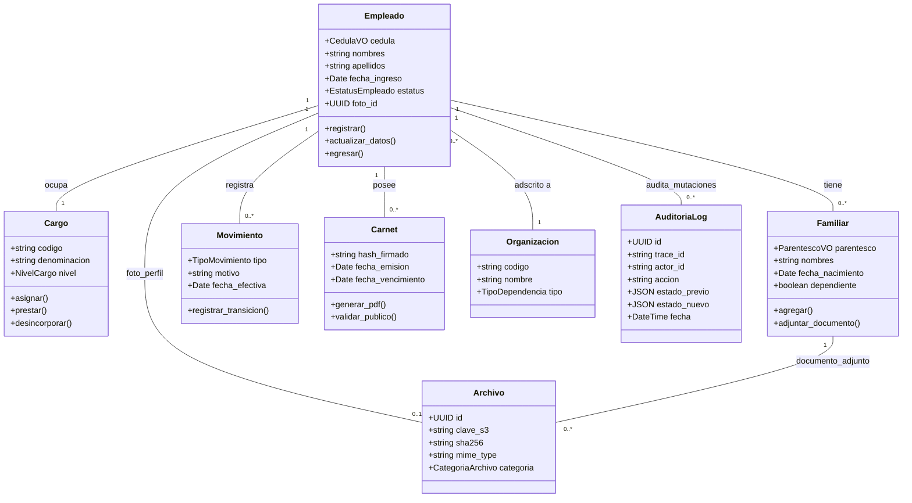

# Plan de Reconstrucción GATH — Arquitectura SCREAM + Feature-Based + Onion + ORCA

> **Versión 2.2 del plan — Reorganización Integral Backend / Frontend, Metodología ORCA, Gobernanza Multi-Agente y Sistema Dual de Auditoría (Base de Datos + Archivos de Texto TXT).**
> 
> Este documento constituye la fuente autoritativa y operativa para la reconstrucción completa del sistema **GATH** (Gestión y Administración de Talento Humano), estructurado bajo el paradigma **SCREAM + Feature-Based + Onion Architecture**, enriquecido con la metodología **ORCA (Object-Oriented UX & Domain Modeling)**, gobernado por un modelo de **Equipos de Agentes Especializados (Multi-Agent Architecture)** y dotado de una infraestructura integral de **Trazabilidad y Auditoría en Dos Capas (Tablas en PostgreSQL + Archivos de Texto .txt rotados en Backend y Frontend)**.
>
> **Alcance:** Diagnóstico profundo, auditoría de seguridad y malas prácticas, diseño de arquitectura objetivo, contratos de interfaz, mapa de migración modular por estrangulamiento, cronograma de dos carriles sincronizados, suites de testing/calidad, sistema dual de logging/auditoría (DB + TXT) y catálogo de decisiones de arquitectura (ADRs) para:
> - **Backend:** Django 5.2.7 + Django REST Framework 3.16.1 + Celery + RabbitMQ + SeaweedFS + PostgreSQL.
> - **Frontend:** Next.js 16.1.3 (App Router) + React 19.2.3 + NextAuth 5 (Beta/Auth.js) + Tailwind v4 + shadcn/ui + Vitest + Playwright.
> - **Infraestructura:** Docker Compose, Gateway S3 SeaweedFS, Broker RabbitMQ, Trazabilidad con `trace_id` correlacionado y volúmenes de logs.
>
> **Integración de Skills (`.claude/skills/`):**
> - Backend: `BACKEND/.claude/skills/` (**6 skills** analizadas, adaptadas y reconciliadas en §0.6.1).
> - Frontend: `NextJS/.claude/skills/` (**12 skills** analizadas, adaptadas y reconciliadas en §0.6.2).
> - Metodología ORCA: Modelado de Objetos, Relaciones, CTAs y Atributos formalizado en §0.4.
> - Agentes Especializados: Definición de subagentes y protocolo de delegación en §0.5.
> - Sistema de Auditoría y Logs: Especificación detallada DB + TXT en §0.7, §I.4.7, §II.4.8 y §III.4.
>
> Fecha de análisis inicial: 2026-08-17 · Adenda de decisiones: 2026-08-18 ·
> **Reorganización, Integración ORCA, Multi-Agente y Sistema de Logs DB/TXT: 2026-08-20** · Rama: `dev`

---

## Cómo navegar este documento

| Perfil / Rol | Ruta de lectura recomendada |
|---|---|
| **Líder Técnico / Arquitecto** | Parte 0 completa (§0.1–§0.8) → Parte IV (Cronograma y Sincronización) → Parte V (Decisiones D-01…D-12) |
| **Agente / Desarrollador Backend** | §0.1–§0.7 → **Parte I completa (Backend)** → Parte III → Parte IV → Apéndice A (Reglas B y S) |
| **Agente / Desarrollador Frontend** | §0.1–§0.7 → **Parte II completa (Frontend)** → Parte III → Parte IV → Apéndice A (Reglas R y S) |
| **Modelador de Dominio / ORCA** | §0.3 → §0.4 (Metodología ORCA) → §I.4 / §II.4 (Arquitectura Objetivo) → §0.7 (Contratos C-1…C-6) |
| **Seguridad y Auditoría** | §0.7 (Contrato C-5) → §I.4.7 (Logs DB/TXT Backend) → §II.4.8 (Logs TXT Frontend) → §III.4 → Apéndice C |
| **DevOps / Infraestructura** | §0.1 → Parte III (Infraestructura Transversal y Volúmenes de Logs) → Parte V → Parte VI |

**Convención de identificadores en todo el documento:**

| Prefijo | Significado |
|---|---|
| `CRIT-nn` · `ALTA-nn` · `MED-nn` | Hallazgos de auditoría de seguridad y arquitectura. |
| `B0.n` … `B9.n` | Tareas de **Backend** en la fase `n`. |
| `F0.n` … `F9.n` | Tareas de **Frontend** en la fase `n`. |
| `T1.n` … `T7.n` | Tareas **transversales** (infraestructura, contenedores, CI/CD, contratos). |
| `B1`–`B26` | Reglas obligatorias de arquitectura Backend. |
| `R1`–`R16` | Reglas obligatorias de arquitectura Frontend. |
| `S1`–`S19` | Reglas obligatorias de Seguridad (aplicables a backend, frontend o ambos). |
| `R-01`–`R-12` | Elementos del inventario de reubicación de código compartido de facto (§I.2.2). |
| `C-1`–`C-6` | Contratos compartidos y sincronizados Backend ↔ Frontend (§0.7). |
| `D-01`–`D-12` | Decisiones de Arquitectura Tomadas (ADRs en Parte V). |
| `A-01`–`A-10` | Acciones y acuerdos pendientes de respuesta externa (§VI.2). |

---

## Tabla de Contenido General

- [PARTE 0 — CONTEXTO COMÚN, METODOLOGÍA ORCA, GOBERNANZA MULTI-AGENTE Y SISTEMA DE LOGS](#parte-0--contexto-común-metodología-orca-gobernanza-multi-agente-y-sistema-de-logs)
  - [0.1 Stack real verificado en código](#01-stack-real-verificado-en-código-no-en-documentación)
  - [0.2 Volumetría y métricas del sistema](#02-volumetría-y-métricas-del-sistema)
  - [0.3 Principios de arquitectura comunes (SCREAM + Feature-Based + Onion)](#03-principios-de-arquitectura-comunes-a-ambos-lados)
  - [0.4 Metodología ORCA (Objects, Relationships, CTAs, Attributes)](#04-metodología-orca-objects-relationships-ctas-attributes)
  - [0.5 Arquitectura de Agentes y Protocolo de Delegación](#05-arquitectura-de-agentes-y-protocolo-de-delegación)
  - [0.6 Inventario de Skills (.claude) y Reconciliación](#06-inventario-de-skills-y-reconciliación-con-la-arquitectura-objetivo)
  - [0.7 Contratos compartidos Backend ↔ Frontend](#07-contratos-compartidos-backend--frontend)
  - [0.8 Resumen consolidado de auditoría de seguridad](#08-resumen-consolidado-de-hallazgos-por-lado)
- [PARTE I — BACKEND (Django / DRF)](#parte-i--backend-django--drf)
  - [I.1 Estado actual del backend](#i1-estado-actual-del-backend)
  - [I.2 Diagnóstico de arquitectura](#i2-diagnóstico-de-arquitectura--backend)
  - [I.3 Auditoría de seguridad y malas prácticas](#i3-auditoría-de-seguridad-y-malas-prácticas--backend)
  - [I.4 Arquitectura objetivo Backend y Sistema de Logs (DB + TXT)](#i4-arquitectura-objetivo--backend)
  - [I.5 Mapa de migración Backend](#i5-mapa-de-migración--backend)
  - [I.6 Plan detallado por fases Backend (Fases B0 a B9)](#i6-plan-por-fases--backend)
  - [I.7 Reglas de arquitectura Backend y divergencias](#i7-reglas-de-backend-y-divergencias-frente-a-las-skills)
  - [I.8 Checklist maestro de migración por módulo Backend](#i8-checklist-de-migración-por-módulo--backend)
  - [I.9 Testing y calidad Backend](#i9-testing--backend)
- [PARTE II — FRONTEND (Next.js / React)](#parte-ii--frontend-nextjs--react)
  - [II.1 Estado actual del frontend](#ii1-estado-actual-del-frontend)
  - [II.2 Diagnóstico de arquitectura](#ii2-diagnóstico-de-arquitectura--frontend)
  - [II.3 Auditoría de seguridad y malas prácticas](#ii3-auditoría-de-seguridad-y-malas-prácticas--frontend)
  - [II.4 Arquitectura objetivo Frontend y Sistema de Logs TXT](#ii4-arquitectura-objetivo--frontend)
  - [II.5 Mapa de migración Frontend](#ii5-mapa-de-migración--frontend)
  - [II.6 Plan detallado por fases Frontend (Fases F0 a F9)](#ii6-plan-por-fases--frontend)
  - [II.7 Reglas de arquitectura Frontend y divergencias](#ii7-reglas-de-frontend-y-divergencias-frente-a-las-skills)
  - [II.8 Checklist maestro de migración por módulo Frontend](#ii8-checklist-de-migración-por-módulo--frontend)
  - [II.9 Calidad: Vitest, Playwright, axe-core, Storybook y Prettier](#ii9-calidad-tests-visual-accesibilidad-y-formato--frontend)
- [PARTE III — INFRAESTRUCTURA, ALMACENAMIENTO Y OBSERVABILIDAD](#parte-iii--infraestructura-y-operación-transversal)
  - [III.1 Topología objetivo de infraestructura](#iii1-infraestructura-objetivo-tras-d-01-d-02-y-d-03)
  - [III.2 Almacenamiento con SeaweedFS (D-01)](#iii2-almacenamiento-de-objetos-seaweedfs)
  - [III.3 Tareas asíncronas con Celery + RabbitMQ (D-02)](#iii3-trabajos-asíncronos-celery--rabbitmq)
  - [III.4 Arquitectura Dual de Logging y Auditoría (PostgreSQL + Archivos TXT)](#iii4-arquitectura-dual-de-logging-y-auditoría-postgresql--archivos-txt)
  - [III.5 Plan de tareas de infraestructura (T1 a T7)](#iii5-plan-de-tareas-de-infraestructura)
- [PARTE IV — SECUENCIA CONJUNTA Y CRONOGRAMA DE DOS CARRILES](#parte-iv--secuencia-conjunta-y-cronograma-de-dos-carriles)
  - [IV.1 Matriz de sincronización de hitos (H-1 a H-5)](#iv1-hitos-de-sincronización-entre-carriles)
  - [IV.2 Cronograma maestro por fases](#iv2-cronograma-maestro-por-fases)
- [PARTE V — DECISIONES DE ARQUITECTURA TOMADAS (ADRs D-01 A D-12)](#parte-v--decisiones-tomadas)
- [PARTE VI — RIESGOS Y ACCIONES PENDIENTES (A-01 A A-10)](#parte-vi--riesgos-y-pendientes)
- [APÉNDICES](#apéndice-a--reglas-de-validación-de-arquitectura-consolidado)
  - [Apéndice A: Catálogo Consolidado de Reglas (B1–B26, R1–R16, S1–S19)](#apéndice-a--reglas-de-validación-de-arquitectura-consolidado)
  - [Apéndice B: Informe Técnico: SeaweedFS y RabbitMQ](#apéndice-b--informe-beneficios-y-contras-de-seaweedfs-y-rabbitmq)
  - [Apéndice C: Matriz Cruzada de Hallazgos y Tareas](#apéndice-c--matriz-hallazgo--lado--fase--tarea)
  - [Apéndice D: Guía de Referencia de Skills (.claude)](#apéndice-d--las-18-skills-en-detalle-qué-usar-de-cada-una-y-cuándo)
  - [Apéndice E: Trazabilidad de Tareas con Versiones Anteriores](#apéndice-e--trazabilidad-con-la-versión-anterior)

---
---

# PARTE 0 — CONTEXTO COMÚN, METODOLOGÍA ORCA, GOBERNANZA MULTI-AGENTE Y SISTEMA DE LOGS

## 0.1 Stack real (verificado en código, no en documentación)

| Capa | Lado | Tecnología | Versión real | Notas de auditoría |
|---|---|---|---|---|
| **Frontend** | F | Next.js (App Router) + React | `16.1.3` / `19.2.3` | `next-auth@5.0.0-beta.25` (beta en producción). Estilos: Tailwind v4 + Radix/shadcn. |
| **Backend** | B | Django + DRF | `5.2.7` / `3.16.1` | `simplejwt 5.5.1`, `drf-spectacular`, `django-filter`. |
| **Base de datos** | T | PostgreSQL | Externa | **Instancia en servidor dedicado** (D-03). No está en `compose.yml`. Tablas de negocio + tablas de auditoría (`auditoria_log`, `sistema_error_log`). |
| **Gestor de Archivos** | T | NestJS-Files → **SeaweedFS** | `11.x` → S3 Gateway | 2 módulos NestJS (`file-save`, `read-file`). **Se retira** (D-01); la lógica se traslada a Django y los binarios a SeaweedFS. |
| **Cola de tareas** | B | Celery + **RabbitMQ** | Celery 5.5.x | En `requirements.txt` sin broker ni app configurada. Objetivo (D-02): Celery + RabbitMQ (`amqp://`). |
| **Caché y Throttling** | B | PostgreSQL DatabaseCache | — | **Sin backend de caché declarado** (**ALTA-17**). Se adopta `DatabaseCache` en Postgres (D-11). |
| **Auditoría & Logs** | T | PostgreSQL + Archivos TXT | — | **Sistema Dual:** (1) Tablas Postgres append-only + (2) Archivos `.txt` rotados en `logs/backend/` y `logs/frontend/` correlacionados con `trace_id`. |
| **Validación** | F | Zod | `3.25.56` | Se planifica ascenso a v4 (F1.9) para compatibilidad con las plantillas de skills. |
| **Contenedores** | T | Docker Compose | — | Compose multi-stage con stage `tester` de CI, volumen dedicado `/logs/` y usuario no root. |

## 0.2 Volumetría y métricas del sistema

| Métrica | Backend (Django) | Frontend (Next.js) |
|---|---|---|
| **Archivos de código** | 101 archivos `.py` (excluyendo migraciones) | 397 archivos en `src/`, `actions/`, `types/` |
| **Líneas de código (LoC)** | ~16.000 líneas | ~56.600 líneas |
| **Archivo de mayor tamaño** | `RAC/views/personal_activo_views.py` — **3.174 líneas** | `gestion-pasivos/.../crear-familiar.tsx` — **1.708 líneas** |
| **Archivos críticos (> 400 líneas)** | 12 archivos | **34 archivos** |
| **Endpoints / Rutas** | **135 `@api_view`** + 3 `APIView` + 3 CRUD roles | 61 `page.tsx`, 50 archivos de server actions |
| **Pruebas automatizadas** | 128 líneas totales (`RAC` con **0 tests**) | **0 tests (unitarios ni E2E)** |
| **Hardcodeo de roles en código** | Resolutor inexistente (comparaciones dispersas) | **35** a `nombre_rol` · **22** a `RECEPCIONISTA` (**MED-18**) |

## 0.3 Principios de arquitectura comunes a ambos lados

```
presentation / ui  ──▶  application  ──▶  domain (núcleo puro)
                             │
                             ▼
                      infrastructure (implementa puertos de domain)
```

1. **SCREAM:** Las carpetas gritan el negocio (`personal`, `cargos`, `familiares`, `organizacion`), no el detalle técnico (`views`, `components`, `controllers`).
2. **Feature-Based:** Cada módulo de negocio es una unidad autónoma que encapsula sus cuatro capas completas.
3. **Onion (Clean Architecture):** Las dependencias apuntan estrictamente hacia adentro. La capa `domain` no importa ningún framework ni detalle de I/O.
4. **Ubiquitous Language (Lenguaje Unificado):** Backend y Frontend comparten exactamente las mismas entidades, Value Objects, códigos de error y vocabulario.

**Tabla de equivalencia estructural entre lados:**

| Concepto | Backend (`BACKEND/`) | Frontend (`NextJS/`) |
|---|---|---|
| **Kernel transversal** | `core/` | `shared/` |
| **Módulo de dominio** | `apps/[modulo]/` | `modules/[modulo]/` |
| **Capa interna de dominio** | `domain/` (entities, value_objects, ports) | `domain/` (entities, value-objects, ports) |
| **Casos de uso** | `application/use_cases/` | `application/use-cases/` |
| **Adaptadores de I/O** | `infrastructure/` (models, mappers, repositories, serializers, loggers) | `infrastructure/` (http, mappers, repositories, actions, loggers) |
| **Capa de interfaz/entrega** | `presentation/` (views, filters, permissions, urls) | `ui/` (schema, forms, pages, components) |
| **Punto de entrada / Enrutamiento** | `config/urls.py` → `/api/v1/` | `app/` (App Router, solo thin wrappers) |
| **Sobre de respuesta estándar** | `core/presentation/envelope.py` | `shared/types/api-respose.ts` |
| **Archivos de Log TXT** | `logs/backend/audit_backend.txt` | `logs/frontend/audit_frontend.txt` |
| **Convención de nomenclatura** | `snake_case.py` | `kebab-case.ts` |

---

## 0.4 Metodología ORCA (Objects, Relationships, CTAs, Attributes)

Para evitar la fragmentación del diseño y garantizar que el modelo de dominio sea idéntico en Backend y Frontend, se formaliza la metodología **ORCA (Object-Oriented UX & Domain Modeling)**.

```
┌─────────────────────────────────────────────────────────────────────────┐
│                           ORCA DOMAIN MATRIX                            │
├───────────────┬───────────────────────────┬─────────────────────────────┤
│ OBJECTS       │ Core business entities    │ Empleado, Cargo, Familiar...│
│ RELATIONSHIPS │ Structural cardinality    │ 1:1, 1:N, N:M + Constraints │
│ CTAs (Verbs)  │ State mutations & queries │ Registrar, Egresar, Emitir..│
│ ATTRIBUTES    │ Value Objects & Metadata  │ Cédula, Fechas, Salud (PII) │
└───────────────┴───────────────────────────┴─────────────────────────────┘
```

### 0.4.1 Matriz de Objetos Maestros del Sistema GATH



### 0.4.2 Catálogo Detallado ORCA por Dominio

| Objeto (Object) | Relaciones (Relationships) | Llamadas a la Acción (CTAs / Verbos) | Atributos Críticos (Attributes & VOs) | Destino de Auditoría |
|---|---|---|---|---|
| **Empleado (Activo / Pasivo)** | 1:1 Cargo actual, 1:N Familiares, 1:N Movimientos, 1:N Carnets, N:1 Dependencia, 1:1 Foto (`Archivo`) | `registrar_ingreso`, `actualizar_datos_personales`, `actualizar_salud`, `egresar_personal`, `reincorporar` | `CedulaVO` (canónica V/E), `NombreCompleto`, `FechaIngreso`, `EstatusLaboral`, `AnosAPN` (D-05), `ExpedienteSalud` (PII protegido) | DB (`auditoria_log`) + TXT (`audit_backend.txt`) |
| **Cargo y Ubicación** | N:1 Organización (Dependencia/Dirección), 1:1 Empleado titular, 0..1 Empleado prestado | `crear_denominacion`, `asignar_titular`, `prestar_cargo`, `revertir_prestamo`, `eliminar_vacante` | `CodigoCargoVO`, `Denominacion`, `Grado`, `TipoAsignacion`, `FechaAsignacion`, `Observaciones` | DB + TXT Backend |
| **Familiar y Cargas** | N:1 Empleado titular, 1:N Documentos adjuntos (`Archivo`) | `agregar_familiar`, `actualizar_familiar`, `adjuntar_partida_o_constancia`, `descargar_documento` | `ParentescoVO` (hijo, cónyuge, padre), `CedulaFamiliar`, `Nombres`, `FechaNacimiento`, `Discapacidad` | DB + TXT Backend |
| **Historial de Movimientos** | N:1 Empleado, N:1 Cargo anterior/nuevo, N:1 Dependencia anterior/nueva | `registrar_cambio_cargo`, `registrar_aumento`, `registrar_egreso`, `anular_movimiento` | `TipoMovimiento` (ingreso, traslado, ascenso, egreso), `FechaEfectiva`, `Motivo`, `ActorId`, `TraceId` | DB + TXT Backend |
| **Carnetización** | N:1 Empleado, 1:1 Plantilla, 1:1 Archivo PDF generado | `disenar_plantilla`, `emitir_carnet`, `validar_qr_publico`, `revocar_carnet` | `HashFirmadoVO`, `FechaEmision`, `FechaVencimiento`, `CodigoQR`, `EstadoCarnet` | DB + TXT Backend |
| **Autogestión (Censo)** | 1:1 Empleado (propiedad estricta) | `responder_censo`, `actualizar_vivienda`, `consultar_resumen_propio`, `exportar_censo` | `TipoVivienda`, `EstadoVivienda`, `ServiciosBasicos`, `Comunidad`, `RespuestasJSON` | DB + TXT Backend |
| **Organización** | 1:N Sub-dependencias (jerarquía recursiva), 1:N Cargos | `crear_dependencia`, `reasignar_padre`, `modificar_estructura` | `CodigoDependencia`, `Nombre`, `NivelJerarquico` (General, Línea, Coordinación), `UbicacionGeo` | DB + TXT Backend |
| **Identidad / Cuenta** | 1:1 Empleado (opcional), N:1 Rol, N:M Permisos | `iniciar_sesion`, `refrescar_token`, `cambiar_password`, `asignar_rol`, `conceder_permiso`, `bloquear` | `Username/Cedula`, `PasswordHash` (Argon2), `IsActive`, `PermisosVersion`, `TraceId` | DB + TXT Backend & Frontend |
| **Archivo Digital** | N:1 Propietario polimórfico (Empleado, Familiar, Carnet), 1:1 Binario S3 | `subir_archivo`, `normalizar_imagen`, `generar_url_firmada`, `marcar_reemplazado` | `UUID`, `ClaveS3`, `SHA256`, `MimeTypeReal`, `Bytes`, `Categoria`, `SubidoPor` | DB + TXT Backend |
| **Auditoría & Trazabilidad** | N:1 Actor, 1:1 Transacción (`trace_id`) | `registrar_mutacion`, `registrar_acceso_sensible`, `rotar_archivo_txt`, `consultar_historial` | `UUIDv7`, `TraceId`, `ActorId`, `Accion`, `EstadoPrevioJSON`, `EstadoNuevoJSON`, `IP`, `Timestamp` | DB (persistente) + TXT (forense) |

---

## 0.5 Arquitectura de Agentes y Protocolo de Delegación

Para ejecutar la reconstrucción con máxima autonomía, paralelismo y sin colisiones de contexto, se establece un ecosistema de **subagentes especializados**:

```
                              ┌───────────────────────────────┐
                              │     ORCA Domain Architect     │
                              │  (Orquestador & Contratos)    │
                              └───────────────┬───────────────┘
                                              │
                    ┌─────────────────────────┴─────────────────────────┐
                    ▼                                                   ▼
     ┌─────────────────────────────┐                     ┌─────────────────────────────┐
     │   Backend Engineer Agent    │                     │   Frontend Engineer Agent   │
     │   (Django / DRF / Celery)   │                     │  (Next.js / React / SWR)    │
     └─────────────────────────────┘                     └─────────────────────────────┘
```

### 0.5.1 Catálogo de Subagentes Especializados

1. **`orca_domain_architect` (Orquestador de Dominio, Contratos y Auditoría):**
   - **Misión:** Modelado conceptual ORCA, verificación de simetría de entidades entre backend y frontend, gobernanza de contratos (`C-1` a `C-6`), supervisión de los esquemas de auditoría DB y formato de logs TXT.
   - **Herramientas:** Lectura/escritura de contratos, definición de DTOs compartidos, validación de boundaries.
2. **`backend_engineer_agent` (Especialista Backend Django/DRF):**
   - **Misión:** Implementación de las 4 capas Onion en `apps/`, creación de puertos y repositorios ORM, configuración de tareas Celery + RabbitMQ, seguridad (Argon2, DatabaseCache throttling, `HasPermission`), logger dual (PostgreSQL + `logs/backend/audit_backend.txt`), y suite de tests con `pytest`.
   - **Reglas rectoras:** B1–B26, S1–S19, D-01..D-12.
3. **`frontend_engineer_agent` (Especialista Frontend Next.js/React):**
   - **Misión:** Implementación de módulos bajo SCREAM en `modules/`, creación de schemas Zod v4, formularios `react-hook-form` con wrappers de `shared/ui/`, cliente HTTP `apiClient` robusto, logger en servidor a `logs/frontend/audit_frontend.txt` con propagación de `trace_id`, y testing con Vitest, Playwright y axe-core.
   - **Reglas rectoras:** R1–R16, S1–S19, D-01..D-12.

### 0.5.2 Protocolo de Trabajo Concurrente y Sincronización

1. **Definición de Contrato (ORCA):** Antes de iniciar la migración de un módulo (ej. `personal/activo`), `orca_domain_architect` define los VOs, entidades, DTOs de entrada/salida, códigos de permiso y eventos auditables.
2. **Implementación Paralela:**
   - `backend_engineer_agent` construye `apps/[modulo]/` exponiendo `/api/v1/[modulo]/` con middleware de auditoría que escribe en Postgres y en `audit_backend.txt`.
   - `frontend_engineer_agent` construye `modules/[modulo]/` consumiendo la ruta, inyectando `X-Trace-Id` y registrando en `audit_frontend.txt`.
3. **Hito de Integración:** Se ejecuta la suite E2E de Playwright conectando frontend y backend, verificando que una operación genera registros sincronizados en DB y en ambos archivos TXT.

---

## 0.6 Inventario de Skills y Reconciliación con la Arquitectura Objetivo

Las 18 skills de `.claude/skills/` constituyen la guía canónica de **estilo de código**, adaptadas y reconciliadas para GATH.

### 0.6.1 Skills de Backend — `BACKEND/.claude/skills/`

| Skill | Líneas | Qué aporta | Decisión en GATH |
|---|---|---|---|
| `arquitectura-onion-feature-scream` | 317 | Capas y reglas de dependencia en Django, tabla de convención de nombres, patrón evento→signal→Celery con `transaction.on_commit()`, truco de `models.py` re-exportador. | **Adoptada con 2 adaptaciones:** La capa `api/` se renombra **`presentation/`**; se rechaza la regla R5 y **se exige el patrón Repository (D-09)**. |
| `patrones-drf-implementacion` | 303 | Serializers de lectura/escritura separados, `@extend_schema_field` obligatorio, guard `swagger_fake_view`, `_padre_o_404`, prohibición de `StringRelatedField` en endpoints públicos, `MensajeRespuestaSerializer`. | **Adoptada con 1 adaptación:** Se permite `DefaultRouter` + `ViewSet` **solo para catálogos mecánicos de solo lectura (D-10)**; para el resto, vistas explícitas. |
| `autenticacion-permisos-jwt` | 190 | Modelo usuario/rol por FK, cookie `HttpOnly` + helpers `cookies.py`, rotación con blacklist, permisos componibles con `\|`. | **Adoptada con enriquecimiento:** Se incorpora el claim `permisos_version` en el JWT (§I.6.9) para invalidar permisos revocados en minutos. |
| `uso-librerias-backend` | 168 | Configuración de Celery, Argon2 como primer hasher, `ENUM_NAME_OVERRIDES` para drf-spectacular, CORS por entorno. | **Adoptada con 1 adaptación:** El broker es **RabbitMQ** (no Redis) y el backend de throttling es **DatabaseCache sobre PostgreSQL con fallo cerrado (D-11)**. |
| `testing-backend-django` | 185 | Factories que pasan por el servicio real, aislamiento de la caché de throttling, mocking en el punto de entrada del servicio. | **Adoptada con 1 adaptación de herramienta:** Se adopta **`pytest` + `pytest-django` (D-12)** para permitir tests de casos de uso puros sin tocar base de datos. |
| `integracion-bd-recaudacion` | 217 | Plantilla de integración con bases ajenas: router por módulo, `managed=False`, `allow_migrate=False`, rol SQL solo lectura, degradación a 503. | **Reservada para fuentes legadas (§I.4.6)**: Scripts de migración histórica (`SAGP`, `SIGEP`, carpeta `migrar/`). |

### 0.6.2 Skills de Frontend — `NextJS/.claude/skills/`

| Skill | Líneas | Qué aporta | Decisión en GATH |
|---|---|---|---|
| `arquitecto-scream-feature-onion` | 1.307 | Estructura modular, orden de creación en 16 pasos, flujo de datos lectura/escritura, plantillas tipadas, reglas Server/Client Component. | **Adoptada con 1 rechazo tajante:** Se **rechaza la regla de `.env` versionado** (**CRIT-03**); ningún secreto va a git. Se amplía el orden de creación a **18 pasos** (+ tests unitarios y E2E). |
| `patrones-implementacion-frontend` | 1.449 | Formularios `react-hook-form` + Zod, wrappers de campo (`InputForm`, `SelectForm`, `DateForm`, `FileForm`, `TextareaForm`), `DireccionAdminSelects`, `CedulaSearch`, proxy de PDF. | **Adoptada íntegramente:** Base de la capa `ui/` y componentes de `shared/`. |
| `validacion-input-protegido` | 499 | Regla "cero hardcodeo", archivo único de regex y mensajes, validación zero-trust en server actions, saneamiento contra XSS. | **Adoptada íntegramente:** Ubicada en `shared/validation/`. |
| `testing-e2e-playwright` | 458 | Configuración multi-navegador (Chromium, Firefox, WebKit), fixture de login con `storageState`, Page Objects genéricos. | **Adoptada íntegramente:** Suite en `e2e/`. |
| `testing-unit-vitest` | 209 | Tests unitarios de casos de uso puros, schemas Zod, componentes presentacionales y cliente HTTP con MSW. | **Adoptada íntegramente:** Regla R11 (tests junto al archivo). |
| `storybook-chromatic` | 166 | Stories de componentes UI, regresión visual con Chromatic, addon de a11y. | **Adoptada:** Exigida para componentes compartidos en `shared/ui/components/` (R12). |
| `testing-a11y-axe` | 95 | Auditoría automatizada de accesibilidad con `@axe-core/playwright` sobre rutas renderizadas. | **Adoptada:** Regla R13 (un caso por ruta nueva). |
| `formato-prettier` | 124 | Prettier como formateador único, `eslint-config-prettier` **al final** del array, `format:check` en CI. | **Adoptada:** Regla R14. |
| `despliegue-docker-django-nextjs` | 420 | Dockerfile multi-stage con stage `tester` de CI, `output: standalone`, usuario no root. | **Adoptada íntegramente.** |
| `design-taste-frontend` | 1.304 | Criterio estético, tipografía (`Inter` + `Outfit`), calibración de contrastes, modo oscuro obligatorio. | **Adoptada en Fase F6.** |
| `mobile-first-design` | 96 | Breakpoints responsivos, touch targets ≥ 48 px, tablas colapsables. | **Adoptada en Fase F6.** |
| `animaciones-frontend` | 278 | Motion / CSS animations respetando `prefers-reduced-motion`. | **Adoptada en Fase F6.** |

---

## 0.7 Contratos compartidos Backend ↔ Frontend

Los 6 contratos vinculantes que garantizan la interoperabilidad absoluta y permiten el desarrollo paralelo:

```
┌──────────────────────────────────────────────────────────────────────────┐
│                   CONTRATOS COMPARTIDOS (SHARED CONTRACTS)               │
├─────┬───────────────────────┬────────────────────────────────────────────┤
│ C-1 │ Sobre de Respuesta    │ {status: "success"|"error", message, data} │
│ C-2 │ Sesión y Tokens       │ Cookies HttpOnly dj_access (15m)/refresh(8h│
│ C-3 │ Autorización Códigos  │ HasPermission("mod.act") ↔ puede("mod.act")│
│ C-4 │ Trabajo Asíncrono     │ 202 Accepted {tarea_id} ↔ Polling /tareas/ │
│ C-5 │ Trazabilidad Dual     │ X-Trace-Id originado en UI ↔ DB + TXT Logs │
│ C-6 │ Versionado /api/v1/   │ Convivencia modular sin Big Bang           │
└─────┴───────────────────────┴────────────────────────────────────────────┘
```

1. **C-1: Sobre de Respuesta Unificado (`envelope`):**
   - Éxito: `{"status": "success", "message": "Descripción clara.", "data": <T>}`
   - Error: `{"status": "error", "message": "Mensaje seguro para usuario.", "data": null}` (los errores internos se asocian al `trace_id` en los logs DB y TXT, nunca en el payload HTTP — regla S6).
2. **C-2: Autenticación y Ciclo de Vida de Sesión:**
   - Un solo endpoint de login (`POST /api/v1/identidad/auth/login/`). NextAuth ejecuta `authorize()` en el servidor, guardando las cookies `httpOnly`, `secure`, `sameSite: "lax"` (`dj_access` de 15 min y `dj_refresh` de 8 h). `session.maxAge` de NextAuth sincronizado estrictamente a 8 horas (D-08).
3. **C-3: Autorización Basada en Códigos de Permiso (`[modulo].[accion]`):**
   - Backend exige `HasPermission("personal.crear")`. Frontend evalúa `puede("personal.crear")` contra `session.user.permisos: {id, code, name}[]`. **Cero comparaciones de nombres de rol (`RECEPCIONISTA`, `ADMIN`) en código de negocio** (reglas B2, R16).
4. **C-4: Protocolo de Trabajos Asíncronos (Celery ↔ SWR):**
   - Peticiones pesadas (> 3s o lotes) responden `202 Accepted` con `{"status": "success", "data": {"tarea_id": "<UUID>"}}`.
   - Frontend realiza sondeo con `useSWR` a `GET /api/v1/tareas/{id}/` (`pendiente` | `en_proceso` | `completada` | `fallida`). Al finalizar, devuelve el `archivo.id` resultante.
5. **C-5: Correlación de Trazabilidad y Auditoría Dual (`trace_id` + DB + TXT):**
   - El frontend genera un UUIDv7 `trace_id` por flujo de usuario y lo inyecta en el header `X-Trace-Id`.
   - El frontend registra la acción en `logs/frontend/audit_frontend.txt`.
   - El backend propaga el `trace_id` a:
     - (a) **Base de Datos:** Tabla `auditoria_log` en PostgreSQL con cambios JSON antes/después.
     - (b) **Archivo de Texto Backend:** `logs/backend/audit_backend.txt` con línea estructurada.
     - (c) **Tareas Celery:** Payload del worker y registro en log de tareas.
6. **C-6: Versionado y Coexistencia Modular (`/api/v1/`):**
   - Los módulos nuevos se publican bajo `/api/v1/[modulo]/`. Los endpoints legados continúan respondiendo con cabecera `Deprecation: true` hasta que la Fase 8 verifique cero consumidores.

---

## 0.8 Resumen consolidado de hallazgos por lado

| Severidad | Solo Backend | Solo Frontend | Infraestructura / Ambos | Total |
|---|---|---|---|---|
| **Críticos** | CRIT-01, 02, 04, 05, 06, 07, 08, 11, **12** | CRIT-09 | CRIT-03, CRIT-10 | **12** |
| **Altos** | ALTA-04, 05, 06, 07, 08, 11, 14, 16, **17** | ALTA-01, 02, 15 | ALTA-03, 09, 10, 12, 13 | **17** |
| **Medios** | MED-01, 03, 04, 05, 06, 14, 16, 17 | MED-07, 08, 09, 10, 12, **18** | MED-02*, 11, 13, 15 | **18** |

<small>*Nota: MED-02 se reservó históricamente. La serie salta de MED-01 a MED-03.</small>

---
---

# PARTE I — BACKEND (Django / DRF)

## I.1 Estado actual del backend

El backend es un monolito Django 5.2 / DRF 3.16 compuesto por 5 aplicaciones:
- `RAC` (Registro de Administración y Control): **God-App** que concentra 8 dominios disjuntos (personal activo, pasivo, cargos, organización, familiares, movimientos, reportes PDF/Excel). Vistas monolíticas de hasta 3.174 líneas (`personal_activo_views.py`).
- `USER`: Autenticación y roles. Modelo `cuenta` custom sin `PermissionsMixin`. En agosto 2026 incorporó `rol_views.py` permitiendo a cualquier usuario autenticado crear/editar/borrar roles (**CRIT-12**).
- `CARNETIZACION`: Generación de carnets y validación pública que expone datos de empleados (**ALTA-05**).
- `AUTOGESTION`: Censo de vivienda sin verificación de propiedad del recurso (**ALTA-07**).
- `SIGEP`: Configuración raíz con credenciales versionadas (**CRIT-11**).

### I.1.1 Flujo actual de manejo de peticiones

```
HTTP Request ──▶ urls.py (paths planos sin versionar)
                     │
                     ▼
          @api_view función monolítica
          ├── Validación manual con serializers (que hacen de DTO y mapper)
          ├── Lógica de negocio mezclada con llamadas ORM (sin puertos)
          ├── Generación directa de reportes / archivos en el ciclo HTTP
          └── Response({status, message, data}) armado a mano
```

---

## I.2 Diagnóstico de arquitectura — Backend

### I.2.1 Dependencias circulares entre aplicaciones

Existe un acoplamiento bidireccional severo entre `RAC` y `USER`:
- `RAC` importa modelos, serializers y vistas de `USER` en 8 archivos.
- `USER` importa `from RAC.models import *` en `USER/serializers/USER_serializers.py:3` y usa filtros de `RAC`.

### I.2.2 Inventario de reubicación de código compartido de facto

| ID | Origen actual | Problema diagnosticado | Destino en Arquitectura Objetivo | Fase |
|---|---|---|---|---|
| **R-01** | `RAC/filters/filters_personal.py` (`CuentaFilter`) | Filtra el modelo `cuenta` de `USER`, pero vive en `RAC` | `apps/identidad/presentation/filters/cuenta_filters.py` | B3 |
| **R-02** | `RAC/utils/data_formatters.py` (`CleanZerosMixin`) | Usado por 7 serializers en 2 apps; importado vía re-export | `core/infrastructure/serializer_mixins.py` | B2 |
| **R-03** | `RAC/utils/data_formatters.py` (`extract_first_error`) | Desempaquetado manual de errores en vistas | Se elimina: absorbido por `core/presentation/exception_handler.py` | B2 |
| **R-04** | `RAC/utils/constants.py` | Strings de estatus (`ESTATUS_ACTIVO`) comparados contra BD | Value Objects en `domain/value_objects/` y catálogos | B4.2 |
| **R-05** | `RAC/utils/tiempo_servicio.py` | Lógica de cálculo APN duplicada con la BD (D-05) | `apps/personal/shared/domain/services/tiempo_servicio.py` | B4.3 |
| **R-06** | `RAC/utils/mapa_reporte.py` y `AUTOGESTION/utils/...` | Dos motores de mapeo de campos a ORM para reportes | Puerto `ReportFieldRegistry` en `core/domain/ports.py` | B5.11 |
| **R-07** | `RAC/services/pdf/` y `CARNETIZACION/services/` | Dos motores ReportLab independientes | `core/infrastructure/pdf/` (base, estilos, componentes) | B2 |
| **R-08** | `RAC/serializers/personal_activo_serializers.py` | Serializer gigante importado por 4 apps | DTOs específicos en `apps/personal/activo/` | B4.3 |
| **R-09** | `RAC/services/profile_services.py` (`upsert_contrato`) | Caso de uso invocado desde serializers y management commands | `apps/personal/activo/application/use_cases/upsert_contrato.py` | B4.3 |
| **R-10** | `USER/authentication.py` (`CookieJWTAuthentication`) | Autenticación global del sistema alojada dentro de una app | `core/infrastructure/authentication.py` | B2 |
| **R-11** | `USER/services/token_service.py` | Mezcla emisión de tokens con manipulación de cookies HTTP | Emisión a `apps/identidad/application/`; cookies a `core/presentation/cookies.py` | B3.6 |
| **R-12** | God-App `RAC` | Agrupa 8 dominios bajo una sigla organizativa obsoleta | Se disuelve completamente en los 11 módulos de `apps/` | B4 |

---

## I.3 Auditoría de seguridad y malas prácticas — Backend

### I.3.1 Vulnerabilidades Críticas

- **CRIT-01:** `SECRET_KEY` hardcodeada en `settings.py` e idéntica a `SIGNING_KEY` de SimpleJWT.
- **CRIT-02:** `DEBUG = True` forzado en producción; cookies sin flag `Secure`.
- **CRIT-04:** Endpoint de cambio de contraseña `AllowAny` que acepta `user_id` arbitrario en el body sin exigir contraseña actual.
- **CRIT-05:** Registro de usuarios `AllowAny` que permite al solicitante asignarse el rol `ADMINISTRADOR`.
- **CRIT-06:** Descarga de documentos familiares por ID secuencial entero sin autenticación ni verificación de parentesco (IDOR masivo).
- **CRIT-07:** `MEDIA_ROOT` servido públicamente vía `static(settings.MEDIA_URL, ...)` en `urls.py`.
- **CRIT-08:** 135 endpoints protegidos solo con `IsAuthenticated`; cero validación de permisos o roles a nivel de endpoint.
- **CRIT-11:** Archivo `wait-for-postgres.py` versionado con host real y contraseña del usuario `postgres`.
- **CRIT-12:** Endpoints `crear_rol`, `actualizar_rol`, `eliminar_rol` añadidos con solo `IsAuthenticated`: cualquier empleado con cuenta puede borrar o modificar roles del sistema.

### I.3.2 Vulnerabilidades Altas

- **ALTA-04:** Ausencia de rate limiting en endpoints de autenticación y cambio de credenciales.
- **ALTA-05:** `api_validar_carnet` expone el expediente completo del empleado ante un ID secuencial adivinable.
- **ALTA-06:** Modificación y activación/desactivación de cuentas sin permiso administrativo.
- **ALTA-07:** Endpoints de autogestión permiten consultar y modificar censos de cualquier cédula.
- **ALTA-08:** `token_service.py` pasa un entero a `RefreshToken.for_user()` causando `AttributeError` no capturado; tokens rotados pierden claims.
- **ALTA-11:** Vistas capturan `Exception` y devuelven `str(e)` al cliente, filtrando nombres de tablas, columnas y rutas del servidor.
- **ALTA-14:** Esquema OpenAPI (`/api/docs/`, `/api/schema/`) y Django Admin expuestos sin restricción de red.
- **ALTA-16:** Carga masiva de Excel sobrescribe `Employee.profile = None`, borrando masivamente la referencia a fotos de empleados.
- **ALTA-17:** Throttling configurado sin backend de caché compartido: opera sobre `LocMemCache` por proceso worker, multiplicando el límite de intentos por N workers y reseteándose en cada reinicio.

---

## I.4 Arquitectura objetivo — Backend

### I.4.1 Estructura canónica por módulo (`apps/[modulo]/`)

```
apps/[modulo]/
├── domain/                               ← Núcleo puro (sin Django ni DRF)
│   ├── entities/
│   │   └── [entidad].py                  (dataclass inmutable)
│   ├── value_objects/
│   │   └── [vo].py                       (validación en construcción)
│   └── ports/
│       ├── repo_[entidad].py             (Protocol / ABC del repositorio)
│       └── [servicio_externo].py         (Protocol de I/O)
│
├── application/                          ← Orquestación y reglas de negocio
│   ├── dtos/
│   │   └── [accion]_dto.py               (dataclasses de entrada/salida)
│   └── use_cases/
│       ├── [accion]_[entidad].py         (función o clase pura que recibe repo)
│       └── ...
│
├── infrastructure/                       ← Adaptadores tecnológicos
│   ├── models/
│   │   └── [entidad]_model.py            (modelos ORM Django)
│   ├── mappers/
│   │   └── mapper_[entidad].py           (convierte ORM ↔ Entity)
│   ├── repositories/
│   │   └── repo_[entidad]_orm.py         (implementa el puerto de domain)
│   ├── serializers/
│   │   ├── [entidad]_lectura_serializers.py
│   │   └── [entidad]_escritura_serializers.py
│   └── tasks/
│       └── [accion]_tasks.py             (Celery shared_tasks con IDs)
│
├── presentation/                         ← Capa de entrega DRF
│   ├── views/
│   │   └── [entidad]_views.py            (APIView / generics delgadas)
│   ├── filters/
│   │   └── [entidad]_filters.py          (SearchFilter / DjangoFilter)
│   ├── permissions/
│   │   └── [modulo]_permissions.py       (HasPermission bindings)
│   └── urls.py                           (urlpatterns con prefijo /api/v1/)
│
├── models.py                             ← Re-exporta infrastructure/models/ (D-e)
└── apps.py                               ← AppConfig con registro de receivers
```

### I.4.7 Sistema de Logging y Auditoría Backend (PostgreSQL + Archivos TXT)

El backend implementa un sistema de registro en dos destinos coordinados mediante `core/infrastructure/logging/`:

#### 1. Destino Base de Datos (`auditoria_log` en PostgreSQL)
Modelo ORM `AuditoriaLog` en `core/infrastructure/models/auditoria.py`:
- `id`: `UUIDField(primary_key=True, default=uuid7)`
- `trace_id`: `CharField(max_length=64, db_index=True)` (recibido desde el frontend o generado en middleware)
- `actor_id`: `IntegerField(null=True)` (ID del usuario autenticado)
- `actor_cedula`: `CharField(max_length=15)`
- `actor_rol`: `CharField(max_length=50)`
- `modulo`: `CharField(max_length=50, db_index=True)`
- `accion`: `CharField(max_length=100, db_index=True)` (ej. `personal.actualizar_datos`)
- `recurso_tipo`: `CharField(max_length=50)` (ej. `Empleado`, `Cargo`)
- `recurso_id`: `CharField(max_length=64)`
- `ip_origen`: `GenericIPAddressField()`
- `estado_previo`: `JSONField(null=True)` (snapshot del registro antes de mutar)
- `estado_nuevo`: `JSONField(null=True)` (snapshot después de mutar)
- `resultado`: `CharField(max_length=20)` (`SUCCESS`, `FAILED`, `DENIED`)
- `fecha_hora`: `DateTimeField(auto_now_add=True, db_index=True)`

#### 2. Destino Archivo de Texto TXT (`logs/backend/audit_backend.txt`)
Handler `ConcurrentRotatingFileHandler` o `TimedRotatingFileHandler` configurado en `LOGGING`:
- Ruta: `logs/backend/audit_backend.txt` (rotación diaria con compresión gzip, retención 90 días).
- Formato de línea fija de auditoría TXT:
  ```text
  [2026-08-20 16:30:15.123] [TRACE:01916f12-3456-789a-bcde-f0123456789a] [ACTOR:12345678|ADMIN] [IP:192.168.1.50] [ACTION:personal.actualizar_datos] [TARGET:Empleado#V-12345678] [STATUS:SUCCESS] [DIFF:{"cargo_id":[10,12],"salario":[100,150]}]
  ```
- Separación de archivos:
  - `logs/backend/audit_backend.txt`: Mutaciones de personal, accesos a datos sensibles, cambios de roles/permisos.
  - `logs/backend/errors_backend.txt`: Excepciones 500 con traceback completo y `trace_id`.
  - `logs/backend/security_backend.txt`: Intentos fallidos de login, 403 Forbidden y bloqueos de rate limit.

---

## I.5 Mapa de migración — Backend

| Módulo Origen Legado | Módulo Objetivo en `apps/` | Dominios Encapsulados | Endpoints Estimados | Orden / Prioridad |
|---|---|---|---|---|
| `USER/` + `rol_views.py` | `identidad/` | Cuentas, roles, permisos, sesiones JWT, tokens | ~18 | **1 (Piloto B3)** |
| `RAC/models/ubicacion_models.py` | `organizacion/` | Dependencias, direcciones, coordinaciones, sedes | ~18 | 2 (B4.1) |
| `RAC/` (tablas maestras) | `catalogos/` | ~35 catálogos (profesiones, estados, parentescos) | ~35 | 3 (B4.2) |
| `RAC/views/personal_activo_views.py` | `personal/activo/` | Datos personales, salud, vivienda, educación | ~30 | 4 (B4.3) |
| `RAC/views/personal_pasivo_views.py` | `personal/pasivo/` | Jubilados, pensionados, sobrevivientes | ~12 | 5 (B4.4) |
| `RAC/` (cargos y asignaciones) | `cargos/` | Denominaciones, vacantes, asignaciones, préstamos | ~15 | 6 (B4.5) |
| `RAC/views/family_views.py` | `familiares/` | Familiares, cargas y documentos adjuntos | ~10 | 7 (B4.6) |
| `RAC/views/historial_views.py` | `movimientos/` | Historial laboral, cambios de estatus, egresos | ~8 | 8 (B4.7) |
| `RAC/services/pdf/` + views reporte | `reportes/` | Generadores PDF/Excel, filtros avanzados | ~10 | 9 (B4.8) |
| `CARNETIZACION/` | `carnetizacion/` | Plantillas, emisión, validación criptográfica | ~8 | 10 (B4.9) |
| `AUTOGESTION/` | `autogestion/` | Censo socioeconómico, encuestas | ~7 | 11 (B4.10) |

---

## I.6 Plan por fases — Backend

### FASE B0 — Contención Inmediata de Seguridad (3–5 días · Bloqueante)

- **B0.1:** Mover `SECRET_KEY` a variable de entorno y rotarla. Separar `SIMPLE_JWT['SIGNING_KEY']` a clave independiente (CRIT-01).
- **B0.2:** Configurar `DEBUG = config('DJANGO_DEBUG', cast=bool, default=False)` y forzar `AUTH_COOKIE_SECURE = True` mediante variable explícita (CRIT-02).
- **B0.4:** Rediseñar `cambiar-password`: requerir `IsAuthenticated` + contraseña actual obligatoria + validación con `validate_password()`, operando estrictamente sobre `request.user` (CRIT-04).
- **B0.5:** Proteger `register_view` con `IsAuthenticated` + permiso administrativo; eliminar campos `rol` y `departamento` del payload de auto-registro (CRIT-05).
- **B0.6:** Proteger `descargar_documento_familiar` con `IsAuthenticated` y validación de propiedad sobre el expediente (CRIT-06).
- **B0.7:** Retirar `static(MEDIA_URL, ...)` de `urls.py`. Servir archivos mediante vista autenticada con streaming seguro (CRIT-07).
- **B0.8:** Aplicar `permission_classes` por rol en los ~20 endpoints de escritura más críticos como contención puente (CRIT-08).
- **B0.10:** Activar `ScopedRateThrottle` en login y password reset, configurando **`DatabaseCache` en PostgreSQL** con `python manage.py createcachetable` y política de fallo cerrado (ALTA-04, ALTA-17, D-11).
- **B0.11:** Restringir `/api/docs/`, `/api/schema/` y `/admin/` por red y autenticación (ALTA-14).
- **B0.12:** Purgar volcados SQL (`SAGP_CONATEL.sql`, `SIGEP_MINISTERIO.sql`, `ENVIADA.sql`) del repositorio e historial de git usando `git filter-repo` (CRIT-10).
- **B0.13:** Rotar la contraseña de `postgres` en la BD externa. Eliminar `wait-for-postgres.py` del repositorio y sustituirlo por script que lea credenciales del entorno sin defaults (CRIT-11).
- **B0.14:** Corregir pérdida de fotos en carga masiva: eliminar `'profile'` de `employee_data` en `personal_activo_views.py:392` (ALTA-16).
- **B0.15:** Proteger `crear_rol`, `actualizar_rol`, `eliminar_rol` en `rol_views.py` con permiso administrativo explícito e impedir borrado de roles con usuarios asociados (CRIT-12).
- **B0.16:** Barrido completo con `grep -rn "AllowAny"` justificando cada uso restante con comentario formal (S1).

---

### FASE B1 — Cimientos, Tooling y Configuración Base (1–2 semanas)

- **B1.2:** Versionar migraciones iniciales de Django (`--fake-initial`) y remover migraciones de `.gitignore` (MED-01).
- **B1.3:** Crear `config/settings.py` único parametrizado por entorno con cabeceras estrictas (`SECURE_HSTS_SECONDS`, `SECURE_SSL_REDIRECT`, `X_FRAME_OPTIONS = 'DENY'`) (ALTA-13, MED-14).
- **B1.4:** Configurar pipeline de calidad: `ruff` (linter/formateador), `mypy` (tipado estricto), `pytest` + `pytest-django` (D-12) e **`import-linter`** para verificar contratos Onion.
- **B1.8:** Purgar `django-simple-history` (D-04). Configurar Celery 5.5.x, `django-celery-results` y `boto3` para SeaweedFS (D-01, D-02).
- **B1.11:** Configurar conexión a PostgreSQL externo (D-03) con `sslmode=require`, `connect_timeout=5` y comprobación ruidosa en el arranque.
- **B1.12:** **Configuración del Sistema de Logging Dual (D-04):** Formateador JSONLines para consola y formateador estructurado para archivos `.txt` en `logs/backend/` (`audit_backend.txt`, `errors_backend.txt`).
- **B1.13:** Configurar `PASSWORD_HASHERS` con `Argon2PasswordHasher` en primera posición.
- **B1.14:** Configurar `SPECTACULAR_SETTINGS` con `ENUM_NAME_OVERRIDES` para evitar colisiones de Enums en OpenAPI.
- **B1.15:** Crear `MensajeRespuestaSerializer` estándar en `core/presentation/schema.py`.

---

### FASE B2 — Kernel Compartido `core/` (2 semanas)

- **B2.1:** `core/domain/`: Entidad base inmutable, Value Objects transversales (`Cedula`, `Email`, `Telefono`) y jerarquía de excepciones de dominio (`DomainError`, `NotFoundError`, `ValidationError`, `PermissionDeniedError`, `ConflictError`).
- **B2.2:** `core/domain/ports.py`: Interfaces abstractas (`Repository`, `UnitOfWork`, `FileStorage`, `TaskQueue`, `AuditLogger`, `ReportGenerator`).
- **B2.3:** `core/presentation/envelope.py`: Funciones estándar `ok(data, message, status)` y `fail(message, status, data)` (C-1).
- **B2.4:** `core/presentation/exception_handler.py`: Exception handler de DRF que captura excepciones de dominio, las vuelca en `errors_backend.txt` con `trace_id` y genera respuestas C-1 sin filtrar trazas internas (ALTA-11, S6).
- **B2.5:** `core/presentation/permissions.py`: Clase `HasPermission("codigo")` y combinador `IsOwnerOrHasPermission`.
- **B2.7:** Adaptador `SeaweedFSStorage` vía gateway S3 con `boto3` y validación de firmas MIME reales (D-01).
- **B2.7b:** Modelo ORM `Archivo` (`core/infrastructure/models/archivo.py`) con UUIDv7, clave S3, SHA256, categoría y propietario polimórfico.
- **B2.7d:** Migración de `Employee.foto` como FK a `Archivo` permitiendo null (sustituye el campo `profile`).
- **B2.8:** **Módulo de Auditoría Dual `core/presentation/audit.py` (D-04, C-5):**
  - Inserta en la tabla append-only `auditoria_log` de PostgreSQL.
  - Escribe la línea estructurada en `logs/backend/audit_backend.txt`.
- **B2.15:** Configurar patrón de re-export en `models.py` de cada app (D-e).
- **B2.16:** Implementar despacho de eventos de dominio conectados a Celery mediante `transaction.on_commit()` (B22).
- **B2.17:** `core/presentation/cookies.py`: Helpers de manipulación de cookies JWT `HttpOnly`.

---

### FASE B3 — Módulo Piloto: Identidad y Autorización (2 semanas)

- **B3.1:** Construir `apps/identidad/` bajo arquitectura Onion completa de 4 capas.
- **B3.2:** Implementar resolutor de permisos `HasPermission("codigo")` consultando matriz en dominio.
- **B3.3:** Aplicar `HasPermission` en los 138 endpoints existentes generando el artefacto `PERMISOS.md` (CRIT-08, CRIT-12).
- **B3.4:** Aplicar `IsOwnerOrHasPermission` en autogestión para restringir acceso por cédula propia (ALTA-07).
- **B3.6:** Reescribir `token_service.py` corrigiendo `RefreshToken.for_user()`, validando `is_active` en cada refresco y preservando claims (ALTA-08).
- **B3.12:** Implementar bloqueo progresivo de cuentas tras 5 intentos fallidos sobre `DatabaseCache`, registrando el incidente en `security_backend.txt` y en DB.
- **B3.14:** Suite de tests `pytest` para identidad aislando la caché de throttling con `override_settings`.

---

### FASE B4 — Migración Modular de Dominio por Estrangulamiento (8–12 semanas)

*Cada módulo se migra de forma autónoma manteniendo vivas las rutas legadas hasta el cierre de la sub-fase.*

- **B4.1 — `organizacion` (Semana 1):** Migrar dependencias, direcciones y coordinaciones. Implementar `DefaultRouter` para tablas maestras (D-10).
- **B4.2 — `catalogos` (Semana 2):** Migrar ~35 catálogos a `apps/catalogos/` con `ReadOnlyModelViewSet` y cache en memoria.
- **B4.3 — `personal/activo` (Semanas 3–5):** Descomponer `personal_activo_views.py` (3.174 líneas). Ejecutar verificación de trigger vs servicio para `total_anos_apn` (D-05). Crear submódulos `activo/`, `pasivo/`, `shared/`. Conectar auditoría de mutaciones de personal.
- **B4.4 — `personal/pasivo` (Semana 6):** Migrar jubilados y herederos reutilizando entidades de `personal/shared/domain/`.
- **B4.5 — `cargos` (Semana 7):** Migrar cargos, asignaciones, vacantes y casos de uso de préstamo de cargo.
- **B4.6 — `familiares` (Semana 8):** Unificar gestión de familiares de activos y pasivos. Conectar documentos adjuntos a `Archivo` con UUID.
- **B4.7 — `movimientos` (Semana 9):** Migrar transiciones de estatus, ascensos, egresos y auditoría laboral.
- **B4.8 — `carnetizacion` (Semana 10):** Rediseñar `api_validar_carnet` exigiendo hash firmado y limitando la salida a validez + datos mínimos (ALTA-05, S18).
- **B4.9 — `autogestion` (Semana 11):** Migrar censo socioeconómico con control de acceso por propietario.

---

### FASE B5 — Almacenamiento SeaweedFS, Celery y Trabajos Asíncronos (4–5 semanas)

- **B5.2:** Reimplementar normalización de imágenes (`Pillow` 1024×768 `fit: contain`) sustituyendo Sharp de NestJS (D-01).
- **B5.3:** Levantar inventario de archivos en el host de producción `/var/www/backup/uploadsNestFS` y calcular SHA256 (A-01).
- **B5.3b:** Reconstruir referencias de foto `Employee.foto_id` cruzando archivos de disco con cédulas (cierra ALTA-16).
- **B5.4:** Comando idempotente `manage.py migrar_archivos_a_seaweedfs` con verificación de integridad SHA256.
- **B5.5:** Activar adaptador dual de lectura (SeaweedFS → Disco Legado → 404) con escritura exclusiva en SeaweedFS.
- **B5.8:** Implementar URLs firmadas S3 temporales (≤ 5 min) para descarga de documentos sensibles (CRIT-06, CRIT-07).
- **B5.9:** Apagar servicio NestJS-Files y removerlo del `compose.yml`.
- **B5.10:** **Auditoría de Acceso a Archivos:** Registrar en DB (`auditoria_log`) y en `audit_backend.txt` cada descarga o consulta de documento sensible con actor, IP y `trace_id`.
- **B5.14:** Configurar topología de colas RabbitMQ: `default`, `reportes`, `cargas`, `archivos` con `x-queue-type: quorum` (D-02).
- **B5.16:** Implementar Celery tasks para: `cargar_personal_masivo`, `generar_reporte_pdf`, `exportar_censo_excel`, `emitir_carnet_pdf`.
- **B5.17:** Exponer endpoint `GET /api/v1/tareas/{id}/` para sondeo de estado (C-4).

---

### FASE B6 — Calidad, Optimización y Seguridad Avanzada (2 semanas)

- **B6.1:** Cobertura de tests unitarios ≥ 80% sobre casos de uso puros con repositorios mockeados en `pytest`.
- **B6.5:** Optimización de consultas ORM: eliminación de N+1 con `select_related`/`prefetch_related` e índices en `cedula`, `codigo`, `estatus`.
- **B6.9:** Validación del esquema OpenAPI 3.0 con `drf-spectacular` en pipeline de CI.

---

### FASE B8 — Retiro del Código Legado (1–2 semanas)

- **B8.1:** Eliminar aplicaciones legadas `RAC/`, `USER/`, `CARNETIZACION/`, `AUTOGESTION/` y rutas sin versión.
- **B8.3:** Purgar librerías no utilizadas del `requirements.txt`.
- **B8.6:** Actualizar las 6 skills de `BACKEND/.claude/skills/` con ejemplos del dominio GATH.

---

### FASE B9 — Permisología Granular por Módulo (2–3 semanas · Fase Final)

- **B9.1:** Crear modelos `Modulo`, `Permiso` (~80 permisos), `RolPermiso`, `CuentaPermiso` (excepciones individuales).
- **B9.3.2:** Migrar roles actuales a combinaciones de permisos manteniendo compatibilidad total.
- **B9.4.1:** Incorporar claim `permisos_version` en JWT para refresco inmediato de credenciales modificadas.
- **B9.6:** **Auditoría de Permisos:** Toda modificación de permisos individuales o de rol se registra con snapshots en DB y en `audit_backend.txt`.

---

## I.7 Reglas de arquitectura Backend (B1–B26)

| # | Regla de Arquitectura | Método de Verificación |
|---|---|---|
| **B1** | `domain/` no importa Django, DRF, ORM, Celery ni librerías de I/O | `import-linter` (`dominio-puro`) |
| **B2** | `application/` solo importa de `domain/` y servicios de aplicación | `import-linter` |
| **B3** | `infrastructure/` no importa de `presentation/` | `import-linter` |
| **B4** | Los casos de uso reciben puertos de repositorio por inyección; nunca importan `models` | `import-linter` + code review |
| **B5** | Un Value Object valida su invariante en el constructor y es inmutable (`@dataclass(frozen=True)`) | Tests unitarios |
| **B6** | Las entidades de dominio no conocen el ORM ni los serializers | Revisión de código |
| **B7** | Las vistas de `presentation/` no acceden al ORM; solo invocan casos de uso | Grep `objects.` en `presentation/` |
| **B8** | Los serializers solo validan y transforman entrada/salida; no contienen reglas de negocio | Code review |
| **B9** | Toda respuesta HTTP se emite a través de `envelope.py` (`ok()` o `fail()`) | Grep `Response(` fuera de `core/` |
| **B10** | Las excepciones de dominio se traducen a HTTP en `exception_handler.py`, nunca en las vistas | Code review |
| **B11** | Ningún módulo define paginación o formato de error propio; usa los de `core/` | Code review |
| **B12** | Toda ruta nueva vive bajo `/api/v1/`, en minúsculas con guiones y barra final | Check de URLs |
| **B13** | Ningún archivo de código supera las 400 líneas | Script de CI (`check_file_length.py`) |
| **B14** | Prohibido `import *` y exportación mediante `globals()` | Linter `ruff` (F403, F405) |
| **B15** | Prohibidos los IDs mágicos en código; consultar por clave natural o declarar Enum | Grep `id=\d+` |
| **B16** | Un módulo nunca importa directamente de otro módulo; lo transversal reside en `core/` | `import-linter` (`independencia-modulos`) |
| **B17** | Prohibida la existencia de carpetas genéricas `utils/` o `services/` desestructuradas | Verificación de estructura |
| **B18** | Prohibida la duplicación de reglas de negocio en Python y base de datos (D-05) | Auditoría de triggers |
| **B19** | Prohibido el acceso al disco por rutas directas; siempre mediante el puerto `FileStorage` | Grep `open(`, `MEDIA_ROOT` |
| **B20** | Los casos de uso no importan Celery; encolan mediante el puerto `TaskQueue` | `import-linter` |
| **B21** | Todo acceso a datos en casos de uso pasa por un repositorio de dominio (D-09) | `import-linter` |
| **B22** | Todo despacho asíncrono se envuelve en `transaction.on_commit()` | Grep `.delay(` fuera de `on_commit` |
| **B23** | Las tareas Celery reciben solo IDs primitivos, configuran `acks_late=True` y reintentos | Code review en `tasks/` |
| **B24** | Toda vista declara `@extend_schema` con `MensajeRespuestaSerializer` para errores | CI de OpenAPI |
| **B25** | SerializerMethodField con `@extend_schema_field`; Enums en `ENUM_NAME_OVERRIDES` | CI de OpenAPI |
| **B26** | Toda app posee `models.py` re-exportador y `AppConfig` con registro de receivers | Verificación de apps |

---

## I.8 Checklist de migración por módulo — Backend

1. [ ] Crear estructura de 4 capas en `apps/[modulo]/` (`domain`, `application`, `infrastructure`, `presentation`).
2. [ ] Definir Value Objects y Entidades inmutables en `domain/`.
3. [ ] Definir contratos de repositorio (`repo_[entidad].py`) en `domain/ports/`.
4. [ ] Crear DTOs y Casos de Uso en `application/use_cases/`.
5. [ ] Implementar modelos ORM en `infrastructure/models/` y re-exportar en `models.py` raíz de la app.
6. [ ] Implementar Mappers (`mapper_[entidad].py`) y Repositorio ORM (`repo_[entidad]_orm.py`).
7. [ ] Crear serializers separados de lectura y escritura en `infrastructure/serializers/`.
8. [ ] Implementar vistas DRF delgadas en `presentation/views/` con `@permission_classes([HasPermission])` y logging de auditoría dual (DB + TXT).
9. [ ] Anotar endpoints con `@extend_schema` y vincular URLs en `presentation/urls.py` bajo `/api/v1/`.
10. [ ] Escribir tests unitarios `pytest` para casos de uso con repositorios falsos (sin base de datos).
11. [ ] Escribir tests de integración para vistas verificando códigos 200, 400, 403, envelope C-1 y registro en `auditoria_log`.

---

## I.9 Testing — Backend

Se establece una estrategia de prueba en pirámide utilizando **`pytest` + `pytest-django`** (D-12):
1. **Tests Unitarios de Dominio y Casos de Uso (Base de la Pirámide):** Ejecutan en milisegundos sin cargar Django ni conectar a PostgreSQL. Se inyectan implementaciones en memoria de los puertos (`RepoEmpleadoMemoria`, `AuditLoggerMemoria`).
2. **Tests de Integración de API:** Heredan de `BaseAPITestCase`, usan `APIClient` de DRF, aíslan el throttling en `LocMemCache` (`tests-throttling`) y verifican transacciones, serialización, permisos y escritura en tablas de auditoría.
3. **Tests de Regresión de Seguridad:** Un test automatizado por cada hallazgo de auditoría (`CRIT-*`, `ALTA-*`).

---
---

# PARTE II — FRONTEND (Next.js / React)

## II.1 Estado actual del frontend

El frontend está construido sobre Next.js 16.1.3 (App Router) y React 19.2.3 con las siguientes características:
- 397 archivos de código y ~56.600 líneas.
- 34 componentes con más de 400 líneas (máximo: `crear-familiar.tsx` con 1.708 líneas).
- **Duplicación estructural severa:** Pantallas y formularios para "Personal Activo" y "Personal Pasivo" (jubilados) existen duplicados en un 80% (`gestion-trabajadores` vs `gestion-pasivos`).
- **Rutas accidentales:** Carpetas de tablas (`tableEmployees/`, `tablePasive/`, `tableRole/`) con archivos `page.tsx` internos que exponen URLs no deseadas (**MED-08**).
- **Hardcodeo de Roles:** 35 comparaciones de `nombre_rol` y 22 de `"RECEPCIONISTA"` distribuidas en 20 componentes para ocultar/mostrar elementos (**MED-18**).
- **0 pruebas automatizadas y 0 logging de auditoría en servidor.**

---

## II.2 Diagnóstico de arquitectura — Frontend

### II.2.1 Acoplamientos y God-Files

- `src/app/types/types.ts`: Archivo monolítico de 579 líneas con interfaces no tipadas y mezclas de respuestas de backend.
- `src/lib/api-client.ts` y `getInfoRac.ts`: Módulo de 551 líneas con ~60 funciones de fetch sin tipado uniforme.
- `src/lib/api-client.ts:9`: **`refreshPromise` global compartido a nivel de módulo** (**CRIT-09**).

---

## II.3 Auditoría de seguridad y malas prácticas — Frontend

### II.3.1 Vulnerabilidades Críticas y Altas

- **CRIT-03:** Variables `AUTH_SECRET`, `NEXT_SERVER_ACTIONS_ENCRYPTION_KEY` y credenciales de API Resend versionadas en `.env.docker` y `.env.example`.
- **CRIT-09:** `refreshPromise` como singleton en servidor: peticiones concurrentes de distintos usuarios comparten la misma promesa de refresco de token, provocando **mezcla e intercambio de sesiones entre usuarios distintos**.
- **ALTA-01:** `apiFetch` no valida `response.ok` (solo captura 401). Errores 403, 404 y 500 se procesan como respuestas válidas, mostrando pantallas en blanco sin datos.
- **ALTA-02:** `changePasswordAction` envía `userId` arbitrario recibido del cliente al backend (par de CRIT-04).
- **ALTA-03:** Doble autenticación en login: se fijan cookies antes de que NextAuth valide la sesión.
- **ALTA-09:** `session.maxAge = 10 h` en NextAuth frente a `REFRESH_TOKEN_LIFETIME = 8 h` en Django: sesiones vivas con tokens muertos generan errores opacos durante 2 horas.
- **ALTA-15:** `NEXT_PUBLIC_DJANGO_API_URL_SERVER` expone la IP y puerto del servidor backend interno en el bundle del navegador.

---

## II.4 Arquitectura objetivo — Frontend

### II.4.1 Estructura modular (`modules/[modulo]/` y `shared/`)

```
NextJS/
├── auth.ts · auth.config.ts · proxy.ts · next.config.ts
├── eslint.config.mjs · .prettierrc.json · vitest.config.mts · playwright.config.ts
│
├── logs/frontend/                        ← Directorio de Logs TXT Frontend (D-04, C-5)
│   ├── audit_frontend.txt                (Auditoría de Server Actions y accesos)
│   ├── errors_frontend.txt               (Errores de render y fallos de API)
│   └── security_frontend.txt             (Sesiones expiradas, 403 y accesos denegados)
│
├── shared/                               ← Kernel compartido transversal
│   ├── commons/
│   │   └── api.ts                        (API.url server-only, sin NEXT_PUBLIC_)
│   ├── infrastructure/
│   │   ├── http/
│   │   │   ├── fetcher-api.ts            (apiClient robusto con mutex por sesión)
│   │   │   ├── errors.ts                 (SessionExpiredError, handleSessionExpired)
│   │   │   ├── query-params.ts           (queryParams helper)
│   │   │   └── blob-utils.ts             (gestión de blobs y descargas)
│   │   ├── actions/                      (Server Actions transversales)
│   │   └── logging/
│   │       ├── logger-server.ts          (Escribe en logs/frontend/audit_frontend.txt)
│   │       └── trace-context.ts          (Generador y propagador de trace_id)
│   ├── validation/                       (regex.ts, messages.ts, sanitize.ts)
│   ├── types/                            (api-respose.ts, layout-props.ts)
│   └── ui/
│       ├── components/                   (shadcn/ui + wrappers InputForm, SelectForm...)
│       └── layout/                       (PageLayout, HeaderLayout, Breadcrumb)
│
├── modules/[modulo]/                     ← Módulos de dominio (SCREAM + Onion)
│   ├── domain/
│   │   ├── entities/                     ([nombre]-entity.ts)
│   │   ├── value-objects/                ([nombre]-vo.ts)
│   │   └── ports/                        (repo-[nombre].ts)
│   ├── application/
│   │   ├── dtos/                         ([nombre]-dto.ts)
│   │   └── use-cases/                    ([accion]-[nombre].ts)
│   ├── infrastructure/
│   │   ├── http/                         ([nombre]-api.ts)
│   │   ├── mappers/                      (mapper-[nombre].ts)
│   │   ├── repositories/                 (repo-[nombre]-api.ts)
│   │   └── actions/                      ([nombre]-actions.ts con logging TXT)
│   └── ui/
│       ├── schema/                       (schema-[nombre].ts con Zod)
│       ├── [nombre]-form.tsx             (Formulario cliente con useTransition)
│       ├── [nombre]-edit-form.tsx
│       └── [nombre]-page.tsx             (Página cliente consumida por app/)
│
└── app/                                  ← App Router (ÚNICAMENTE THIN WRAPPERS)
    ├── (auth)/login · signout
    ├── api/logs/client/route.ts          (Endpoint para volcar errores del browser a TXT)
    └── (app)/[modulo]/page.tsx           (export default function Page() { return <ModuloPage />; })
```

### II.4.8 Sistema de Logging y Auditoría Frontend (`logs/frontend/audit_frontend.txt`)

En Next.js (Node.js runtime en Server Actions, Middleware y Route Handlers), se implementa `shared/infrastructure/logging/logger-server.ts`:
- **Ruta de log TXT:** `logs/frontend/audit_frontend.txt` (con rotación diaria y retención de 90 días).
- **Formato estructurado de línea TXT:**
  ```text
  [2026-08-20 16:30:14.980] [TRACE:01916f12-3456-789a-bcde-f0123456789a] [SESSION:usr_12345678] [IP:192.168.1.50] [ACTION:createEmpleadoAction] [STATUS:SUCCESS] [DURATION:145ms]
  ```
- **Captura de Errores de Cliente:**
  - Route Handler `POST /api/logs/client/route.ts` recibe reportes de Error Boundaries en navegador y los escribe en `logs/frontend/errors_frontend.txt` vinculados al `trace_id` de la sesión.
- **Regla S17 (Privacidad en Logs):** Prohibido registrar datos de contraseñas, tokens JWT, diagnósticos de salud o números de tarjeta en archivos de log TXT.

---

## II.5 Mapa de migración — Frontend

| Código Legado | Módulo Objetivo `modules/` | Rutas en `app/(app)/` | Unificación de Duplicados |
|---|---|---|---|
| `actions/auth-actions.ts` + `login/` | `auth/` | `(auth)/login`, `signout` | Unifica flujo con `authorize()` |
| `dashboard/seguridad/**` | `identidad/` | `usuarios/`, `roles/`, `permisos/` | Incluye gestión de roles |
| `dashboard/gestion-trabajadores/ubicacion-administrativa/` | `organizacion/` | `organizacion/*` | Selects en cascada a `shared/` |
| Selects dispersos | `catalogos/` | — (consumo transversal) | Elimina fetchers en `getInfoRac` |
| `gestion-trabajadores/personal-trabajador/` | `personal/activo/` | `personal/*` | Descompone formularios > 1000 l |
| `gestion-pasivos/personal-jubilado/` | `personal/pasivo/` | `pasivos/*` | **Reutiliza `personal/shared/`** |
| `dashboard/**/cargos/` | `cargos/` | `cargos/*` | Unifica asignación de cargos |
| `**/familiares/**` (`crear-familiar.tsx` ×2) | `familiares/` | `familiares/*` | **Fusiona 3.385 líneas duplicadas en 1 solo módulo** |
| `**/movimientos/**` | `movimientos/` | `movimientos/*` | Unifica historial y egresos |
| `**/reportes/**` | `reportes/` | `reportes/*` | Proxy PDF unificado |
| `dashboard/carnetizacion/**` | `carnetizacion/` | `carnetizacion/*` | Adapta contrato seguro de QR |
| `dashboard/autogestion/**` | `autogestion/` | `autogestion/*` | Restringe vista a datos propios |

---

## II.6 Plan por fases — Frontend

### FASE F0 — Contención Inmediata de Seguridad (Paralela a B0 · Bloqueante)

- **F0.3:** Eliminar `.env.docker` y `.env.example` del índice de git y purgar historial. Rotar `AUTH_SECRET`, `NEXT_SERVER_ACTIONS_ENCRYPTION_KEY` y credenciales de correo (CRIT-03).
- **F0.4:** Modificar `changePasswordAction` para eliminar el parámetro `userId`: opera exclusivamente sobre la sesión actual (ALTA-02).
- **F0.9:** Eliminar el singleton global de `refreshPromise` en `api-client.ts`. Implementar refresco mutex con scope por petición mediante `React.cache()` (CRIT-09).
- **F0.17:** Configurar cookies de sesión con `httpOnly: true`, `secure: true`, `sameSite: "lax"` (CRIT-02).

---

### FASE F1 — Tooling, Calidad y Dependencias (1–2 semanas)

- **F1.1:** Eliminar prefijo `NEXT_PUBLIC_` de la URL del backend; renombrar a `DJANGO_API_SERVER` (server-only) centralizada en `shared/commons/api.ts` (ALTA-15).
- **F1.5:** Configurar ESLint con `@typescript-eslint/no-explicit-any: "error"` y `eslint-plugin-boundaries` con reglas R1–R3 y aislamiento de `shared/`. Unificar en **pnpm**.
- **F1.5b:** Configurar Prettier (`.prettierrc.json`) con `eslint-config-prettier` **al final** de la configuración (R14).
- **F1.5c:** Instalar **Vitest + RTL + MSW** para pruebas unitarias (`test:unit` con `--project=unit`).
- **F1.5d:** Instalar **Storybook + Chromatic** para componentes visuales de `shared/ui/components/`.
- **F1.6:** Configurar pipeline de CI: `format:check` → `eslint` → `tsc --noEmit` → `test:unit` → `build`.
- **F1.8:** Purgar librerías muertas (`prisma`, `bcryptjs`, `@formity/react`, `html2canvas`, `d3`, `chart.js`) conservando solo `recharts` (MED-11).
- **F1.9:** Ascender Zod a **v4** y estabilizar versión de NextAuth (MED-12).
- **F1.10:** Acotar `bodySizeLimit` a 25 MB en `next.config.ts` (ALTA-10).

---

### FASE F2 — Kernel Compartido `shared/` y Logging TXT (2 semanas)

- **F2.9:** Consolidar `src/shared/`, `src/components/`, `src/lib/` en `shared/`. Eliminar duplicados de `use-mobile` y `actions/` raíz (MED-10).
- **F2.10:** Reescribir `shared/infrastructure/http/fetcher-api.ts` (`apiClient`): 8 métodos tipados, verificación obligatoria de `response.ok` (ALTA-01), manejo explícito de 403, inyección y propagación de `trace_id` (C-5).
- **F2.11:** Implementar `errors.ts` (`SessionExpiredError`, `handleSessionExpired`), `query-params.ts` y `blob-utils.ts`.
- **F2.12:** Crear `shared/validation/` (`regex.ts`, `messages.ts`, `sanitize.ts`). Eliminar todos los regex inline del código.
- **F2.13:** Consolidar `shared/ui/components/` (shadcn + wrappers `InputForm`, `SelectForm`, `DateForm`, `FileForm`, `TextareaForm`, `DireccionAdminSelects`, `CedulaSearch`).
- **F2.14:** Descomponer `types.ts` monolítico (579 líneas) distribuyendo tipos a entidades y DTOs de módulos.
- **F2.15:** **Implementar Logger TXT de Servidor (`logger-server.ts`):** Escritura asíncrona a `logs/frontend/audit_frontend.txt` con rotación diaria y canal de errores de cliente.
- **F2.18:** Tests unitarios de `apiClient` con MSW simulando 200, 401 (refresco), 403 y 500.

---

### FASE F3 — Módulo Piloto: Autenticación e Identidad (2 semanas)

- **F3.7:** Unificar login: `authorize()` de NextAuth es el único ejecutor de la llamada HTTP y fijador de cookies. `loginAction` solo invoca `signIn("credentials")` (ALTA-03, C-2).
- **F3.8:** Alinear `session.maxAge = 8 * 60 * 60` (8 h) con el backend (ALTA-09).
- **F3.9:** Aplicar autorización estricta en Server Actions y Layouts evaluando permisos en sesión.
- **F3.10:** Implementar `modules/identidad/` bajo el flujo de 18 pasos (incluye gestión de usuarios y roles) con logging en `audit_frontend.txt`.
- **F3.11:** Implementar `modules/auth/` (`login-form.tsx`, `schema-login.ts`).
- **F3.13:** **Congelar MED-18:** Prohibir nuevas comparaciones de `nombre_rol`; encapsular las existentes en el helper `puede("codigo")` con techo decreciente en CI.

---

### FASE F4 — Migración Modular de Dominio (8–12 semanas)

- **F4.1 — `organizacion`:** Migrar vistas administrativas y promover `DireccionAdminSelects` a `shared/`.
- **F4.2 — `catalogos`:** Centralizar consumo de catálogos mediante SWR y eliminar fetchers de `getInfoRac.ts`.
- **F4.3 — `personal/activo`:** Descomponer formularios en pasos (< 400 líneas por archivo). Promover `CedulaSearch` a `shared/`. Conectar Server Actions a `logger-server.ts`.
- **F4.4 — `personal/pasivo`:** Implementar vistas de pasivos reutilizando DTOs y componentes de `personal/shared/`.
- **F4.5 — `cargos`:** Unificar pantallas de asignación y préstamos de cargos.
- **F4.6 — `familiares`:** **Fusionar `crear-familiar.tsx` duplicado (1.708 + 1.677 líneas)** en un único componente modular parametrizado.
- **F4.7 — `movimientos`:** Migrar vistas de historial y transiciones de estatus.
- **F4.8 — `carnetizacion`:** Adaptar pantalla de validación pública al nuevo contrato seguro de QR.
- **F4.9 — `autogestion`:** Adaptar interfaz de censo socioeconómico.

---

### FASE F5 — Archivos, Reportes y Trabajos Asíncronos (2–3 semanas)

- **F5.2:** Reapuntar las 7 llamadas de subida/lectura de fotos de NestJS a `/api/v1/archivos/...` en Django (cierra ALTA-16 en frontend).
- **F5.3:** Eliminar referencias a `NEXT_PUBLIC_NEST_API_URL*` del código y variables de entorno.
- **F5.4:** Implementar sondeo asíncrono con `useSWR` (`refreshInterval`) para tareas pesadas con respuesta `202 Accepted` (C-4).
- **F5.5:** Configurar proxy de reportes PDF en `app/api/reportes/[tipo]/route.ts` consumiendo URLs firmadas.

---

### FASE F6 — Calidad, Accesibilidad, UX y Performance (3 semanas)

- **F6.2:** Suite E2E con **Playwright** cubriendo login, permisos por rol y CRUD completo de los 11 módulos en Chromium, Firefox y WebKit.
- **F6.2c:** Auditoría de accesibilidad automatizada con **axe-core** sobre todas las rutas renderizadas (`e2e/specs/accesibilidad.spec.ts`) sin violaciones serias ni críticas (R13).
- **F6.2d:** Regresión visual con **Chromatic** sobre componentes de `shared/ui/components/`.
- **F6.3:** Aplicar principios de `mobile-first-design`: touch targets ≥ 48 px, tablas responsivas, sidebar colapsable.
- **F6.4:** Aplicar sistema visual de `design-taste-frontend` y animaciones fluidas con `prefers-reduced-motion`.

---

### FASE F8 — Retiro del Código Legado (1–2 semanas)

- **F8.2:** Eliminar carpetas legadas `src/app/(protected)/dashboard/`, `getInfoRac.ts`, types monolíticos y componentes huérfanos.
- **F8.6:** Actualizar las 12 skills de `NextJS/.claude/skills/` con ejemplos y nomenclatura del dominio GATH.
- **F8.7:** Medir y documentar la reducción efectiva de líneas de código (estimada entre −35% y −45%).

---

### FASE F9 — Permisología en la Interfaz (2–3 semanas · Fase Final)

- **F9.5.1:** Consumir `session.user.permisos: {id, code, name}[]` desde el catálogo oficial del backend.
- **F9.5.2:** Sustituir definitivamente todas las comparaciones de `nombre_rol` y `nombre_departamento` por `puede("codigo")` (elimina MED-18).
- **F9.5.3:** Renderizado condicional del Sidebar: los módulos sin permisos asignados no se dibujan en el DOM.
- **F9.5.4:** Renderizado condicional de botones de acción (`puede("personal.egresar")`).
- **F9.5.5:** Pantalla de administración de permisos en `modules/identidad/ui/permisos-page.tsx`.

---

## II.7 Reglas de arquitectura Frontend (R1–R16)

| # | Regla de Arquitectura | Método de Verificación |
|---|---|---|
| **R1** | `domain/` no importa de `application/`, `infrastructure/`, `ui/` ni librerías externas | `eslint-plugin-boundaries` |
| **R2** | `application/` solo importa de `domain/` | `eslint-plugin-boundaries` |
| **R3** | `ui/` no importa de `infrastructure/`: datos ingresan vía DTOs o Server Actions | `eslint-plugin-boundaries` |
| **R4** | Los casos de uso reciben el repositorio por parámetro (inversión de dependencias) | Tests unitarios |
| **R5** | La UI recibe y opera estrictamente con DTOs, nunca con entidades de dominio directas | Code review |
| **R6** | Prohibidos imports relativos de más de 2 niveles; utilizar alias `@/` | ESLint |
| **R7** | Toda Server Action captura errores y llama obligatoriamente a `handleSessionExpired(error)` | Grep en `actions/` |
| **R8** | Toda mutación asíncrona en cliente se envuelve en `useTransition` + `startTransition` | Code review |
| **R9** | Nombres de archivo estrictamente en `kebab-case` | Linter |
| **R10** | Los archivos en `app/` son exclusivamente Thin Wrappers sin lógica de negocio | Code review |
| **R11** | Todo caso de uso, schema Zod y componente presentacional lleva su `.test.ts(x)` en el mismo commit | CI (cobertura Vitest) |
| **R12** | Todo componente compartido con variantes visuales en `shared/ui/` lleva su `.stories.tsx` | Chromatic en CI |
| **R13** | Toda ruta con Page Object en `e2e/pages/` lleva su test de accesibilidad en `accesibilidad.spec.ts` | Playwright CI |
| **R14** | `eslint-config-prettier` se ubica como último elemento de la configuración; `format:check` en CI | CI Prettier |
| **R15** | Prohibidas variables de backend con `NEXT_PUBLIC_`; prohibidos archivos `.env` en git | Grep en CI |
| **R16** | Prohibida la evaluación de permisos por `nombre_rol` o `departamento`; usar exclusivamente `puede("codigo")` | Grep en CI (techo decreciente) |

---

## II.8 Checklist maestro de migración por módulo — Frontend (18 pasos)

1. [ ] Crear Value Objects en `domain/value-objects/[nombre]-vo.ts`.
2. [ ] Crear Entidades inmutables en `domain/entities/[nombre]-entity.ts`.
3. [ ] Definir interfaz de repositorio en `domain/ports/repo-[nombre].ts`.
4. [ ] Definir DTOs de entrada y salida en `application/dtos/[nombre]-dto.ts`.
5. [ ] Implementar caso de uso `list-[nombre].ts` en `application/use-cases/`.
6. [ ] Implementar caso de uso `create-[nombre].ts` en `application/use-cases/`.
7. [ ] Implementar caso de uso `update-[nombre].ts` en `application/use-cases/`.
8. [ ] Crear mapper de transformación en `infrastructure/mappers/mapper-[nombre].ts`.
9. [ ] Implementar llamadas HTTP con `apiClient` en `infrastructure/http/[nombre]-api.ts`.
10. [ ] Implementar adaptador de repositorio en `infrastructure/repositories/repo-[nombre]-api.ts`.
11. [ ] Crear Server Actions con validación `safeParse`, `handleSessionExpired` y logging en `audit_frontend.txt`.
12. [ ] Definir Schema Zod con regex compartidos en `ui/schema/schema-[nombre].ts`.
13. [ ] Crear formulario de creación en `ui/[nombre]-form.tsx` con `useTransition`.
14. [ ] Crear formulario de edición en `ui/[nombre]-edit-form.tsx`.
15. [ ] Crear componente de página principal en `ui/[nombre]-page.tsx` con SWR.
16. [ ] Crear thin wrapper en `app/(app)/[ruta]/page.tsx`.
17. [ ] Escribir tests unitarios Vitest junto a cada caso de uso y schema Zod.
18. [ ] Crear Page Object (`e2e/pages/`), spec E2E (`e2e/specs/`) y caso en `accesibilidad.spec.ts`.

---

## II.9 Calidad: Tests, Visual, Accesibilidad y Formato — Frontend

```
┌─────────────────────────────────────────────────────────────────────────┐
│                      FRONTEND QUALITY PYRAMID                           │
├───────────────────┬───────────────────────────┬─────────────────────────┤
│ Vitest + RTL + MSW│ Unit Tests (Use Cases/Zod)│ In-memory / Mocked HTTP │
│ Storybook + Chrom.│ Visual Regression         │ Isolated UI Components  │
│ axe-core          │ Automated Accessibility   │ WCAG 2.1 AA Compliance  │
│ Playwright E2E    │ End-to-End User Flows     │ Chromium, Firefox, WebK │
│ Prettier + ESLint │ Style & Boundary Guard    │ Zero drift formatting   │
└───────────────────┴───────────────────────────┴─────────────────────────┘
```

---
---

# PARTE III — INFRAESTRUCTURA, ALMACENAMIENTO Y OBSERVABILIDAD

## III.1 Infraestructura objetivo (tras D-01, D-02 y D-03)

```
                            ┌────────────────────────┐
             Navegador ────▶│  Nginx Reverse Proxy   │ (TLS Termination)
                            └───┬────────────────┬───┘
                                │                │
                                ▼                ▼
                        ┌──────────────┐  ┌──────────────┐
                        │   Next.js    │─▶│ Django (DRF) │ (gunicorn /api/v1/)
                        │ Standalone   │  └──┬────┬──────┘
                        └──────────────┘     │    │
                               Puerto        │    ▼ encola (puerto TaskQueue)
                            FileStorage      │  ┌──────────┐     ┌────────────────┐
                                 │           │  │ RabbitMQ │────▶│ Celery Workers │
                                 ▼           │  └──────────┘     └────────┬───────┘
                        ┌─────────────────┐  │                            │
                        │   SeaweedFS     │◀─┴────────────────────────────┘
                        │ (Master+Volume+ │
                        │  Filer+S3 Gate) │
                        └────────┬────────┘
                                 │
                                 ▼
                     /data/seaweedfs-storage (Volumen persistente respaldado)
```

- **Base de Datos PostgreSQL:** Servidor dedicado externo (D-03). Aloja tablas operativas y tablas de auditoría `auditoria_log`.

---

## III.2 Almacenamiento de objetos: SeaweedFS (D-01)

- **Protocolo:** Gateway S3 compatible consumido mediante `boto3` y `django-storages`.
- **Características:** Manejo nativo O(1) de millones de archivos pequeños (fotos de perfil de 100–300 KB y PDFs de familiares), generación nativa de URLs prefirmadas temporales (≤ 5 min), metadatos persistidos en filer respaldado.
- **Seguridad:** SeaweedFS no se expone a redes públicas; solo accesible desde la red Docker interna `backend_net`.

---

## III.3 Trabajos asíncronos: Celery + RabbitMQ (D-02)

- **Broker:** RabbitMQ con colas durables `quorum` (`x-queue-type: quorum`).
- **Resultados:** `django-celery-results` almacenando estados en PostgreSQL.
- **Topología de Colas:**
  - `cargas`: Procesamiento de importaciones Excel masivas.
  - `reportes`: Generación de PDFs complejos y exportaciones de personal.
  - `archivos`: Procesamiento y normalización de imágenes.
  - `default`: Tareas periódicas y notificaciones.
- **Resiliencia:** `acks_late=True` en todas las tareas para garantizar que ante una caída del worker el mensaje se reencole sin pérdida de datos.

---

## III.4 Arquitectura Dual de Logging y Auditoría (PostgreSQL + Archivos TXT)

```
                       ┌──────────────────────────────────────────────┐
                       │          FRONTEND (Next.js Node)             │
                       │ logs/frontend/audit_frontend.txt             │
                       └──────────────────────┬───────────────────────┘
                                              │ Header: X-Trace-Id
                                              ▼
                       ┌──────────────────────────────────────────────┐
                       │             BACKEND (Django DRF)             │
                       ├──────────────────────┬───────────────────────┤
                       │                      │                       │
                       ▼                      ▼                       ▼
            ┌───────────────────┐  ┌────────────────────┐  ┌────────────────────┐
            │   POSTGRESQL DB   │  │ logs/backend/      │  │ logs/backend/      │
            │   auditoria_log   │  │ audit_backend.txt  │  │ errors_backend.txt │
            │ (Snapshot JSON)   │  │ (Línea estructurada│  │ (Traceback + Trace)│
            └───────────────────┘  └────────────────────┘  └────────────────────┘
```

1. **Capa 1 — Auditoría Relacional Estructurada (PostgreSQL):**
   - Tabla append-only `auditoria_log`: Registra `id (UUIDv7)`, `trace_id`, `actor_id`, `actor_rol`, `modulo`, `accion`, `recurso_tipo`, `recurso_id`, `estado_previo` (JSON), `estado_nuevo` (JSON), `ip_origen`, `fecha_hora`.
   - Consulta administrativa en `modules/identidad/ui/auditoria-page.tsx` para trazabilidad forense directa.
2. **Capa 2 — Archivos de Texto TXT Rotados en Disco:**
   - **Backend (`logs/backend/audit_backend.txt`):** Formato estructurado de una línea por evento con diffs de campos, ideal para `grep`, SIEM, exportación a Syslog o ingestión mediante Fluentbit.
   - **Backend Errores (`logs/backend/errors_backend.txt`):** Excepciones no controladas con stack trace completo y `trace_id` correlacionado.
   - **Frontend (`logs/frontend/audit_frontend.txt`):** Registro de ejecución de Server Actions, logins, refresco de credenciales y tiempos de respuesta en milisegundos.
   - **Rotación y Retención:** Rotación diaria a medianoche (`.txt.YYYY-MM-DD.gz`) con política de retención de 90 días en volumen Docker `/var/log/gath/`.

---

## III.5 Plan de tareas de infraestructura

| # | Tarea | Descripción | Fase |
|---|---|---|---|
| **T1.7** | Dockerfile Backend | Multi-stage con etapa `tester` (ruff, mypy, pytest), gunicorn y usuario no root | B1 / F1 |
| **T1.11** | Compose Base | Configurar servicios `rabbitmq`, `seaweedfs` y volumen de logs en `compose.dev.yml` | B1 / F1 |
| **T7.1** | Compose Producción | Compose endurecido con límites de memoria, healthchecks y volumen persistente `/var/log/gath/` | B7 |
| **T7.4** | Gestión de Secretos | Inyección de variables en runtime sin archivos `.env` en imágenes | B7 |
| **T7.5** | Agregación de Logs | Configurar rotación de logs TXT y exportación a Fluentbit/Promtail | B7 |
| **T7.6** | Runbook de Respaldos | Procedimiento automatizado de snapshot de SeaweedFS, Postgres y RabbitMQ | B7 |
| **T7.7** | Alertas Operativas | Métricas de saturación de cola RabbitMQ y espacio en disco SeaweedFS | B7 |

---
---

# PARTE IV — SECUENCIA CONJUNTA Y CRONOGRAMA DE DOS CARRILES

## IV.1 Hitos de sincronización entre carriles

```
SEMANA       BACKEND (Carril 1)                    FRONTEND (Carril 2)
  01   ┌──────────────────────────────┐       ┌──────────────────────────────┐
       │ B0: Contención Seguridad     │◀──H1──▶│ F0: Contención Seguridad    │ (Rotación llaves)
  02-03├──────────────────────────────┤       ├──────────────────────────────┤
       │ B1: Tooling + Postgres ext   │       │ F1: Tooling + Vitest/Prettier│
  04-05├──────────────────────────────┤       ├──────────────────────────────┤
       │ B2: Kernel core/ + Archivo   │       │ F2: Kernel shared/ + apiClient
  06-07├──────────────────────────────┤       ├──────────────────────────────┤
       │ B3: Identidad + Permisos     │◀──H2──▶│ F3: Auth + puede() congelado │ (Login C-2 / C-3)
  08-19├──────────────────────────────┤       ├──────────────────────────────┤
       │ B4.1..B4.9: Módulos Dominio  │◀──H3──▶│ F4.1..F4.9: Módulos Dominio  │ (Sincronía por módulo)
  20-24├──────────────────────────────┤       ├──────────────────────────────┤
       │ B5: SeaweedFS + RabbitMQ     │◀──H4──▶│ F5: Reapuntado Archivos/202  │ (Retiro NestJS C-4)
  25-27├──────────────────────────────┤       ├──────────────────────────────┤
       │ B6: Calidad + Índices ORM    │       │ F6: Playwright E2E + axe a11y│
  28-29├──────────────────────────────┴───────┴──────────────────────────────┤
       │ T7: Despliegue Producción + Observabilidad + Logs TXT / DB          │
  30-31├─────────────────────────────────────────────────────────────────────┤
       │ B8 / F8: Retiro del Código Legado + Actualización de Skills         │
  32-33├─────────────────────────────────────────────────────────────────────┤
       │ B9 / F9: Permisología Granular por Módulo (Hito Final H5)           │
       └─────────────────────────────────────────────────────────────────────┘
```

- **Hito H-1 (Semana 1):** Rotación sincronizada de `SECRET_KEY` y `AUTH_SECRET` en ventana acordada (A-05).
- **Hito H-2 (Semana 7):** Despliegue de `identidad` y `apiClient` con verificación `response.ok` (ALTA-01) antes de aplicar autorización estricta en backend.
- **Hito H-3 (Semanas 8–19):** Cierre y reapuntado modular a `/api/v1/` al finalizar cada sub-fase gemela (B4.n ↔ F4.n).
- **Hito H-4 (Semana 24):** Verificación de 0 lecturas en disco legado, apagado de NestJS-Files y migración a SeaweedFS.
- **Hito H-5 (Semana 33):** Activación de permisología granular por módulo en base de datos y UI sin roles hardcodeados.

## IV.2 Cronograma maestro por fases

| Fase | Alcance | Carril Backend | Carril Frontend | Duración Estimada |
|---|---|---|---|---|
| **0** | Contención Crítica de Seguridad | B0.1–B0.16 | F0.3–F0.17 | 1 semana |
| **1** | Cimientos, Tooling y Configuración | B1.2–B1.15 | F1.1–F1.10 | 2 semanas |
| **2** | Kernel Compartido (`core/` y `shared/`) | B2.1–B2.17 | F2.9–F2.19 | 2 semanas |
| **3** | Módulo Piloto: Identidad y Auth | B3.1–B3.14 | F3.7–F3.14 | 2 semanas |
| **4** | Migración Modular de Dominio (9 submódulos) | B4.1–B4.9 | F4.1–F4.9 | 12 semanas |
| **5** | Almacenamiento (SeaweedFS) y Async (RabbitMQ) | B5.1–B5.20 | F5.2–F5.6 | 5 semanas |
| **6** | Calidad, E2E, Accesibilidad y Rendimiento | B6.1–B6.9 | F6.2–F6.7 | 3 semanas |
| **7** | Despliegue, Observabilidad y Logs DB/TXT | T7.1–T7.8 | T7.1–T7.8 | 2 semanas |
| **8** | Retiro del Código Legado y Actualización Skills | B8.1–B8.6 | F8.2–F8.7 | 2 semanas |
| **9** | Permisología Granular por Módulo | B9.1–B9.6 | F9.5.1–F9.5.6 | 2 semanas |
| **TOTAL** | **Reconstrucción Completa** | | | **24–33 semanas** |

---
---

# PARTE V — DECISIONES TOMADAS (ADRs D-01 A D-12)

### D-01: Gestor de Almacenamiento: SeaweedFS con Gateway S3
- **Decisión:** Retirar NestJS-Files y centralizar almacenamiento en SeaweedFS mediante gateway S3 (`boto3`).
- **Justificación:** Elimina un runtime innecesario, soporta millones de archivos pequeños en O(1) y provee URLs prefirmadas nativas temporales para seguridad de expedientes.

### D-02: Cola de Tareas: Celery con Broker RabbitMQ
- **Decisión:** Configurar Celery con RabbitMQ como broker (`amqp://`) y resultados en PostgreSQL (`django-celery-results`).
- **Justificación:** RabbitMQ garantiza entrega confiable con confirmación (`acks_late=True`) y persistencia en disco ante caídas de workers durante modificaciones críticas de personal.

### D-03: PostgreSQL: Instancia en Servidor Dedicado
- **Decisión:** La base de datos reside en un servidor externo; Django se conecta con `sslmode=require` y credenciales por entorno sin defaults.
- **Justificación:** Respeta la topología física existente del organismo y desacopla la persistencia de los contenedores de aplicación.

### D-04: Trazabilidad y Auditoría: Sistema Dual (PostgreSQL + Archivos TXT)
- **Decisión:** Retirar `django-simple-history`; implementar sistema dual de auditoría compuesto por: (1) Tabla append-only `auditoria_log` en PostgreSQL para consultas estructuradas en sistema, y (2) Archivos de texto `.txt` rotados diariamente en disco (`logs/backend/audit_backend.txt` y `logs/frontend/audit_frontend.txt`) con `trace_id` correlacionado.
- **Justificación:** Provee doble garantía de no repudio, alta velocidad de análisis forense mediante herramientas estándar de texto (`grep`, `awk`), y exportación directa a SIEM sin sobrecargar la base de datos transaccional.

### D-05: Cálculo de Total APN: Fuente Autoritativa Única
- **Decisión:** Auditar trigger PL/pgSQL existente en producción; unificar en una sola fuente (trigger versionado en migración o servicio de dominio puro). Prohibido cálculo duplicado en serializers.

### D-06: Versionado de API: Prefijo `/api/v1/` con Coexistencia
- **Decisión:** Exponer módulos nuevos bajo `/api/v1/` manteniendo vivas rutas legadas con cabecera `Deprecation`.
- **Justificación:** Permite estrangulamiento modular continuo sin requerir un despliegue Big Bang.

### D-07: Evolución de Roles a Permisología Granular por Módulo
- **Decisión:** Posponer el cambio de esquema de roles a la Fase 9; abstraer la autorización desde la Fase 3 mediante códigos de permiso `HasPermission("modulo.accion")`.

### D-08: Ventana de Mantenimiento para Rotación de Secretos
- **Decisión:** Ejecutar la rotación de `SECRET_KEY` y `AUTH_SECRET` en una única ventana coordinada con operaciones (A-05).

### D-09: Patrón Repositorio en Backend: Adopción Vinculante
- **Decisión:** Adoptar puertos y adaptadores de repositorio en backend, rechazando la regla R5 de la skill de FitVen.
- **Justificación:** Permite probar el 100% de las reglas de negocio de los casos de uso sin tocar base de datos ni inicializar Django, alcanzando la meta de cobertura ≥ 80%.

### D-10: Uso Mixto y Acotado de Routers y ViewSets
- **Decisión:** Usar `DefaultRouter` + `ReadOnlyModelViewSet` exclusivamente para ~35 catálogos mecánicos de solo lectura; vistas explícitas (`APIView`) para acciones de negocio.

### D-11: Backend de Caché para Throttling: PostgreSQL DatabaseCache
- **Decisión:** Configurar `DatabaseCache` sobre PostgreSQL para contadores de rate limiting con política de fallo cerrado.
- **Justificación:** Evita introducir Redis como 4to almacén y garantiza consistencia de límites entre múltiples workers gunicorn.

### D-12: Framework de Testing Backend: `pytest` + `pytest-django`
- **Decisión:** Adoptar `pytest` en backend para permitir tests de casos de uso puros y composición flexible de fixtures.

---
---

# PARTE VI — RIESGOS Y PENDIENTES (A-01 A A-10)

| # | Acción / Pendiente | Impacto / Bloqueo | Responsable |
|---|---|---|---|
| **A-01** | Inventario de archivos en producción (volumen en MB, cantidad de fotos y huérfanos) | Dimensiona la duración de la migración en B5.3 | Operaciones / Sysadmin |
| **A-02** | Extracción y lectura del trigger SQL de cálculo APN en producción | Define la resolución de D-05 en B4.3 | DBA / Operaciones |
| **A-03** | Definición de regla funcional de tiempo de servicio (tiempo en curso, día de ingreso) | Cierra lógica de negocio de APN | RRHH / Funcional |
| **A-04** | Datos del servidor Postgres externo (versión, política de respaldo y restauración) | Bloquea validación de respaldo T7.6 | DBA / Infraestructura |
| **A-05** | **Acuerdo de ventana de mantenimiento para rotación de claves (Fase 0)** | **Bloquea arranque inmediato del plan** | Operaciones / Seguridad |
| **A-06** | Definición de política de retención de logs de auditoría (90 días vs 1 año) | Configura rotación en T7.5 | Seguridad de la Información |
| **A-07** | Validación del catálogo oficial de ~80 permisos granulares por módulo | Cierra matriz de Fase B9 | Líder Funcional |
| **A-08** | Ventana para migración de esquema (`Archivo` y FK `Employee.foto`) | Despliegue de Fase B2.7 | DBA / Operaciones |
| **A-09** | Evaluación de alcance de copias distribuidas de volcados SQL y credenciales | Cierre legal/documental de Fase 0 | Dirección de Seguridad |
| **A-10** | Inventario de administradores actuales de roles | Sembrado de `RolPermiso` en B9.3 | Administrador del Sistema |

---
---

# APÉNDICES

## Apéndice A — Reglas de Validación de Arquitectura (Consolidado)

### A.1 Frontend (R1–R16)
- **R1:** `domain/` no importa de capas externas ni librerías.
- **R2:** `application/` solo importa de `domain/`.
- **R3:** `ui/` no importa de `infrastructure/`.
- **R4:** Casos de uso reciben el repositorio por parámetro.
- **R5:** La UI consume DTOs, nunca entidades de dominio.
- **R6:** Sin imports relativos de más de 2 niveles (usar `@/`).
- **R7:** Server Actions llaman obligatoriamente a `handleSessionExpired`.
- **R8:** Mutaciones en UI envueltas en `useTransition`.
- **R9:** Archivos nombrados en `kebab-case`.
- **R10:** Páginas de `app/` son exclusivamente thin wrappers.
- **R11:** Tests unitarios junto a casos de uso y schemas en el mismo commit.
- **R12:** Stories de Storybook para componentes visuales de `shared/ui/`.
- **R13:** Caso de accesibilidad axe-core para cada ruta nueva.
- **R14:** `eslint-config-prettier` al final de la configuración; 0 diffs en `format:check`.
- **R15:** Sin `NEXT_PUBLIC_` para la API; sin `.env` en el repositorio.
- **R16:** Prohibidas decisiones de acceso por nombre de rol; usar `puede("codigo")`.

### A.2 Backend (B1–B26)
- **B1:** `domain/` puro (sin Django, DRF, ORM ni Celery).
- **B4:** Casos de uso reciben repositorios por inyección; no importan `models`.
- **B7:** Vistas no tocan el ORM; solo llaman casos de uso.
- **B9:** Respuestas unificadas por `envelope.py`.
- **B13:** Techo estricto de 400 líneas por archivo.
- **B16:** Prohibido importar entre módulos hermanos; lo común reside en `core/`.
- **B19:** Acceso a archivos únicamente por `archivo.id` vía puerto `FileStorage`.
- **B20:** Casos de uso encolan mediante puerto `TaskQueue`, sin importar Celery.
- **B21:** Acceso a datos en casos de uso mediante repositorios (D-09).
- **B22:** Despacho Celery dentro de `transaction.on_commit()`.
- **B23:** Tareas Celery reciben solo IDs primitivos y toleran `DoesNotExist`.
- **B24/B25:** Esquema OpenAPI anotado con `@extend_schema` y `ENUM_NAME_OVERRIDES`.
- **B26:** Cada app con `models.py` re-exportador y `AppConfig`.

### A.3 Seguridad (S1–S19)
- **S1:** Sin endpoints sin `permission_classes`; `AllowAny` justificado con comentario.
- **S2:** Autorización por código de permiso, nunca por nombre de rol.
- **S3:** Cero secretos en código o git; credenciales sin valores por defecto.
- **S4:** Operaciones de cuenta sobre `request.user`, nunca sobre `id` del cuerpo.
- **S5:** Cambio de contraseña exige contraseña actual y pasa por `validate_password()`.
- **S6:** Ninguna respuesta de error devuelve `str(exception)`.
- **S7:** Escrituras en personal auditadas en tabla `auditoria_log` y en `audit_backend.txt` con `trace_id`.
- **S8:** Archivos validados por firma MIME real (magic bytes), no por extensión.
- **S9:** Documentos servidos mediante URLs firmadas temporales o vistas autenticadas.
- **S11:** Server Actions validan propiedad del recurso en servidor.
- **S12:** Throttling activo en autenticación sobre `DatabaseCache` con fallo cerrado.
- **S15:** Concesión y revocación de permisos auditada con actor y timestamp.
- **S17:** Logs estructurados sin contraseñas, tokens ni PII de salud.
- **S18:** Prohibido `StringRelatedField` en serializers alcanzables sin autenticación.
- **S19:** Prohibido borrado de roles con usuarios asociados (devolver 409 Conflict).

---

## Apéndice B — Informe: Beneficios y Contras de SeaweedFS y RabbitMQ

### B.1 SeaweedFS
- **A favor:** Rendimiento O(1) con un solo seek en disco para millones de fotos de empleados de 100–300 KB. Gateway S3 estándar compatible con `boto3`. URLs prefirmadas de serie. Binario único en Go de bajo consumo.
- **En contra / Mitigación:** Requiere operar un servicio más. Se mitiga configurando volumen persistente en Docker y respaldando el filer en PostgreSQL (T7.6).

### B.2 RabbitMQ
- **A favor:** Confirmación de entrega (`acks_late=True`) que garantiza que tareas pesadas que modifican expedientes de personal no se pierdan si un worker muere. Colas quorum durables. Enrutamiento por tipo de carga.
- **En contra / Mitigación:** Mayor huella de memoria que Redis. Se mitiga asignando límites de memoria y configurando alertas de profundidad de cola (T7.7).

---

## Apéndice C — Matriz Hallazgo → Lado → Fase → Tarea

| Hallazgo | Severidad | Lado | Fase | Tarea | Estado |
|---|---|---|---|---|---|
| CRIT-01 | Crítica | Backend | 0 | B0.1 | Abierto |
| CRIT-02 | Crítica | Ambos | 0 | B0.2, F0.17 | Abierto |
| CRIT-03 | Crítica | Frontend | 0 | F0.3 | Abierto (en git) |
| CRIT-04 | Crítica | Backend | 0 | B0.4 | Abierto |
| CRIT-05 | Crítica | Backend | 0 | B0.5 | Abierto |
| CRIT-06 | Crítica | Backend | 0 → 5 | B0.6, B5.8 | Abierto |
| CRIT-07 | Crítica | Backend | 0 → 5 | B0.7, B5.8 | Abierto |
| CRIT-08 | Crítica | Backend | 0 → 3 | B0.8, B3.3 | Abierto |
| CRIT-09 | Crítica | Frontend | 0 → 2 | F0.9, F2.10 | Abierto |
| CRIT-10 | Crítica | Infra | 0 | B0.12 | Abierto (en git) |
| CRIT-11 | Crítica | Infra | 0 | B0.13 | Abierto (en HEAD) |
| CRIT-12 | Crítica | Backend | 0 → 3 | B0.15, B3.3 | Abierto (Nuevo) |
| ALTA-01 | Alta | Frontend | 2 | F2.10 | Abierto |
| ALTA-02 | Alta | Frontend | 0 | F0.4 | Abierto |
| ALTA-03 | Alta | Ambos | 3 | F3.7, B3.6 | Abierto |
| ALTA-04 | Alta | Backend | 0 → 3 | B0.10, B3.12 | Abierto |
| ALTA-05 | Alta | Backend | 4 | B4.8 | Abierto |
| ALTA-06 | Alta | Backend | 3 | B3.5 | Abierto |
| ALTA-07 | Alta | Backend | 3 | B3.4 | Abierto |
| ALTA-08 | Alta | Backend | 3 | B3.6 | Abierto |
| ALTA-09 | Alta | Frontend | 3 | F3.8 | Abierto |
| ALTA-10 | Alta | Ambos | 1 → 2/5 | F1.10, B2.7, B5.2 | Abierto |
| ALTA-11 | Alta | Backend | 2 | B2.4 | Abierto |
| ALTA-12 | Alta | Infra | 1 → 7 | T1.7, T7.1 | Abierto |
| ALTA-13 | Alta | Backend | 1 | B1.3 | Abierto |
| ALTA-14 | Alta | Backend | 0 | B0.11 | Abierto |
| ALTA-15 | Alta | Frontend | 1 | F1.1 | Abierto |
| ALTA-16 | Alta | Backend | 0 → 5 | B0.14, B5.3b, F5.2b | Abierto |
| ALTA-17 | Alta | Backend | 0 | B0.10 (D-11) | Abierto (Nuevo) |
| MED-01 | Media | Backend | 1 | B1.2 | Abierto |
| MED-03 | Media | Backend | 4 | Checklist §I.8 | Abierto |
| MED-04 | Media | Backend | 4 | Checklist §I.8 | Abierto |
| MED-05 | Media | Backend | 3 | B3.5 | Abierto |
| MED-06 | Media | Backend | 4 → 6 | §I.8, B6.5 | Abierto |
| MED-07 | Media | Frontend | 4 | §II.8 | Abierto |
| MED-08 | Media | Frontend | 4 | §II.8 | Abierto |
| MED-09 | Media | Frontend | 2 → 4 | F2.14, §II.8 | Abierto |
| MED-10 | Media | Frontend | 2 | F2.9 | Abierto |
| MED-11 | Media | Ambos | 1 → 8 | B1.8, F1.8 | Abierto |
| MED-12 | Media | Frontend | 1 | F1.9 | Abierto |
| MED-13 | Media | Ambos | 1 → 6 | B1.4, F1.5c, B6.1, F6.2 | Abierto |
| MED-14 | Media | Backend | 1 | B1.3 | Abierto |
| MED-15 | Media | Infra | 7 | T7.1 | Abierto |
| MED-16 | Media | Backend | 4 | §I.8 | Abierto |
| MED-17 | Media | Backend | 2 | B2.3 | Abierto |
| MED-18 | Media | Frontend | 3 → 9 | F3.13, F9.5.2 | Abierto (Crece) |

---

## Apéndice D — Las 18 Skills en Detalle: Qué usar de cada una y cuándo

### D.1 Backend (`BACKEND/.claude/skills/`)
1. **`arquitectura-onion-feature-scream`:** Consultar al crear cualquier módulo para la distribución en 4 capas y el árbol de decisión "¿dónde vive este código?". Usar el truco de `models.py` re-exportador y el despacho con `transaction.on_commit()`.
2. **`patrones-drf-implementacion`:** Consultar al escribir serializers y vistas. Aplicar separación lectura/escritura, `@extend_schema_field` y `MensajeRespuestaSerializer`.
3. **`autenticacion-permisos-jwt`:** Consultar al trabajar en auth, refresh y cookies `HttpOnly`.
4. **`uso-librerias-backend`:** Consultar al configurar Celery, RabbitMQ, `ENUM_NAME_OVERRIDES` y Argon2.
5. **`testing-backend-django`:** Consultar para la estructura de factories que pasan por el servicio real y aislamiento de la caché de throttling.
6. **`integracion-bd-recaudacion`:** Consultar para la conexión a bases legadas de solo lectura.

### D.2 Frontend (`NextJS/.claude/skills/`)
1. **`arquitecto-scream-feature-onion`:** Consultar para el orden de creación en 18 pasos, estructura de carpetas y flujo de datos Server/Client Component.
2. **`patrones-implementacion-frontend`:** Consultar para formularios `react-hook-form` + Zod, `DireccionAdminSelects`, `CedulaSearch`, estados de carga y proxy PDF.
3. **`validacion-input-protegido`:** Consultar para regex compartidos en `shared/validation/` y validación zero-trust en Server Actions.
4. **`testing-e2e-playwright`:** Consultar para configuración multi-browser, fixture de login y Page Objects.
5. **`testing-unit-vitest`:** Consultar para tests unitarios de casos de uso puros y mock de red con MSW.
6. **`storybook-chromatic`:** Consultar para stories de componentes UI en `shared/ui/components/`.
7. **`testing-a11y-axe`:** Consultar para tests de accesibilidad WCAG en rutas renderizadas.
8. **`formato-prettier`:** Consultar para configuración de Prettier y orden de ejecución con ESLint.
9. **`despliegue-docker-django-nextjs`:** Consultar para Dockerfile multi-stage standalone de Next.js.
10. **`design-taste-frontend`:** Consultar en Fase F6 para tipografía, color y contrastes.
11. **`mobile-first-design`:** Consultar en Fase F6 para touch targets y diseño responsivo.
12. **`animaciones-frontend`:** Consultar en Fase F6 para microinteracciones y `prefers-reduced-motion`.

---

## Apéndice E — Trazabilidad con la Versión Anterior

| Tarea Actual | Código Versión Original (18-08-2026) | Lado | Dominio |
|---|---|---|---|
| **B0.1** | 0.1 | Backend | Seguridad / Secretos |
| **B0.2** | 0.2 | Backend | Configuración / Debug |
| **F0.3** | 0.3 | Frontend | Seguridad / Secretos |
| **B0.4 / F0.4** | 0.4 | Ambos | Autenticación / Password |
| **B0.5** | 0.5 | Backend | Registro de Usuarios |
| **B0.6** | 0.6 | Backend | Documentos Familiares |
| **B0.7** | 0.7 | Backend | Almacenamiento Media |
| **B0.8** | 0.8 | Backend | Control de Acceso Puente |
| **F0.9** | 0.9 | Frontend | Sesiones / Refresh Mutex |
| **B0.10** | 0.10 | Backend | Throttling / Rate Limit |
| **B0.11** | 0.11 | Backend | Exposición Docs / Admin |
| **B0.12** | 0.12 | Infra | Purgado de Volcados SQL |
| **B0.13** | 0.13 | Infra | Credenciales Postgres |
| **B0.14** | — (Nuevo) | Backend | Corrección Pérdida Fotos (ALTA-16) |
| **B0.15** | — (Nuevo) | Backend | Protección CRUD Roles (CRIT-12) |
| **B1.2** | 1.2 | Backend | Migraciones Iniciales |
| **B1.3** | 1.3 | Backend | Settings Parametrizado |
| **B1.4** | 1.4 | Backend | Tooling / Linters / Pytest |
| **F1.5** | 1.5 | Frontend | Tooling / Boundaries |
| **F1.6** | 1.6 | Frontend | CI Frontend |
| **T1.7** | 1.7 | Infra | Dockerfiles Multi-stage |
| **B1.8 / F1.8** | 1.8 | Ambos | Poda de Dependencias |
| **F1.9** | 1.9 | Frontend | Actualización Zod v4 / NextAuth |
| **B2.1–B2.8** | 2.1–2.8 | Backend | Kernel core/ + Logging Dual |
| **F2.9–F2.15** | 2.9–2.14 | Frontend | Kernel shared/ + Logger TXT |
| **B3.1–B3.6** | 3.1–3.6 | Backend | Módulo Identidad / Permisos |
| **F3.7–F3.14** | 3.7–3.14 | Frontend | Módulo Auth / Identidad |
| **B4.1–B4.9** | 4.1–4.9 | Backend | Migración 9 Módulos Dominio |
| **F4.1–F4.9** | 4.1–4.9 | Frontend | Migración 9 Módulos Dominio |
| **B5.1–B5.12** | 5.1–5.12 | Backend | Almacenamiento SeaweedFS |
| **B5.13–B5.20**| 5.13–5.20 | Backend | Celery + RabbitMQ |
| **F5.2–F5.6** | 5.2–5.6 | Frontend | Archivos y Sondeo Async 202 |
| **B6.1–B6.9** | 6.1–6.9 | Backend | Calidad y Optimización ORM |
| **F6.2–F6.7** | 6.2–6.7 | Frontend | Playwright E2E + axe a11y |
| **T7.1–T7.8** | 7.1–7.8 | Infra | Despliegue y Observabilidad |
| **B8.1–B8.6** | 8.1–8.6 | Backend | Retiro del Legado Backend |
| **F8.2–F8.7** | 8.2–8.7 | Frontend | Retiro del Legado Frontend |
| **B9.1–B9.6** | 9.1–9.6 | Backend | Permisología Granular en BD |
| **F9.5.1–F9.5.6**| 9.5.1–9.5.6| Frontend | Permisología Granular en UI |
