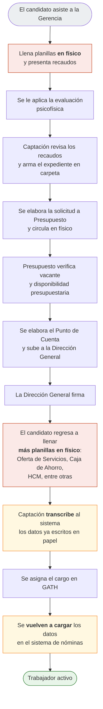
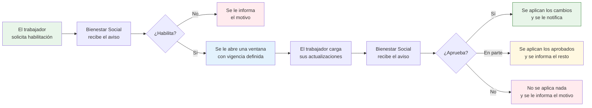

# Sistema GATH · Propuesta de Segunda Fase

**Comisión Nacional de Telecomunicaciones**
Gerencia de Recursos Humanos · Sistema Automatizado de Gestión de Talento Humano

---

## 1. Objeto

Este documento presenta el estado actual del Sistema GATH y el alcance propuesto para su segunda
fase de desarrollo.

La primera fase construyó el **registro** del personal del organismo: hoy el sistema conserva y
consulta la información de los trabajadores activos y del personal pasivo, administra la estructura
de cargos y produce los reportes de la Gerencia. La segunda fase propone dar el paso siguiente:
**conducir los procesos**, en lugar de únicamente registrar su resultado.

Dos procesos concentran la propuesta, porque son los dos que hoy ocurren fuera del sistema:

- El **ingreso de personal**, desde que un candidato es entrevistado hasta que queda contratado y
  asignado a un cargo.
- La **actualización del expediente** del trabajador a lo largo de su carrera en el organismo.

---

## 2. Lo que el sistema tiene hoy

### 2.1 Módulos en funcionamiento

| Módulo | Alcance actual |
|---|---|
| **Personal Trabajador** | Expediente del personal activo: datos personales, grupo familiar, perfil de salud, formación académica, antecedentes de servicio, contactos de emergencia |
| **Personal Pasivo** | Registro de jubilados y pensionados, su grupo familiar y sus reportes |
| **Movimientos** | Asignación de cargo, traslados administrativos, cambios de estatus, encargadurías y egresos, con historial de cada movimiento |
| **Gestión de Códigos de Cargo** | Creación de códigos de cargo y consulta de los ocupados y vacantes. A cargo del área de Presupuesto |
| **Ubicaciones Administrativas** | Dependencias, direcciones generales, direcciones de línea y coordinaciones |
| **Carnetización** | Emisión del carnet institucional con fotografía y código de validación |
| **Autogestión** | Actualmente limitado a una encuesta: el censo de vivienda |
| **Seguridad** | Usuarios, roles y departamentos |
| **Reportes** | Listados y consolidados en PDF y hojas de cálculo |

El sistema opera con perfiles diferenciados para **Administrador, Analista, Presupuesto, Bienestar
Social, Recepcionista** y **Autogestión**, cada uno con acceso a las funciones que le corresponden.

### 2.2 Lo que el sistema resuelve bien

- **El expediente del trabajador está centralizado.** La información que antes vivía en carpetas y
  hojas de cálculo dispersas hoy está en un solo lugar, con historial de cambios.
- **La estructura de cargos es consultable.** El sistema sabe qué cargos existen, cuáles están
  ocupados y cuáles están vacantes, en cada oficina de la estructura organizativa.
- **Los movimientos dejan rastro.** Cada asignación, traslado, cambio de estatus o egreso queda
  asentado con su motivo, su fecha y el responsable que lo ejecutó.
- **Los reportes se producen desde el sistema**, no rearmando información a mano.

### 2.3 Lo que hoy queda fuera del sistema

Estas son las tres brechas que la segunda fase atiende:

**El proceso de ingreso ocurre en papel.** El sistema recibe al trabajador **cuando ya está
contratado**. Todo lo anterior —la entrevista, la evaluación, la solicitud a Presupuesto, la
aprobación de la Dirección General, el llenado de planillas— sucede fuera, en documentos físicos que
circulan de escritorio en escritorio. Cuando la información finalmente llega al sistema, se transcribe
desde esos papeles.

**El trabajador no puede actualizar su propia información.** Cualquier cambio de teléfono, dirección,
estado civil, nivel académico o grupo familiar debe tramitarse ante la Gerencia, que lo captura
manualmente. En la práctica, esto significa que el expediente envejece: los datos se actualizan
cuando hay una gestión que los obliga, no cuando cambian.

**La información se registra dos veces.** Los datos que la Gerencia carga en GATH deben cargarse
también en el sistema de nóminas, porque no existe comunicación entre ambos.

---

## 3. Situación actual del proceso de ingreso

Del levantamiento realizado con el área de Captación, el proceso de ingreso de un trabajador ocurre
hoy de la siguiente manera:

Los recuadros señalados corresponden a los puntos donde la información **se escribe a mano** o
**se vuelve a escribir**. Son cuatro momentos en los que los mismos datos —nombre, cédula, fecha de
nacimiento, dirección, grupo familiar— se copian de nuevo.

De este esquema se desprenden las dificultades que la propuesta busca resolver:

| Dificultad | Consecuencia práctica |
|---|---|
| Los mismos datos se escriben varias veces | Tiempo del personal dedicado a transcribir, y riesgo de discrepancias entre planillas |
| El expediente circula en físico | No hay manera de saber en qué etapa está un caso sin preguntar oficina por oficina |
| No queda registro de las etapas | Si un expediente se demora o se devuelve, no hay constancia de dónde ni por qué |
| La verificación de vacante es manual | El sistema ya tiene el dato, pero la consulta se hace fuera de él |
| El registro es posterior a la decisión | El sistema no participa del proceso: sólo recibe el desenlace |

---

## 4. Alcance propuesto para la Segunda Fase

### 4.1 Expediente digital del postulante

El proceso comienza en el sistema, no al final de él.

Cuando el área de Captación recibe a un candidato, **da de alta su postulación y le entrega una
credencial de acceso temporal**: su cédula y una contraseña que el sistema genera y que se le entrega
en el momento. Con ella el postulante ingresa a un espacio propio y acotado —ve únicamente su
postulación— donde registra sus datos y realiza la evaluación psicofísica.

La credencial tiene **vigencia limitada** y cambia de contraseña en el primer ingreso. No otorga
acceso a ninguna otra parte del sistema.

Captación recibe entonces la información **ya digitalizada** y su trabajo pasa a ser el que le
corresponde: **verificar y validar**, en lugar de transcribir.

### 4.2 Ruta de aprobación dentro del sistema

Verificado el expediente, éste avanza por las instancias que deben aprobarlo, **sin salir del
sistema**:

```mermaid
flowchart LR
    subgraph P["POSTULANTE"]
        A["Registra sus datos<br/>y realiza la evaluación"]
    end
    subgraph C["CAPTACIÓN"]
        B["Verifica y valida"]
        B2["Propone cargo y oficina"]
    end
    subgraph PR["PRESUPUESTO"]
        D["Verifica <b>vacante</b><br/>el sistema la consulta"]
        E["Declara la <b>disponibilidad<br/>presupuestaria</b>"]
        F["Emite el<br/>Punto de Cuenta"]
    end
    subgraph DG["DIRECCIÓN GENERAL"]
        G["Firma y aprueba"]
    end
    subgraph C2["CAPTACIÓN"]
        H["Consolida<br/>la contratación"]
        I["Asigna el cargo"]
    end

    A --> B --> B2 --> D --> E --> F --> G --> H --> I --> J(["Trabajador activo"])

    B -.->|"observaciones"| A
    D -.->|"sin vacante"| B2
    E -.->|"sin disponibilidad"| K["Queda en espera"]
    G -.->|"no aprueba"| L["Cierre del proceso"]

    style P fill:#e8f5e9,stroke:#2e7d32
    style C fill:#e3f2fd,stroke:#1565c0
    style C2 fill:#e3f2fd,stroke:#1565c0
    style PR fill:#fff8e1,stroke:#f9a825
    style DG fill:#fce4ec,stroke:#c2185b
    style J fill:#e8f5e9,stroke:#2e7d32
    style K fill:#fff3e0
    style L fill:#ffebee
```

Cada paso queda asentado con **su responsable, su fecha y su motivo**. En cualquier momento se puede
saber en qué instancia está un expediente y cuánto tiempo lleva ahí. Las devoluciones también quedan
registradas, con la razón por la cual se devolvió.

Dos precisiones sobre el papel de cada verificación en la etapa de Presupuesto:

- La **existencia de la vacante la resuelve el sistema.** GATH ya conoce los cargos ocupados y
  vacantes de cada oficina, de modo que la consulta es automática. Si no hay vacante, el área de
  Presupuesto conserva la facultad de crear el código de cargo correspondiente.
- La **disponibilidad presupuestaria la determina el área de Presupuesto**, conforme a su propia
  gestión. El sistema no la calcula: **registra la declaración** —quién la emitió, cuándo y con qué
  referencia—, que es el respaldo del Punto de Cuenta.

### 4.3 Planillas digitales con datos precargados

Aprobada la contratación, el postulante completa la información restante —grupo familiar, datos de
vivienda, perfil de salud— y llena **en el sistema** las planillas que hoy se llenan a mano:

- Oferta de Servicios
- Afiliación a la Caja de Ahorro
- Planilla de HCM
- Notificación de itinerancia, entre otras

La diferencia principal: **estas planillas se emiten precargadas**. El nombre, la cédula, la fecha de
nacimiento, la dirección y el cargo ya están en el expediente, de modo que no se vuelven a escribir.
El caso más claro es la planilla de HCM, que hoy exige repetir el grupo familiar completo —nombres,
cédulas, parentescos y fechas de nacimiento de cada beneficiario—: si el postulante ya cargó esos
datos, la planilla sale llena.

Al mismo tiempo se carga la **fotografía** del personal aprobado, que queda disponible para el módulo
de carnetización sin necesidad de solicitarla de nuevo.

### 4.4 Asignación del cargo

Con el expediente completo se genera el **contrato** y se ejecuta la asignación del cargo: el
trabajador queda incorporado al registro del organismo, el cargo pasa de vacante a ocupado, se
asienta el movimiento de ingreso y se le habilita su acceso de autogestión.

### 4.5 Autogestión del trabajador

El módulo de autogestión, hoy limitado a una encuesta, pasa a ser **el espacio del trabajador sobre su
propia información**.

**Consulta permanente.** Todo trabajador puede ingresar en cualquier momento y ver su expediente
completo en formato de ficha: sus datos, su cargo, su grupo familiar, su formación.

**Actualización con aprobación.** Para modificar información, el trabajador solicita la habilitación
correspondiente desde el mismo módulo. El ciclo es el siguiente:

Un aspecto importante del diseño: **mientras la actualización no sea aprobada, la información
original permanece intacta**. Bienestar Social revisa los cambios propuestos uno por uno —viendo el
dato anterior junto al nuevo y el soporte que lo respalda— y puede aprobarlos todos, algunos o
ninguno. Esto hace que el rechazo sea real y que la aprobación parcial sea posible: si de tres
actualizaciones sólo una carece de soporte, las otras dos se aplican.

Determinada información permanece fuera del alcance de la autogestión: la identidad —cédula, nombres,
fecha de nacimiento— y todo lo relativo al cargo, la oficina y el estatus, que corresponden a
movimientos administrativos y no a actualizaciones de datos.

### 4.6 Carnetización

El módulo actual emite un carnet **de una sola cara**, con un formato definido dentro del programa.
La propuesta contempla:

- Carnet de **dos caras**.
- **Diseño del formato desde el propio sistema**, ubicando visualmente cada elemento —fotografía,
  nombre, cargo, código de validación— sobre el fondo institucional.
- Alternativamente, **cargar un formato ya diseñado** por la unidad competente y ubicar sobre él
  únicamente los datos variables.
- **Versionado del formato**, de modo que cada carnet emitido conserve constancia del diseño con el
  que se imprimió.

La fotografía es la que el trabajador cargó al momento de su contratación, o la que actualice
posteriormente por autogestión.

### 4.7 Integración con el sistema de nóminas

Cada registro, actualización y movimiento —ingresos, traslados, suspensiones, cambios de estatus y
egresos— se **transmite automáticamente** al sistema donde se gestionan las nóminas.

El mecanismo propuesto asegura que **ningún movimiento se pierda**: cada uno queda registrado para su
transmisión en el mismo momento en que se produce, y se reintenta hasta confirmarse. Se incorpora
además una **conciliación diaria** que compara la información de ambos sistemas y reporta cualquier
diferencia, de modo que las discrepancias se detecten el mismo día y no al cierre de la nómina.

Con esto se elimina la doble carga descrita en el punto 2.3.

---

## 5. Beneficios esperados

**Se elimina la transcripción.** Los datos se escriben una vez, por quien los conoce. Los cuatro
puntos de reescritura señalados en el punto 3 desaparecen: el postulante carga su información, las
planillas se emiten precargadas y los movimientos viajan solos a la nómina.

**El expediente se vuelve rastreable.** En cualquier momento se sabe en qué instancia está cada
postulación, desde cuándo, y qué pasó en cada etapa. Las demoras se hacen visibles.

**Las aprobaciones quedan documentadas.** Cada verificación, declaración y firma queda asentada con
su responsable y su fecha. Si mañana se consulta por qué se contrató a alguien, o por qué no, la
respuesta está en el sistema.

**El expediente se mantiene vigente.** Al permitir que el trabajador proponga sus propias
actualizaciones, la información se corrige cuando cambia y no cuando una gestión lo obliga —siempre
bajo la validación de la Gerencia.

**Se reduce el uso de papel** en un proceso que hoy es íntegramente físico.

**El resguardo de la información mejora.** El acceso a cada documento queda condicionado al perfil de
quien lo solicita, y queda constancia de las consultas.

---

## 6. Alcance de la fase

### 6.1 Incluye

1. Expediente digital del postulante, con acceso temporal por cédula y contraseña.
2. Evaluación psicofísica registrada en el sistema.
3. Ruta de aprobación entre Captación, Presupuesto y Dirección General, con trazabilidad.
4. Verificación automática de vacante y registro de la declaración de disponibilidad presupuestaria.
5. Emisión del Punto de Cuenta y del contrato.
6. Planillas digitales precargadas, con firma del postulante.
7. Asignación del cargo desde el expediente aprobado.
8. Módulo de autogestión con consulta permanente y actualización sujeta a aprobación.
9. Sistema de avisos entre las áreas participantes.
10. Carnet de dos caras con diseño de formato desde el sistema.
11. Transmisión automática de movimientos al sistema de nóminas, con conciliación diaria.

### 6.2 No incluye

Para acotar el alcance y asegurar la entrega, quedan **fuera** de esta fase:

- La reestructuración de los módulos existentes de personal activo y pasivo, que continúan
  funcionando como hasta ahora.
- La gestión de la nómina propiamente dicha, que permanece en el sistema que hoy la administra.
- El cálculo de la disponibilidad presupuestaria, que continúa siendo una gestión del área de
  Presupuesto.
- La evaluación de desempeño y la gestión de capacitación, que corresponden a fases posteriores.

---

## 7. Insumos requeridos de las áreas

El inicio de las etapas correspondientes depende de que las áreas competentes aporten lo siguiente:

| # | Insumo | Área | Condiciona |
|---|---|---|---|
| 1 | **Formato del carnet de dos caras** | Unidad competente en imagen institucional | El módulo de carnetización no puede desarrollarse sin el diseño definitivo |
| 2 | **Documentación técnica o vía de acceso al sistema de nóminas**, y designación de un contacto técnico | Unidad responsable del sistema de nóminas | La integración automática y la conciliación |
| 3 | **Plazo de conservación de los expedientes no contratados** y criterio sobre qué información se conserva | Consultoría Jurídica | El tratamiento de los datos de candidatos no seleccionados |
| 4 | **Formatos oficiales vigentes** de las planillas a digitalizar, en su versión actual | Captación y las instituciones emisoras | La emisión precargada de cada planilla |
| 5 | **Instrumento de evaluación psicofísica**: preguntas, puntajes y criterio de aprobación | Área responsable de la evaluación | El registro de la evaluación en el sistema |
| 6 | **Criterio de reingreso** de personal que egresó previamente del organismo | Gerencia de Recursos Humanos | El tratamiento de postulaciones de ex trabajadores |
| 7 | **Vigencias**: duración de la credencial del postulante y del tiempo de reserva de un cargo aprobado | Captación y Presupuesto | Los vencimientos automáticos |

---

## 8. Etapas y duración estimada

La propuesta se ejecuta en etapas, cada una de las cuales deja funcionalidad utilizable.

| Etapa | Contenido | Duración |
|---|---|---|
| **1** | Trabajos previos de fortalecimiento de la plataforma y preparación de la infraestructura de archivos y procesos automáticos | 2,5 semanas |
| **2** | Perfiles y permisos por área, en el servidor y en la interfaz | 2,5 semanas |
| **3** | Sistema de avisos entre áreas | 1,5 semanas |
| **4** | Expediente del postulante: acceso, datos y evaluación; bandeja de Captación | 3 semanas |
| **5** | Ruta de Presupuesto y Dirección General: vacantes, disponibilidad, Punto de Cuenta y firma | 3 semanas |
| **6** | Planillas digitales precargadas y firma | 3 semanas |
| **7** | Consolidación, contrato y asignación del cargo | 3 semanas |
| **8** | Módulo de autogestión con ciclo de aprobación | 3 semanas |
| **9** | Carnet de dos caras y diseño de formato | 3 semanas |
| **10** | Integración con el sistema de nóminas y conciliación | 3 semanas |
| **11** | Verificación, documentación de usuario y capacitación | 2,5 semanas |

**Duración estimada: aproximadamente 21 semanas**, trabajando dos frentes en paralelo a partir de la
etapa 3. Ejecutadas de forma secuencial, la duración se extiende a unas 30 semanas.

Las etapas 8 y 9 son independientes de las etapas 4 a 7. Si se requiere mostrar resultados
tempranos, se recomienda **adelantar la etapa 8**: la autogestión es el componente que alcanza a
mayor número de usuarios y permite verificar el ciclo completo de solicitud, aprobación y aviso antes
de abordar el proceso de ingreso.

---

## 9. Consideraciones para la evaluación

**Las dos primeras etapas no producen funcionalidad visible**, pero son condición de las demás:
establecen los perfiles y permisos por área en el servidor y preparan la infraestructura. Suprimirlas
o postergarlas para acelerar la entrega comprometería el control de acceso sobre un expediente que
contiene datos personales del personal del organismo y aprobaciones con efecto presupuestario.

**La propuesta requiere la participación de tres áreas además de Recursos Humanos**: Presupuesto,
Dirección General y la unidad responsable del sistema de nóminas. Los tiempos estimados suponen que
las aprobaciones y los insumos del punto 7 se atienden con oportunidad.

**La transmisión hacia el sistema de nóminas es el punto de mayor cuidado**, por tratarse de
información que incide en pagos. Se propone conciliación diaria y verificación en un ambiente de
pruebas antes de operar en producción.

---

*Documento elaborado por la Gerencia de Recursos Humanos · agosto de 2026*
